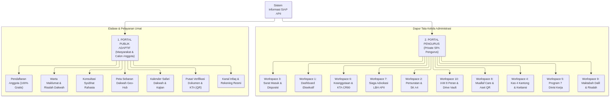
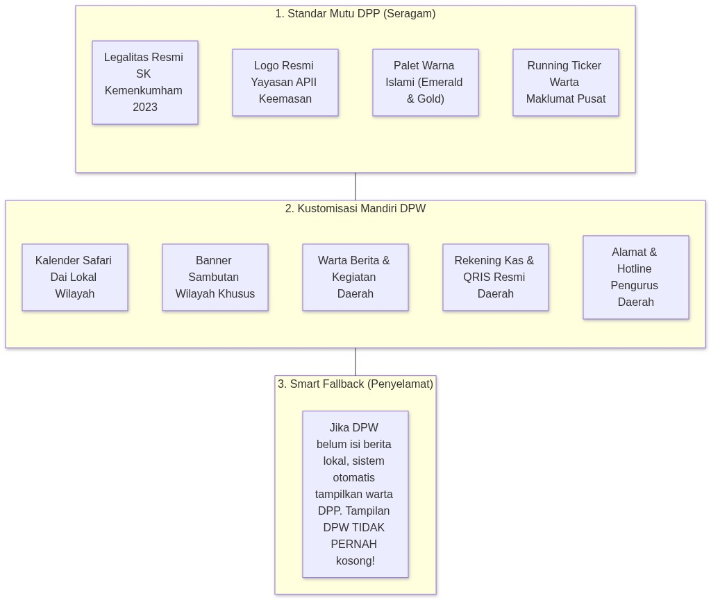
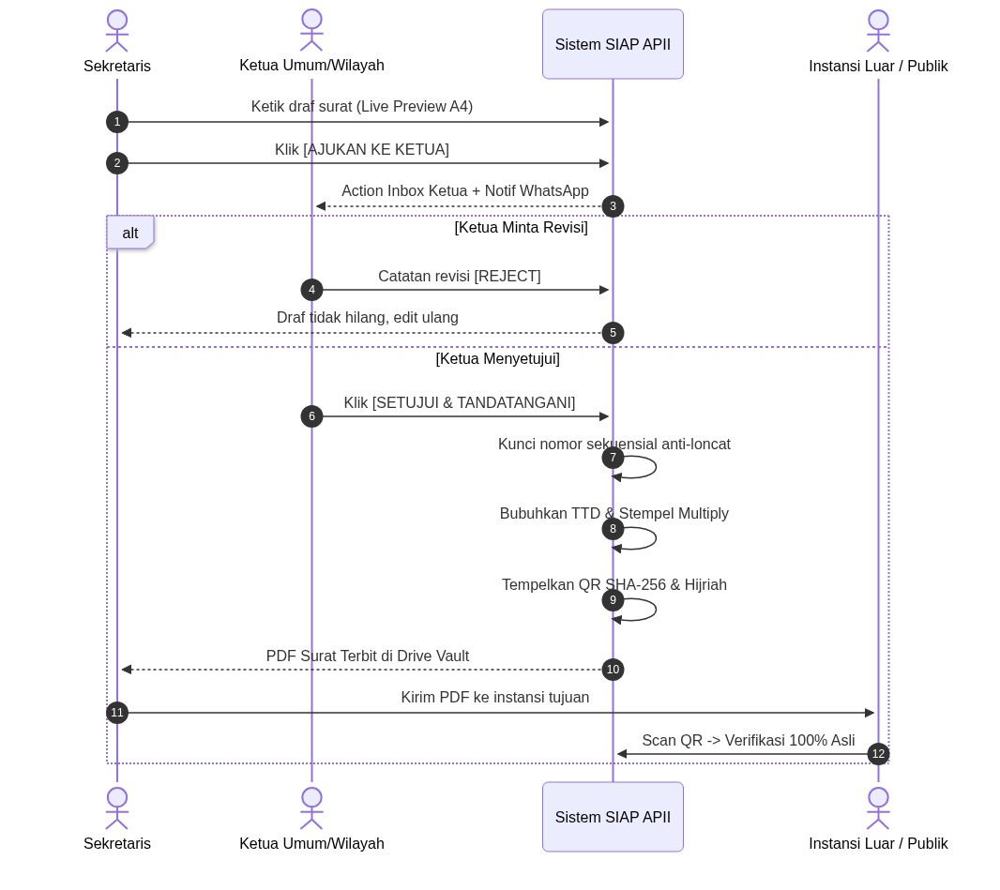
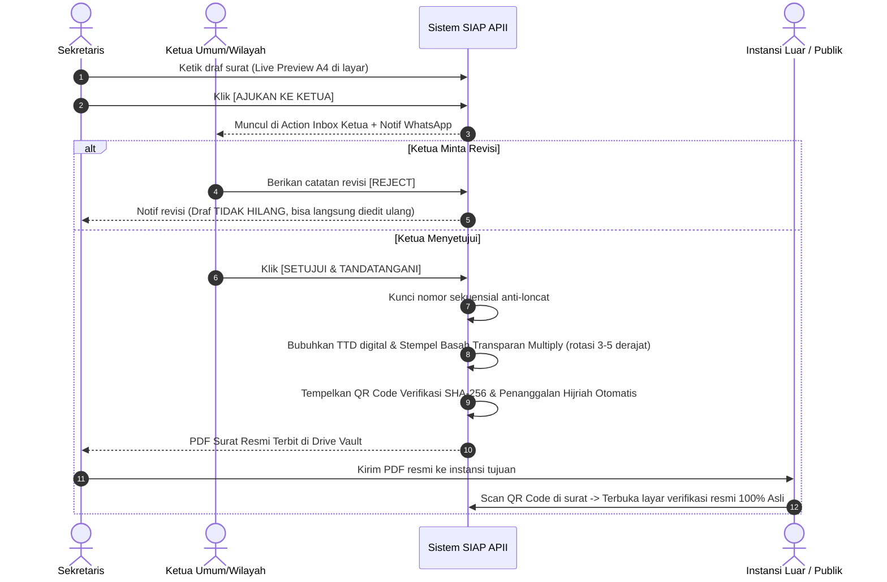
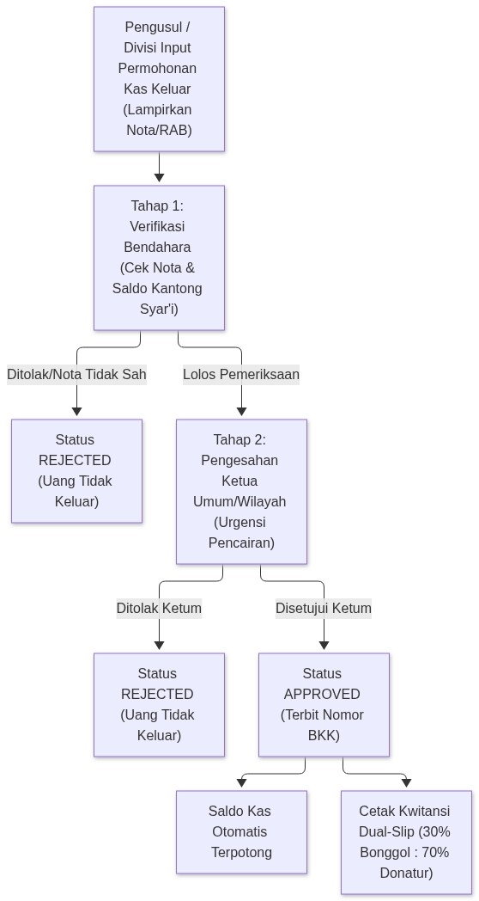
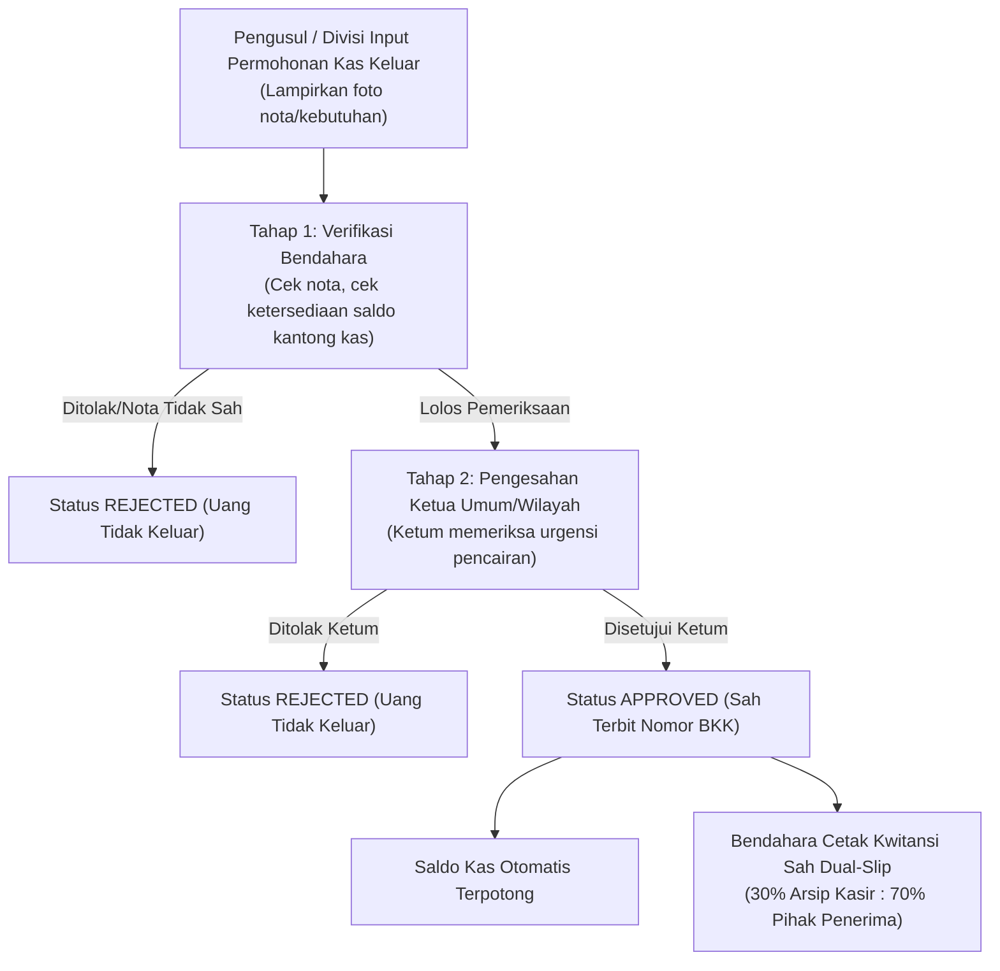
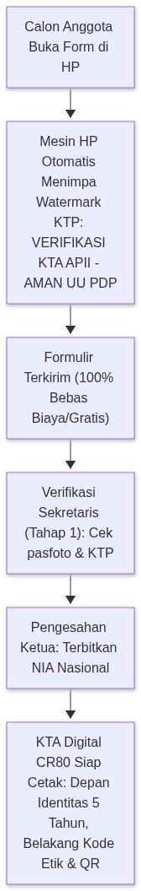
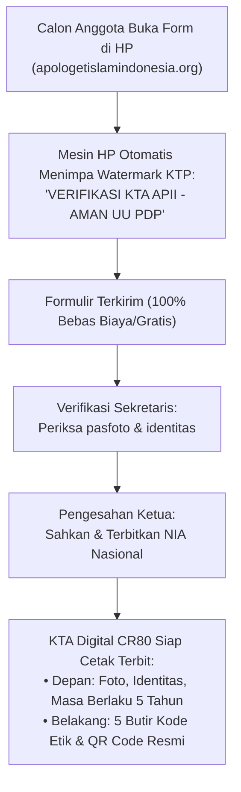
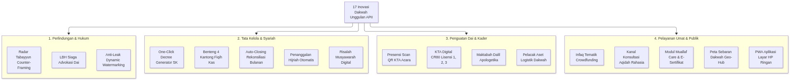
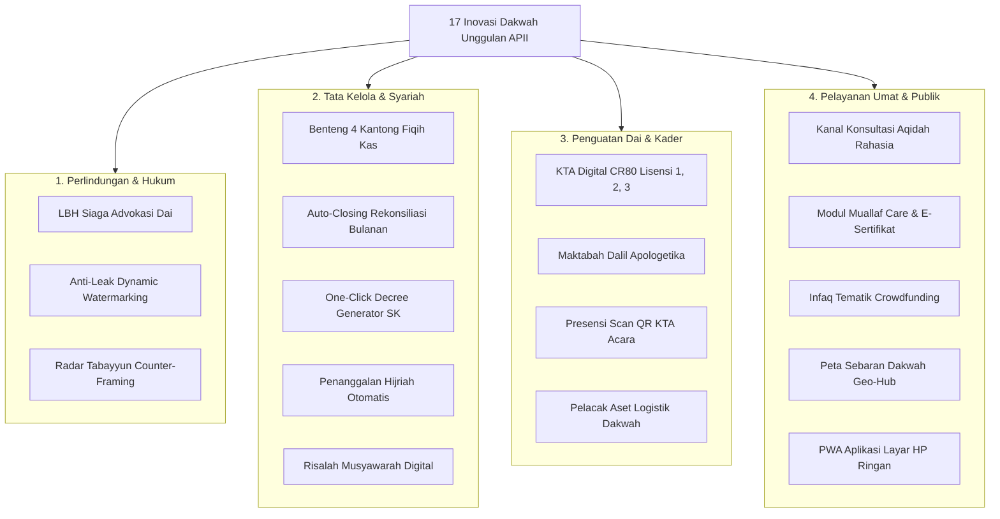

# PANDUAN EKSEKUTIF & PENJELASAN SISTEM SIAP APII v3.0.0

### Solusi Terpadu Tata Kelola Digital, Keuangan Syar'i, Persuratan Dinas, & Ekosistem Dakwah

**Yayasan Apologet Islam Indonesia (APII)**  
*SK Kemenkumham RI: Nomor AHU-0014970.AH.01.04.Tahun 2023 \| Kepatuhan UU PDP No. 27 Tahun 2022*

*Pengembang Sistem:* **Sigit Adi Irianto (Freelance Software Engineer)** \| [https\://wa.me/6281358575678](https://wa.me/6281358575678) \| [sigitadi.id](https://sigitadi.id)

---

## PENGANTAR UNTUK PIMPINAN & CALON KLIEN

Dokumen ini disusun khusus bagi jajaran **Dewan Pembina, Dewan Pengawas, Pengurus Harian (BPH) Pusat (DPP), Pengurus Wilayah (DPW), serta mitra strategis Yayasan Apologet Islam Indonesia (APII)**.

Tujuan dokumen ini adalah memberikan gambaran utuh, transparan, dan mudah dipahami mengenai **cara kerja (logika), alur operasional, serta manfaat nyata dari sistem informasi SIAP APII**, tanpa membingungkan pembaca dengan bahasa pemrograman yang rumit.

Dengan membaca panduan ini, Bapak/Ibu pimpinan akan memahami bagaimana sistem ini menjaga martabat organisasi, melindungi dana umat secara syar'i, mempercepat birokrasi persuratan, dan melindungi para da'i di garis depan dakwah.

---

## 1\. MENGAPA SISTEM SIAP APII DIBUTUHKAN? (LATAR BELAKANG & MASALAH NYATA)

Yayasan APII adalah wadah perjuangan dakwah ilmiah, riset komparasi agama, dan pembinaan muallaf yang jangkauannya telah meluas ke berbagai provinsi di Indonesia. Perkembangan yang sangat pesat ini membawa konsekuensi administratif yang tidak bisa lagi dikelola secara manual.

[https\://drive.google.com/file/d/1VR\_3fTnl39-MTEkLOd\_I\_7wF5zkXxAVE/view?usp=drive\_link](https://drive.google.com/file/d/1VR_3fTnl39-MTEkLOd_I_7wF5zkXxAVE/view?usp=drive_link)

### Empat Risiko Fatal Pengelolaan Manual yang Diatasi SIAP APII:

1. **Risiko Tabrakan & Lompatan Nomor Surat Dinas:**  
   Ketika surat dibuat di dokumen Word terpisah, sangat sering terjadi dua sekretaris mengeluarkan nomor surat yang sama, atau ada nomor yang terlewat. Di mata instansi pemerintah, kepolisian, atau ormas lain, hal ini menurunkan wibawa hukum yayasan.  
   *Solusi SIAP APII:* Nomor surat dikunci oleh mesin otomatis. Tidak akan pernah ada nomor ganda atau nomor loncat, bahkan jika 5 pengurus membuat surat di detik yang sama.  
2. **Risiko Kebocoran Kas & Fitnah Keuangan:**  
   Pencatatan kas di buku tulis atau spreadsheet tanpa sistem verifikasi bertingkat rentan menimbulkan salah paham dan fitnah antar-pengurus.  
   *Solusi SIAP APII:* Kas keluar **wajib melewati 2 pintu persetujuan (*Dual-Approval*)**: diperiksa kelayakan notanya oleh Bendahara, lalu disahkan oleh Ketua Umum. Uang tidak akan keluar tanpa izin sah keduanya.  
3. **Risiko Hukum UU Perlindungan Data Pribadi (UU PDP No. 27/2022):**  
   Menyimpan foto KTP calon anggota atau dai di grup WhatsApp sangat berbahaya. Jika foto KTP tersebut bocor dan disalahgunakan pihak jahat (misal: pinjol ilegal), pengurus yayasan dapat dituntut secara pidana.  
   *Solusi SIAP APII:* Begitu pendaftar memilih foto KTP di HP miliknya, sistem langsung menimpa foto tersebut dengan **watermark tebal menyilang anti-bocor** sebelum foto dikirim ke sistem.  
4. **Risiko Berkas Mandek Karena Lupa atau Saling Tunggu:**  
   Seringkali proposal kegiatan atau permohonan disposisi terhenti berminggu-minggu karena pengurus tidak tahu bahwa giliran tugasnya telah tiba.  
   *Solusi SIAP APII:* Mesin **Estafet WhatsApp Cerdas (*Smart Relay*)** yang otomatis menyiapkan pesan laporan dan permintaan tindak lanjut ke nomor pengurus yang dituju hanya dengan satu klik.

---

## 2\. ARSITEKTUR DWI-PORTAL: DUA WAJAH, SATU JIWA ORGANISASI

Sistem SIAP APII dirancang dengan dua pintu masuk utama yang terhubung erat:

[https\://drive.google.com/file/d/1FrQaPoM-ZbJiL-qBXdB4wMiGgzvuvSdo/view?usp=drive\_link](https://drive.google.com/file/d/1FrQaPoM-ZbJiL-qBXdB4wMiGgzvuvSdo/view?usp=drive_link)

---

## 3\. SATU SISTEM NASIONAL UNTUK PUSAT (DPP) & SELURUH WILAYAH (DPW)

Salah satu keunggulan terbesar SIAP APII adalah kemampuannya menampung seluruh Dewan Pimpinan Wilayah (DPW) di Indonesia dalam **satu rumah teknologi bersama**, tanpa perlu membuat website baru yang memakan biaya berulang.

### A. Format Alamat Website yang Rapi & Berwibawa

- **Pusat (DPP Nasional - Aktif):**  
  - Halaman Publik: `https://apologetislamindonesia.org`  
  - Portal Pengurus Pusat: `https://apologetislamindonesia.org/portal`  
- **Wilayah (DPW Pilot & Tahap Persiapan se-Indonesia):**  
  - **DPW Jabodetabek (Pilot Wilayah Perdana - Aktif):**  
    * Halaman Publik: `https://jabodetabek.apologetislamindonesia.org`  
    * Portal Pengurus: `https://jabodetabek.apologetislamindonesia.org/portal`  
  - **DPW Wilayah Lainnya (Riau, Jawa Barat, Jawa Tengah, Jawa Timur, Sumatera Utara, dsb.):**  
    * *Status: Dalam tahap persiapan pembentukan struktur kepengurusan daerah & penerbitan SK Mandat DPP.*  
    * *Subdomain dan link portal resmi masing-masing provinsi akan diaktifkan secara bertahap begitu pengurus wilayah resmi dilantik melalui SK DPP.*  
  - *(Arsitektur Wildcard DNS telah siap menampung 38 DPW provinsi tanpa ubah kode).*

### B. Apakah Tampilan Publik DPW Sama atau Bisa Dikustomisasi?

Jawabannya: **Standar Mutu Seragam Nasional, Konten Dinamis Bebas Dikelola Mandiri oleh Pengurus DPW\!**

[https\://drive.google.com/file/d/1T1OiDsvtSPdTHpayUOKYZ71liRxwI6m2/view?usp=drive\_link](https://drive.google.com/file/d/1T1OiDsvtSPdTHpayUOKYZ71liRxwI6m2/view?usp=drive_link)

---

## 4\. TENANT SWITCHER & WEWENANG KEPENGURUSAN (RBAC 8 PERAN)

### A. Apa itu Fitur "Tenant Switcher" di Portal Pengurus?

Bayangkan pimpinan pusat memiliki **"Teropong Digital Nasional"**. Di bilah atas (*topbar*) portal pengurus, terdapat dropdown menu khusus bernama **Tenant Switcher**:

- **Bagi Pimpinan DPP (Ketua Umum, Sekjen, Bendahara Umum, Pembina, Pengawas, dan Superadmin):**  
  Mereka dapat mengklik dropdown tersebut untuk memilih wilayah: beralih dari memantau **\[DPP PUSAT\]** ke **\[DPW JABODETABEK\]**, **\[DPW RIAU\]**, atau **\[DPW JATIM\]** dalam hitungan **0 detik** tanpa perlu logout atau berganti password\! Pimpinan pusat dapat melihat buku kas daerah, program kerja daerah, maupun arsip surat daerah secara langsung demi transparansi.  
- **Bagi Pengurus DPW (Tingkat Wilayah):**  
  Dropdown ini otomatis terkunci pada provinsinya sendiri. Pengurus DPW Riau hanya bisa melihat dan mengelola urusan DPW Riau. Mereka tidak bisa mengintip buku kas atau urusan internal DPW lain. Ini menjamin kerahasiaan dan fokus kerja wilayah masing-masing.

### B. Posisi Superadmin di Seluruh Website dan Portal

**Superadmin adalah pengawal teknis dan penjaga stabilitas organisasi.**

- **Yurisdiksi Global:** Superadmin berada di tingkat tertinggi secara teknis, membawahi DPP dan seluruh DPW se-Indonesia.  
- **Tugas Utama Superadmin:**  
  1. *Manajemen Akun:* Membuatkan akun pengurus baru saat ada pelantikan atau pergantian pengurus.  
  2. *Reset Password Darurat:* Membantu pengurus yang lupa kata sandi dengan aman.  
  3. *Membuka Wilayah Baru:* Cukup 1 menit untuk mendaftarkan DPW baru di sistem saat musyawarah pembentukan wilayah selesai.  
  4. *Pemecah Kebuntuan (Deadlock Breaker):* Membantu memproses dokumen penting jika pejabat berwenang berhalangan tetap atau berada dalam kondisi darurat syar'i.  
- **Pengawasan Berlapis atas Superadmin (Checks & Balances):**  
  Apakah Superadmin bisa bertindak sewenang-wenang? **TIDAK BISA.**  
  Sistem dilengkapi *WORM Audit Logs (Write-Once-Read-Many)*. Setiap kali Superadmin mengubah data atau mem bypass alur, sistem mencatat permanen stempel waktu, nama pengguna, alamat IP, dan alasan tindakan dengan label `SUPERADMIN_OVERRIDE`. Catatan ini **bisa diaudit kapan saja oleh Dewan Pembina dan Dewan Pengawas** dan tidak dapat dihapus oleh siapa pun.

### C. Matriks 8 Peran Pengguna (Siapa Boleh Melakukan Apa?)

| Peran Jabatan | Tugas Utama | Tampilan Khusus di Portal | Hak Pengesahan (Approval) |
| :---- | :---- | :---- | :---- |
| **1\. Superadmin** | Pengelola sistem & data induk nasional | Akses penuh seluruh modul \+ Menu Sistem & IAM | Bypass darurat & audit teknis global |
| **2\. Ketua Umum / Ketua Wilayah** | Pemimpin tertinggi & penentu kebijakan | Dashboard Eksekutif \+ Kotak Tindakan Mendesak (*Action Inbox*) | \- Sahkan Surat Keluar<br/>\- Dual-Approval Kas Keluar Tahap 2<br/>\- Sahkan Instruksi Disposisi<br/>\- Sahkan Anggota Baru & SK |
| **3\. Sekretaris Umum / Wilayah** | Pengatur administrasi & lalu lintas surat | Meja Persuratan Live A4 \+ Meja Surat Masuk & Verifikasi KTA | \- Terbitkan Draf Surat Keluar<br/>\- Registrasi Surat Masuk<br/>\- **Penerbit Draf Rekomendasi Disposisi**<br/>\- Verifikasi Berkas KTP Anggota |
| **4\. Bendahara Umum / Wilayah** | Pengawal kepatuhan kas & amanah donatur | Buku Kas Mutasi \+ Simulator Kas \+ Mesin Cetak Kwitansi | \- Verifikasi Nota Kas Keluar Tahap 1<br/>\- Sahkan Kas Masuk (Infaq/Donasi)<br/>\- Cetak Kwitansi Sah Dual-Slip |
| **5\. Dewan Pembina** | Penjaga marwah & arah kebijakan dakwah | Dasbor Makro Statistik Dakwah (*Read-Only*) | Memberikan arahan maklumat & nasihat syar'i |
| **6\. Dewan Pengawas** | Pengawas kepatuhan hukum & audit anggaran | Dasbor Jejak Audit Forensik \+ Rekonsiliasi Kas (*Read-Only*) | Memeriksa kepatuhan kas, nota belanja, & LPJ |
| **7\. Ketua Divisi (7 Divisi)** | Komandan eksekutor program kerja sektoral | Papan Kerja Divisi \+ Kotak Disposisi Masuk Divisi | \- Mengajukan Proposal Program Kerja<br/>\- Mengajukan Pencairan Dana ke Kas<br/>\- Melaporkan LPJ Kegiatan |
| **8\. Anggota Divisi** | Staf lapangan penunjang kegiatan | Form Pengisian Laporan Kegiatan & Scanner Presensi KTA | Membantu draf kegiatan teknis di lapangan |

### D. Alur Kerja Praktis & Lengkap Setiap Pengurus (Panduan Tugas 8 Jabatan)

Berikut adalah panduan langkah-demi-langkah yang ringkas dan teratur mengenai apa yang dilakukan oleh setiap pengurus saat bekerja di sistem SIAP APII:

#### 1\. Ketua Umum (DPP) / Ketua Wilayah (DPW)

*Fokus: Mengambil keputusan kebijakan, otorisasi anggaran kas, dan pengesahan surat resmi.*

1. **Buka Action Inbox:** Begitu login ke portal, Ketua langsung melihat kartu tindakan mendesak di baris teratas Dashboard: naskah surat dinas yang butuh tanda tangan, pengeluaran kas yang menunggu persetujuan tahap 2, serta surat masuk yang menanti disposisi.  
2. **Pengesahan Surat Keluar:** Menelaah naskah di pratinjau A4 live. Jika sesuai, klik `[Setujui & Sahkan]` (otomatis terbit TTD, stempel multiply, QR verifikasi, dan nomor sekuensial anti-loncat). Jika butuh perbaikan, klik `[Revisi]` dengan menyertakan catatan koreksi.  
3. **Persetujuan Kas Keluar (Dual-Approval Tahap 2):** Menelaah voucher kas yang telah diverifikasi kelayakan notanya oleh Bendahara. Klik `[Sahkan Pencairan]` untuk memotong saldo kas dan menerbitkan nomor BKK resmi.  
4. **Instruksi Disposisi Surat Masuk:** Membaca draft rekomendasi Sekretaris, memilih instruksi baku (misal: *Wakili/Hadiri Acara*), menetapkan batas waktu (*deadline*), dan membubuhkan paraf pengesahan.  
5. **Pengesahan Anggota Baru:** Klik `[Sahkan Anggota]` untuk menerbitkan Nomor Induk Anggota (NIA) dan mengunci masa berlaku KTA Digital 5 tahun.  
6. **Estafet WhatsApp:** Menekan tombol kirim WhatsApp di layar untuk memberi kabar instan ke Sekretaris/Bendahara bahwa berkas telah disahkan.

#### 2\. Sekretaris Umum (DPP) / Sekretaris Wilayah (DPW)

*Fokus: Administrasi persuratan dinas, agenda surat masuk, draf disposisi, dan verifikasi anggota.*

1. **Penyusunan Surat Keluar:** Membuka modul persuratan, memilih jenis naskah (SK, Mandat, Tugas, Undangan), mengetik perihal dan konsideran di editor berdampingan dengan pratinjau kertas A4 live, lalu klik `[Ajukan ke Ketua]`.  
2. **Registrasi Surat Masuk:** Mengunggah file PDF/foto scan surat dari instansi luar, mengisi asal surat, tanggal terima, dan perihal ke buku agenda digital.  
3. **Penerbitan Draf Rekomendasi Disposisi:** Sekretaris merumuskan usulan awal sebelum diajukan ke Ketua: menentukan divisi mana yang sebaiknya ditugaskan (multi-divisi), tingkat urgensi, dan draf arahan awal.  
4. **Verifikasi Pendaftar KTA (Tahap 1):** Memeriksa pasfoto dan kejelasan foto KTP ber-watermark UU PDP di modul keanggotaan. Jika data valid, klik `[Loloskan Verifikasi Tahap 1]` untuk diteruskan ke meja Ketua.  
5. **Distribusi & Arsip Dokumen:** Mengunduh berkas PDF resmi yang telah disahkan dan berstempel dari Google Drive Vault untuk dikirimkan ke pihak luar atau disimpan di arsip yayasan.

#### 3\. Bendahara Umum (DPP) / Bendahara Wilayah (DPW)

*Fokus: Perbendaharaan syar'i 4 kantong kas, verifikasi nota belanja, dan pencetakan kwitansi resmi.*

1. **Pencatatan Kas Masuk (Infaq/Donasi/Zakat):** Menginput penerimaan dana donasi $\rightarrow$ memilih pos kantong syar'i $\rightarrow$ status langsung sah (`APPROVED`) $\rightarrow$ terbit nomor BKM sekuensial $\rightarrow$ cetak Kwitansi Dual-Slip ($30\%$ bonggol kasir, $70\%$ lembar donatur).  
2. **Verifikasi Kas Keluar (Tahap 1):** Menerima permohonan pencairan kas dari divisi atau kesekretariatan. Memeriksa kelengkapan nota fisik/struk dan memeriksa saldo kantong kas terkait. Jika sesuai ketentuan syariah, klik `[Lolos Verifikasi Bendahara]` (naik ke meja Ketua).  
3. **Pencairan Dana & Kwitansi BKK:** Setelah disahkan Ketua Umum (Tahap 2), Bendahara mencairkan uang (transfer/tunai di bawah batas Rp 2 juta) dan mencetak bukti pengeluaran kas (BKK).  
4. **Tutup Buku Bulanan:** Memantau hasil rekapitulasi kas bulanan otomatis pada tanggal 30/31 untuk dilaporkan secara transparan ke Dewan Pengawas.

#### 4\. Ketua Divisi (7 Divisi Resmi ART Pasal 16\)

*Fokus: Mengusulkan program kerja, memimpin eksekusi lapangan, dan menyusun LPJ akuntabel.*

1. **Pengajuan Usulan Kegiatan:** Membuka modul divisinya (Humas, Litbang, Sosmed, Dakwah, Bisnis, Hukum, atau Umum) $\rightarrow$ mengisi rincian rencana kegiatan, target umat, dan rincian anggaran (RAB) $\rightarrow$ klik `[Ajukan Proposal]` ke Ketua.  
2. **Permohonan Pencairan Kas:** Setelah proposal disetujui pimpinan dan kegiatan siap dieksekusi, Ketua Divisi mengajukan permohonan pencairan kas bertahap ke Bendahara.  
3. **Pelaksanaan Disposisi Masuk:** Membuka kotak masuk disposisi divisinya, menelaah instruksi Ketua, mengoordinasikan eksekusi bersama anggota divisi, dan mengunggah laporan hasil tindak lanjut.  
4. **Pelaporan LPJ & Rekonsiliasi Dana:** Mengunggah berkas LPJ, nota belanja realisasi, dan dokumentasi foto ke Drive Vault $\rightarrow$ menyetorkan sisa saldo anggaran (jika ada) kembali ke kas yayasan.

#### 5\. Anggota Divisi (Staf Pelaksana Lapangan)

*Fokus: Membantu operasional teknis kegiatan, presensi kajian via QR KTA, dan logistik dakwah.*

1. **Persiapan Teknis & Aset:** Membantu Ketua Divisi mempersiapkan perlengkapan acara dan mencatat peminjaman kendaraan dakwah atau sound system via modul scan QR Aset.  
2. **Presensi Digital Acara:** Saat dauroh ilmiah, tabligh akbar, atau musyawarah kerja berlangsung, anggota divisi membuka kamera di portal HP untuk memindai QR Code KTA para peserta secara instan.  
3. **Dokumentasi Lapangan:** Mengunggah foto dokumentasi acara dan data lapangan ke folder kegiatan divisi.

#### 6\. Dewan Pembina

*Fokus: Menjaga marwah dakwah, mengawal visi maklumat, dan memberi nasihat kebijakan strategis.*

1. **Pemantauan Dasbor Makro:** Membuka dashboard eksekutif untuk meninjau peta sebaran anggota nasional, status posko DPW se-Indonesia, dan rekapitulasi saldo kas umum yayasan (*Read-Only*).  
2. **Kajian Kebijakan & Maklumat:** Memeriksa arsip keputusan strategis dan maklumat dakwah di Drive Vault.  
3. **Nasihat Syar'i:** Memberikan arahan dan evaluasi berkala kepada Pengurus Harian terhadap isu dakwah apologetika nasional.

#### 7\. Dewan Pengawas

*Fokus: Mengawasi kepatuhan hukum, audit independen keuangan kas, dan menelaah LPJ kegiatan.*

1. **Pemeriksaan Kepatuhan Kas:** Memeriksa buku kas mutasi, nota belanja fisik, dan memastikan dana zakat tidak disalahgunakan untuk pos operasional non-ashnaf.  
2. **Inspeksi Jejak Audit (Audit Logs):** Menelaah rekam jejak digital pengurus melalui tabel log audit forensik (melihat riwayat login, pengesahan dokumen, dan mutasi anggaran).  
3. **Penerimaan Rekonsiliasi Kas Bulanan:** Menelaah Laporan Arus Kas Bulanan otomatis format PSAK 409 yang otomatis terkirim ke folder pengawas pada setiap akhir bulan.

#### 8\. Superadmin (Administrator Sistem Pusat)

*Fokus: Mengelola stabilitas teknologi, manajemen akun pengurus (IAM), dan pemecah kebuntuan darurat.*

1. **Manajemen Akun Pengurus:** Membuat akun baru bagi pengurus yang baru dilantik, mengatur hak akses 8-Role RBAC, dan menonaktifkan akun pengurus demisioner.  
2. **Reset Sandi Darurat:** Membantu pengurus yang lupa kata sandi dengan aman dan cepat.  
3. **Registrasi Tenant DPW Baru:** Mendaftarkan DPW baru di sistem saat musyawarah daerah rampung (cukup 1 menit).  
4. **Pemecah Kebuntuan (*Deadlock Breaker*):** Membantu memproses dokumen penting yang tertahan bila pejabat berwenang berhalangan tetap, dengan seluruh tindakan diaudit permanen di `Sheet_AuditLogs` bertanda `SUPERADMIN_OVERRIDE`.

---

## 5\. ALUR KERJA UTAMA ORGANISASI (BAGAIMANA SISTEM BEKERJA?)

### ALUR 1: Persuratan Dinas Keluar & Tanda Tangan/Stempel Otomatis





&nbsp;

### ALUR 2: Kotak Surat Masuk & Lembar Disposisi Berantai (Multi-Divisi)

Organisasi sering menerima surat undangan dialog, permohonan kajian, audiensi kepolisian, atau surat dari ormas lain. Bagaimana alurnya?

1. **Penerimaan & Rekomendasi (Sekretaris):**  
   Sekretaris memfoto/men-scan surat masuk, mengisi data pengirim, lalu **menyusun draf rekomendasi disposisi**: *"Diusulkan dihadiri Divisi Humas dan didampingi Divisi Hukum"*.  
2. **Pengesahan Arahan Pimpinan (Ketua):**  
   Ketua membuka lembar disposisi, menyetujui rekomendasi, memilih instruksi baku (misal: *Wakili/Hadiri Acara*), menetapkan batas waktu (*deadline*), dan membubuhkan paraf digital.  
3. **Penyebaran Otomatis Multi-Divisi:**  
   Lembar disposisi secara otomatis muncul di akun Ketua Divisi Humas dan Divisi Hukum sekaligus. Masing-masing ketua divisi bisa melapor balik progresnya di portal hingga tugas tuntas.

### ALUR 3: Keuangan Kas Syar'i (Dual-Approval) & Kwitansi 2 Sisi

Untuk menjaga nama baik yayasan dari fitnah uang, sistem memberlakukan aturan ketat:





&nbsp;

- **Kwitansi Dual-Slip (Dua Sisi):**  
  Dicetak pada selembar kertas. Sisi kiri ($30\%$) adalah **Bonggol Kasir** yang disimpan rapi di binder bendahara sebagai bukti fisik audit. Sisi kanan ($70\%$) adalah **Kwitansi Resmi** berstempel dan ber-QR code yang diserahkan kepada pihak donatur atau penerima dana. Dilengkapi tulisan terbilang Rupiah otomatis (mencegah manipulasi angka nol).  
- **Aturan Kas Tunai (Cash Buffer):**  
  Uang fisik di brankas kesekretariatan dibatasi maksimal **Rp 2.000.000,-**. Pengeluaran di atas nominal tersebut wajib melalui transfer bank resmi yayasan demi keamanan.

### ALUR 4: Benteng 4 Kantong Fiqih Kas (Zakat, Infaq Dakwah, Wakaf, Amil)

Banyak yayasan tergelincir mencampuradukkan uang donasi umat. Di SIAP APII, buku kas disekat menjadi 4 kantong syar'i:

1. **Kantong Zakat:** Hanya boleh dikeluarkan untuk 8 golongan mustahiq yang berhak menurut Al-Qur'an (termasuk pembinaan muallaf dan bantuan darurat dai fi sabilillah).  
2. **Kantong Infaq Dakwah:** Untuk operasional tabligh akbar, cetak buku bantahan syubhat, dan safari pedalaman.  
3. **Kantong Wakaf:** Untuk pengadaan aset permanen (tanah, bangunan markaz, sound system permanen).  
4. **Kantong Amil/Operasional:** Untuk honor pengurus, listrik, air, internet, dan operasional kantor. *Teknologi Sharia Guard:* Jika ada pengurus mencoba mengajukan dana dari Kantong Zakat untuk membayar sewa bus atau beli ATK kantor, sistem akan **menolak secara otomatis**.

### ALUR 5: Pendaftaran Anggota & KTA Digital 5 Tahun (100% Bebas Biaya)





&nbsp;

- **Alur Notifikasi Pendaftaran yang Aman:**  
  Pemberitahuan pendaftaran anggota baru **HANYA beredar di kalangan internal antar-pengurus melalui WhatsApp**. Sistem sengaja **tidak mengirim pesan WhatsApp keluar ke nomor calon pendaftar** untuk melindungi privasi nomor HP pengurus yayasan dari bahaya balasan spam, panggilan telepon massal, atau penyalahgunaan nomor pribadi. Calon anggota cukup memantau statusnya di portal publik atau melalui email resmi yayasan.

---

## 6\. MESIN ESTAFET KERJA WHATSAPP CERDAS (SMART RELAY DISPATCHER)

Salah satu keluhan terbesar pengurus organisasi adalah: *"Saya sudah kerjakan tugas saya, tapi pengurus lain tidak melanjutkan karena tidak tahu kalau sudah selesai."*

SIAP APII memecahkan masalah ini dengan **Smart WhatsApp Action Card**: Setiap kali seorang pengurus selesai menekan tombol persetujuan di portal, sebuah kotak dialog ramah muncul di layarnya:

```
┌─────────────────────────────────────────────────────────────┐
│  🟢 TUGAS BERHASIL DISELESAIKAN!                            │
│  Lanjutkan estafet kerja ke pejabat berikutnya?             │
│                                                             │
│  Tujuan: Ustadz Ahmad Fauzi (Ketua Umum DPP)               │
│  Pesan Siap Kirim:                                          │
│  "Bismillah. Laporan: Draf Surat Mandat Safari Dakwah       │
│  Riau telah selesai disusun Sekretaris. Permintaan: Mohon   │
│  Ketua berkenan menelaah & mengesahkan di portal:           │
│  https://apologetislamindonesia.org/portal/#/surat/12       │
│  Jazakallahu khairan."                                      │
│                                                             │
│  [ Kirim WhatsApp ke Ketua ]   [ Salin Teks ]   [ Lewati ] │
└─────────────────────────────────────────────────────────────┘
```

Pengurus cukup menekan **\[Kirim WhatsApp\]**, aplikasi WhatsApp di HP atau laptopnya langsung terbuka dengan nomor target dan pesan yang sudah terisi rapi. Rantai pekerjaan berlanjut dalam hitungan detik\!

### Fitur Tambahan: Siaran Komunitas ke WhatsApp Group

Pengurus redaksi/sosmed juga dibekali tombol **\[Siarkan ke Grup WhatsApp APII\]**. Dengan 1-klik, sistem menyiapkan naskah siaran tabligh akbar, edaran maklumat resmi pimpinan, atau rekapitulasi infaq bulanan yang rapi untuk dibagikan ke puluhan grup WhatsApp jamaah dan simpatisan.

---

## 7\. RANGKAIAN 17 FITUR INOVASI DAKWAH UNGGULAN

Sistem SIAP APII tidak sekadar aplikasi kantor biasa, melainkan dipersenjatai dengan 17 instrumen strategis pembelaan dakwah Islam:





&nbsp;

1. **Aplikasi Ponsel Ringan Tanpa Install Berat (PWA Ready):** Pengurus dan jamaah bisa memasang logo SIAP APII langsung di layar utama smartphone (Android/iPhone) seperti aplikasi native.  
2. **Pembuat SK Kepengurusan 1-Klik (*One-Click Decree Generator*):** Menerbitkan Surat Keputusan (SK) pengesahan struktur pengurus DPW dan personalia divisi berformat kertas A4 lengkap dengan tabel nama pengurus dan konsideran hukum resmi ormas.  
3. **Modul Siaga Advokasi Da'i (LBH APII Crisis Intake):** Form darurat kilat jika ada dai APII yang mengalami somasi, intimidasi hukum, atau persekusi di lapangan untuk segera diterbitkan surat tugas pendampingan advokat LBH APII.  
4. **Infaq Tematik Program Kerja (*Cause-Specific Crowdfunding*):** Menampilkan kartu donasi dakwah khusus (misal: "Bantuan Motor Dai Pedalaman") lengkap dengan bar progres dana terkumpul secara real-time.  
5. **Presensi Digital Acara via Scan QR KTA:** Panitia kajian/dauroh cukup mengarahkan kamera HP ke QR Code kartu anggota peserta untuk mencatat kehadiran seketika.  
6. **Benteng 4 Kantong Fiqih Kas:** Pemisahan saldo Zakat, Infaq Dakwah, Wakaf, dan Amil secara mandiri dengan perlindungan *Sharia Guard*.  
7. **Kanal Konsultasi Aqidah Rahasia (*Anonymous Inquiry Desk*):** Layanan tanya-jawab syubhat pemikiran bagi masyarakat yang ingin bertanya secara privat tanpa harus mengungkap nama asli atau nomor HP (menggunakan kode tiket rahasia).  
8. **Maktabah Dalil Apologetika Digital:** Bank dalil Al-Qur'an, Hadits shahih, dan naskah komparatif yang bisa dicari cepat oleh dai saat berdialog ilmiah di mimbar dakwah.  
9. **Modul Muallaf Care & E-Sertifikat Syahadat Resmi:** Pencatatan bimbingan muallaf dan penerbitan Piagam Ikrar Syahadat resmi ber-QR Code dengan perlindungan hak zakat muallaf.  
10. **Pelacak Aset & Peminjaman Logistik Dakwah (Asset QR Tracker):** Menempelkan stiker QR Code pada sound system, proyektor, genset, dan mobil operasional dakwah untuk mencatat peminjaman antar-divisi.  
11. **Anti-Leak Dynamic Watermarking Dokumen Rahasia:** Pratinjau surat internal atau berkas perkara secara otomatis ditimpa cap transparan nama pengurus yang sedang membukanya. Jika difoto/discreenshot lalu disebarkan, oknum pembocornya langsung ketahuan\!  
12. **Penanggalan Hijriah Otomatis (*Auto-Hijri Engine*):** Kop surat dinas otomatis menyandingkan tanggal Masehi dan kalender Hijriah baku Kementerian Agama RI (misal: *28 Jumadil Awal 1448 H / 09 November 2026 M*).  
13. **Tutup Buku Kas Bulanan Otomatis (Tiap Tanggal 30/31):** Sistem otomatis merangkum Laporan Arus Kas Bulanan format standar nirlaba dan mengirimkan PDF resminya ke folder arsip Dewan Pengawas dan Pembina.  
14. **Radar Tabayyun & Counter-Framing Media (Divisi Sosmed):** Generator rilis pers kilat untuk meluruskan potongan video ceramah dai APII yang difitnah atau diplintir pihak luar.  
15. **Jenjang Lisensi & Kompetensi Da'i pada KTA:** KTA mencantumkan jenjang resmi dai: Tingkat 1 (Kader Dai Muda), Tingkat 2 (Dai Madya/Lapangan), dan Tingkat 3 (Dewan Pakar Senior) yang dapat diverifikasi oleh takmir masjid.  
16. **Peta Interaktif Sebaran Dakwah (*APII Geo-Dakwah Hub*):** Peta pulau Indonesia di portal publik yang memperlihatkan titik posko DPW dan agenda kajian di seluruh provinsi.  
17. **Risalah Musyawarah Digital (*Digital Plenary Ledger*):** Notulensi rapat pleno BPH dan Rakernas berparaf digital yang otomatis membagikan tugas (*action items*) ke divisi pelaksana.

---

## 8\. PERLINDUNGAN HUKUM, KEAMANAN DATA & INTEGRITAS SISTEM

1. **Kepatuhan Mutlak UU Perlindungan Data Pribadi (UU PDP No. 27/2022):**  
   Nomor KTP/NIK tidak pernah ditampilkan telanjang di ruang publik. Seluruh berkas KTP diproteksi dengan hak akses terbatas pimpinan.  
2. **Integritas Naskah Berbasis Enkripsi SHA-256:**  
   Setiap surat dinas yang disahkan dihitung tanda tangan digital uniknya. Jika ada pihak yang mencoba memalsukan isi surat atau memindai stempel secara ilegal, saat QR Code discan di internet, sistem akan menyatakan: **"PERINGATAN: DOKUMEN TIDAK VALID / TELAH DIMANIPULASI\!"**  
3. **Penyimpanan Aman Google Drive Vault 3-Tingkat:**  
   Seluruh berkas tersimpan rapi di Google Drive resmi milik yayasan dengan hierarki folder per wilayah dan per kategori dokumen, lengkap dengan tempat sampah pemulihan (*Recycle Bin*) berdurasi 30 hari.  
4. **Efisiensi Tanpa Server Mahal (*Serverless Cloud Architecture*):**  
   Yayasan tidak perlu menyewa server fisik yang memakan biaya puluhan juta per tahun. Seluruh mesin berjalan di atas ekosistem Google Workspace yang stabil, tahan pemadaman listrik, dan memiliki cadangan data (*backup*) otomatis dari Google.

---

## 9\. KESIMPULAN & NILAI STRATEGIS BAGI YAYASAN APII

Dengan mengadopsi sistem **SIAP APII v3.0.0**, Yayasan Apologet Islam Indonesia tidak hanya memodernisasi tata kelola kantornya, tetapi juga:

* 🏛️ **Menegakkan Wibawa Kelembagaan:** Persuratan resmi, KTA digital, dan SK kepengurusan tampil profesional setara lembaga negara.  
* 🛡️ **Menjaga Kehormatan & Amanah Umat:** Kas keuangan transparan, dual-approval, 4 kantong fiqih kas, dan bebas dari fitnah pengelolaan dana.  
* 🤝 **Mempererat Ukhuwah & Kelancaran Kerja:** Estafet WhatsApp pintar menghilangkan kebiasaan saling tunggu dan mempercepat eksekusi program dakwah.  
* 🌍 **Mempersatukan Dakwah Sabang Sampai Merauke:** Seluruh DPW se-Indonesia terintegrasi dalam satu sistem komando nasional yang rapi dan terukur.

Dokumen ini menjadi bukti komitmen bersama untuk mewujudkan tata kelola dakwah apologetika Islam yang **akuntabel, syar'i, modern, dan berkepastian hukum**.

---

*Dokumen Resmi Penjelasan Sistem SIAP APII v3.0.0*  
*Diselaraskan oleh RetroBOT Software Engineering Framework*  
**Sigit Adi Irianto (Freelance Software Engineer)** \| [https\://wa.me/6281358575678](https://wa.me/6281358575678) \| [sigitadi.id](https://sigitadi.id)