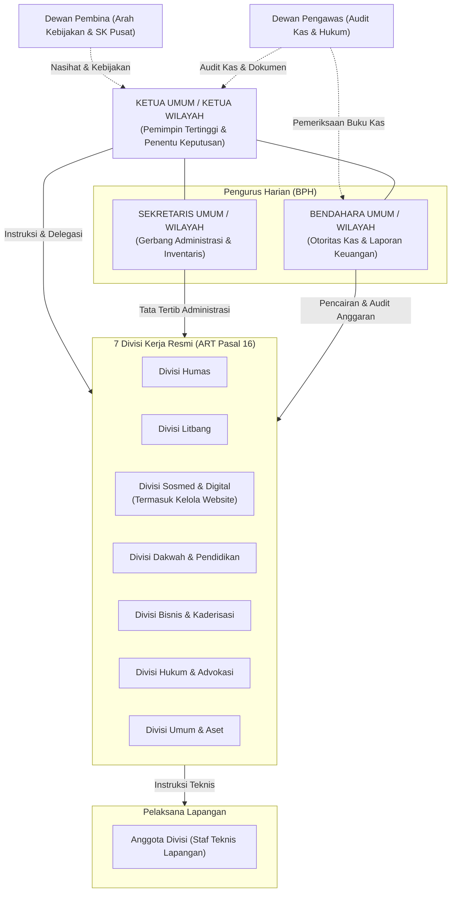
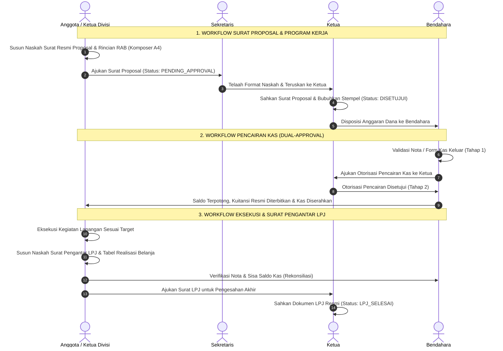
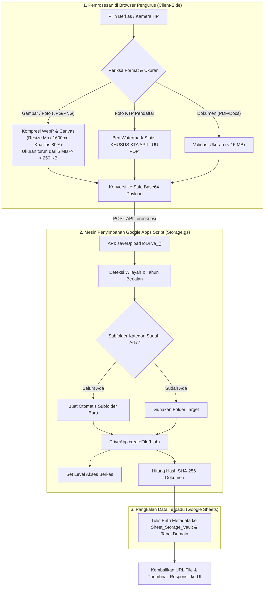
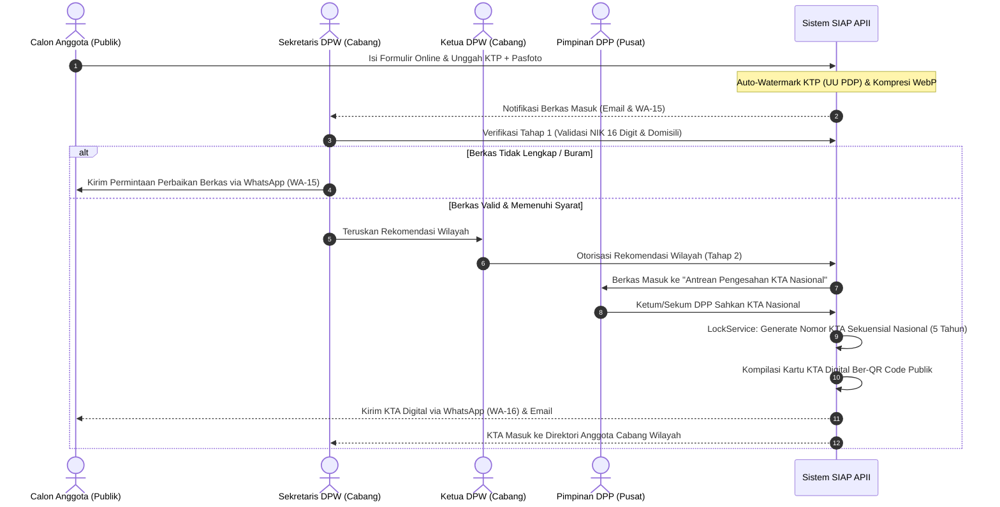
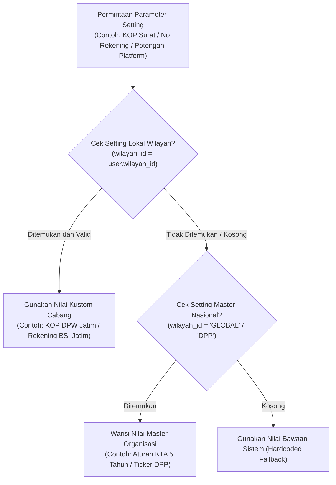
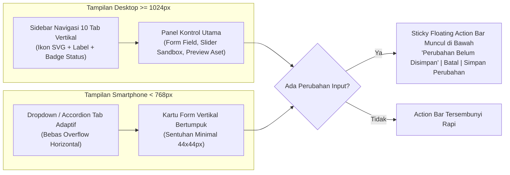

# RANCANGAN SISTEM INFORMASI & ADMINISTRASI TERPADU (SIAP APII)
## Arsitektur Terpadu Dewan Pimpinan Pusat (DPP) & Dewan Pimpinan Wilayah (DPW)
**Yayasan Apologet Islam Indonesia (APII)**
*Nomor SK Menteri Hukum & HAM RI: AHU-0014970.AH.01.04.Tahun 2023*

Dokumen ini disusun sebagai cetak biru resmi (*master architecture design*) yang menampung seluruh hasil diskusi, telaah Anggaran Rumah Tangga (ART), spesifikasi logika, pembagian tugas dan wewenang kepengurusan, alur kerja operasional (workflow), setup pembuatan surat menyurat interaktif dwimoda (termasuk surat resmi divisi untuk proposal & LPJ), integrasi kanal notifikasi Email & WhatsApp anti-error, konsep Website Publik Tunggal Adaptif, serta matriks pengujian kualitas bertingkat nasional.

---

## 1. Landasan Hukum, Identitas & Visi Lembaga

### 1.1 Landasan Hukum Organisasi
Seluruh logika kerja dan pembagian kewenangan sistem mengacu mutlak pada Anggaran Rumah Tangga (ART) Yayasan Apologet Islam Indonesia:
1. **Bentuk Lembaga (Bab I Pasal 1):** Yayasan bergerak di bidang sosial, kemasyarakatan, dan keagamaan.
2. **Visi & Misi (Bab I Pasal 2):**
   - **Visi:** Mengimplementasikan Islam sebagai Agama Rahmatan Lil Alamin.
   - **Misi:**
     1. Transfer ilmu pengetahuan bagi sesama umat.
     2. Mengoptimalkan digital dan internet sebagai sarana dakwah.
     3. Dialog perbandingan agama secara online maupun offline.
     4. Bersinergi dengan individu, organisasi Islam, dan instansi pemerintah/swasta guna mengukuhkan ukhuwah islamiah.
3. **Keanggotaan & KTA Terpusat (Bab II Pasal 4 & 5):**
   - Kartu Anggota berlaku di seluruh dunia, dikeluarkan resmi oleh **Dewan Pengurus Pusat (DPP)** Yayasan APII, dan berlaku selama 5 tahun.
4. **Wewenang Pengurus Pusat (Bab V Pasal 14 Ayat 9 & 10):**
   - Pengurus DPP berhak mengeluarkan Surat Keputusan (SK) Struktur Kepengurusan yayasan yang terbentuk di dalam maupun luar negeri.
   - Pengurus mencetak dan mengeluarkan kartu anggota yayasan serta merekrut anggota baru.
5. **Struktur 7 Divisi Resmi (Bab V Pasal 16):**
   - Divisi Humas
   - Divisi Litbang
   - Divisi Sosial Media / Digital (termasuk tugas: Pengelolaan Website)
   - Divisi Dakwah dan Pendidikan
   - Divisi Pengembangan dan Investasi Bisnis
   - Divisi Hukum
   - Divisi Umum

---

## 2. Struktur Kepengurusan, Tugas, Wewenang & Tanggung Jawab

Struktur kepengurusan di tingkat **Pusat (DPP)** maupun **Wilayah (DPW)** memiliki bagan organisasi yang seragam dengan garis wewenang yang tegas:



### 2.1 Ketua Umum (Tingkat DPP) / Ketua Wilayah (Tingkat DPW)
*Dasar Hukum: ART Bab V Pasal 15 Huruf A & Pasal 14*
- **Kedudukan:** Pemimpin tertinggi yayasan di tingkatannya yang memegang kendali kepemimpinan dan pengambil keputusan final.
- **Tugas & Wewenang:**
  1. Memimpin dan mengoordinasikan seluruh jajaran pengurus harian, divisi, dan anggota yayasan.
  2. Mengoordinasikan seluruh tahapan program kerja: perencanaan, pelaksanaan, evaluasi, hingga pertanggungjawaban (LPJ).
  3. Mengundang rapat dan memimpin rapat kepengurusan minimal 1 (satu) kali dalam sebulan.
  4. Memberikan mandat wewenang kepada para Ketua Divisi sehubungan lingkup kerja masing-masing.
  5. Mendelegasikan kepada salah satu pengurus harian dalam melakukan hubungan kemitraan dengan pihak eksternal.
  6. Menandatangani dan mengesahkan seluruh surat dinas resmi, proposal kegiatan divisi, laporan pertanggungjawaban (LPJ), pengeluaran kas, serta naskah instruksi kebijakan keluar.
- **Peran Sistem Digital (Portal SIAP APII):**
  - Otorisator tahap akhir (*final approval*) penerbitan surat dinas umum maupun surat resmi proposal/LPJ divisi.
  - Pembubuh stempel basah digital resmi pada naskah yang disetujui.
  - Verifikator Tahap 2 pengeluaran kas (*dual-approval disbursement* setelah verifikasi nota oleh Bendahara).
  - Pengesah usulan program kerja 7 divisi dan penerbit lembar disposisi instruksi masuk.
  - *Di tingkat DPP:* Pengesah tunggal Nomor KTA Nasional resmi berlaku 5 tahun dan SK Struktur Kepengurusan Cabang.
- **Pertanggungjawaban:** Bertanggung jawab langsung kepada Dewan Pembina Yayasan.

### 2.2 Sekretaris Umum (Tingkat DPP) / Sekretaris Wilayah (Tingkat DPW)
*Dasar Hukum: ART Bab V Pasal 15 Huruf B*
- **Kedudukan:** Pintu gerbang utama administrasi organisasi, inventarisasi barang, dokumentasi, dan operasional harian.
- **Tugas & Wewenang:**
  1. Mengatur dan menertibkan pengorganisasian administrasi perkantoran yayasan.
  2. Bertanggung jawab atas pengelolaan, pemeliharaan, dan inventarisasi barang-barang milik yayasan.
  3. Bertanggung jawab atas kelancaran kegiatan operasional harian yayasan.
  4. Berhak dan berwenang mendokumentasikan serta mengarsipkan seluruh surat masuk maupun keluar (termasuk arsip surat divisi).
  5. Menyusun konsep draf naskah persuratan dinas resmi (SK, Undangan, Tugas, Rekomendasi, Berita Acara, Notulen).
- **Peran Sistem Digital (Portal SIAP APII):**
  - Konseptor naskah surat dinas umum dengan generator nomor urut sekuensial otomatis berbasis penguncian transaksi.
  - Penelaah format naskah surat proposal dan LPJ yang diajukan oleh para Ketua Divisi sebelum diteruskan ke Ketua Wilayah/Pusat.
  - Pengelola modul Komposer Surat Dwimoda: memilih template dokumen master atau menyusun bebas dari awal dengan pratinjau A4 langsung.
  - Pengelola pintu gerbang modul *Instruksi & Disposisi Nasional*: menerima naskah dari luar, mencatat nomor agenda masuk, dan menyiapkan lembar disposisi ke Ketua.
  - Verifikator Tahap 1 berkas pendaftaran anggota baru (validasi NIK 16 digit dan watermark KTP UU PDP).
- **Pertanggungjawaban:** Bertanggung jawab langsung kepada Ketua Umum / Ketua Wilayah.

### 2.3 Bendahara Umum (Tingkat DPP) / Bendahara Wilayah (Tingkat DPW)
*Dasar Hukum: ART Bab V Pasal 15 Huruf C*
- **Kedudukan:** Pemegang amanah tunggal tata kelola keuangan, kas, dan akuntabilitas anggaran yayasan.
- **Tugas & Wewenang:**
  1. Bertanggung jawab penuh atas pengelolaan, penerimaan, penyimpanan, dan pengeluaran kas keuangan yayasan.
  2. Menyusun dan merancang rencana anggaran tahunan dengan berkoordinasi kepada Ketua Umum.
  3. Membuat laporan keuangan secara periodik dan tertulis yang disampaikan secara berkala dan transparan.
  4. Mengatur pencatatan seluruh bukti kas, nota belanja, kwitansi, dan surat-surat berharga yayasan.
  5. Berhak bertanya, menguji kelayakan belanja, dan menyelenggarakan audit keuangan pada setiap kepanitiaan divisi.
- **Peran Sistem Digital (Portal SIAP APII):**
  - Pembukuan voucher kas masuk (donasi, infak, wakaf, iuran) yang langsung meng-update saldo kas aktif.
  - Verifikator Tahap 1 pengeluaran kas: memvalidasi keabsahan bukti nota fisik sebelum diajukan ke Ketua.
  - Pemeriksa realisasi anggaran belanja pada Surat Resmi LPJ Divisi sebelum program dinyatakan selesai.
  - Generator kuitansi kas resmi otomatis dengan konversi terbilang Rupiah dan tanda tangan digital.
  - Pengelola master rekening bank, kas brankas, dan QRIS resmi yayasan.
- **Pertanggungjawaban:** Bertanggung jawab langsung kepada Ketua Umum / Ketua Wilayah.

### 2.4 Ketua Divisi (Tingkat DPP & DPW)
*Dasar Hukum: ART Bab V Pasal 16 Huruf A s.d. G*
- **Kedudukan:** Pemimpin fungsional bidang program kerja yang memimpin para anggotanya.
- **Tugas & Wewenang Khusus Berdasarkan 7 Divisi Resmi:**
  1. **Divisi Humas (Pasal 16 Huruf A):**
     - Mengoordinir program hubungan komunikasi yayasan baik internal maupun eksternal.
     - Melakukan sosialisasi yayasan dengan media publikasi dan membangun kemitraan lembaga (pemerintah dan swasta).
     - Mewakili / menggantikan Ketua Umum jika berhalangan sesuai bidang tugasnya.
  2. **Divisi Litbang (Pasal 16 Huruf B):**
     - Mengoordinasikan perumusan kebijakan teknis, rencana, dan program kelitbangan (kajian perbandingan agama).
     - Meningkatkan kapasitas tenaga peneliti melalui pendidikan, pelatihan, dan pemagangan.
     - Mengoptimalkan jejaring kerja sama litbang dengan lembaga penelitian pemerintah dan swasta.
     - Memfasilitasi masyarakat dalam menumbuhkembangkan kreativitas dan inovasi iptek keagamaan.
  3. **Divisi Sosial Media & Digital (Pasal 16 Huruf C):**
     - Mengelola seluruh kanal media sosial resmi yayasan (TikTok, Instagram, Facebook, Line, Twitter/X, YouTube).
     - Mencari media partner untuk meningkatkan publikasi (portal berita online, radio, televisi).
     - Membuat karya desain poster dakwah dan konten kreatif.
     - **Pengelolaan Website Resmi:** Bertanggung jawab atas pengelolaan konten, pembaruan warta, dan agenda di website yayasan.
  4. **Divisi Dakwah dan Pendidikan (Pasal 16 Huruf D):**
     - Melaksanakan kegiatan syiar Islam dan melestarikan nilai-nilai Islami.
     - Menjalin koordinasi dan kerja sama dengan instansi lain di bidang syiar Islam.
     - Melaksanakan pembinaan, pengawasan, pengendalian syiar, dan pemberdayaan Da'i / tenaga keagamaan.
  5. **Divisi Pengembangan & Investasi Bisnis (Pasal 16 Huruf E):**
     - Merumuskan rencana, kebijakan, dan strategi kemandirian ekonomi yayasan serta pengawasan investasi bisnis.
     - Melakukan analisis kebutuhan SDM pengurus dan kaderisasi anggota baru yayasan.
     - Merencanakan, mengawasi, dan memonitoring pembukaan cabang/wilayah (DPW) baru yayasan.
  6. **Divisi Hukum (Pasal 16 Huruf F):**
     - Mengoordinasikan penyusunan produk hukum dan peraturan internal yayasan.
     - Memberikan pertimbangan hukum dalam penyelesaian masalah (litigasi maupun non-litigasi).
     - Memberikan advokasi hukum kepada pengurus dan anggota yayasan apabila diperlukan.
  7. **Divisi Umum (Pasal 16 Huruf G):**
     - Divisi pelengkap yang membantu dan mendukung operasional seluruh divisi lain dalam setiap kegiatan.
     - Melaksanakan pengadaan/pembelian barang operasional dan pemeliharaan fisik aset yayasan.
     - Menyusun laporan pertanggungjawaban operasional dan logistik kepada Ketua Umum.
- **Peran Khusus Pembuatan Surat Resmi Divisi:**
  - Mengonsep **Surat Resmi Proposal Kegiatan** (memuat latar belakang, rincian RAB, jadwal, dan susunan kepanitiaan).
  - Mengonsep **Surat Resmi Pengantar LPJ** (memuat laporan hasil kegiatan, evaluasi, dan tabel rekapitulasi realisasi belanja).
  - Menandatangani naskah surat divisi selaku Penanggung Jawab Program sebelum diajukan ke Ketua Wilayah/Pusat untuk disahkan.
- **Pertanggungjawaban:** Bertanggung jawab langsung kepada Ketua Umum / Ketua Wilayah.

### 2.5 Anggota Divisi (Pelaksana Teknis Lapangan)
*Dasar Hukum: ART Bab II Pasal 4 & Bab V Pasal 16*
- **Kedudukan:** Staf pelaksana teknis operasional di bawah komando Ketua Divisi terkait.
- **Tugas & Tanggung Jawab:**
  1. Menjalankan penugasan teknis lapangan sesuai arahan Ketua Divisi (pembuatan konten, penyiapan panggung, pengumpulan data riset, verifikasi logistik, penyiapan berkas hukum).
  2. Membantu penyusunan draf surat proposal kegiatan dan pengumpulan bukti nota pengeluaran dana untuk naskah surat LPJ.
  3. Menjunjung tinggi kode etik yayasan (ART Pasal 6) dan menjaga nama baik yayasan di media sosial.
- **Peran Sistem Digital (Portal SIAP APII):**
  - Membantu mengisi draf naskah proposal dan mengunggah berkas nota pendukung.
  - Memantau status persetujuan usulan program pada kalender dan kanban divisi.
- **Pertanggungjawaban:** Bertanggung jawab kepada Ketua Divisi masing-masing.

---

## 3. Matriks Tanggung Jawab Operasional (RACI Matrix)

Matriks RACI membagi batas wewenang secara presisi agar tidak terjadi tumpang tindih antar-pengurus:
- **R (Responsible):** Pihak yang menyusun, mengerjakan, dan menyelesaikan tugas teknis.
- **A (Accountable):** Pihak pemegang keputusan mutlak dan penandatangan pengesahan akhir (hanya 1 pihak).
- **C (Consulted):** Pihak yang dimintai masukan, saran, atau telaah sebelum keputusan diambil.
- **I (Informed):** Pihak yang mendapat tembusan laporan atau notifikasi setelah keputusan disahkan.

| Aktivitas Operasional Organisasi | Ketua Umum / Wilayah | Sekretaris | Bendahara | Ketua Divisi | Anggota Divisi | Pembina & Pengawas |
| :--- | :---: | :---: | :---: | :---: | :---: | :---: |
| **Penerbitan Surat Dinas Umum** | **A** | **R** | I | C | I | I |
| **Penerbitan Surat Proposal Divisi**| **A** (Mengesahkan) | C (Review No) | C (Review RAB)| **R** (Konseptor/Ttd)| **R** (Bantu Draf)| I |
| **Penerbitan Surat Pengantar LPJ** | **A** (Mengesahkan) | C (Arsip) | C (Verif Kas) | **R** (Konseptor/Ttd)| **R** (Bantu Bukti)| I |
| **Pencatatan Kas Masuk (Donasi/Wakaf)**| I | I | **A / R** | I | I | I |
| **Pencairan Kas Keluar Operasional** | **A** | I | **R** | C | I | I |
| **Penyusunan Rencana Program Kerja** | **A** | C | C | **R** | **R** | I |
| **Eksekusi Kegiatan di Lapangan** | I | C | C | **A** | **R** | I |
| **Verifikasi Berkas Pendaftar Baru** | C | **R** | I | I | I | I |
| **Rekomendasi Keanggotaan Wilayah** | **A** | **R** | I | I | I | I |
| **Penerbitan Nomor KTA Nasional (DPP)**| **A** | **R** | I | I | I | I |
| **Penerbitan Instruksi Kebijakan ke DPW**| **A** | **R** | I | I | I | I |
| **Disposisi Tindak Lanjut Instruksi** | **A** | **R** | C | **R** | I | I |
| **Kurasi & Terbit Warta Web Publik** | **A** | C | I | **R** (Sosmed) | **R** | I |
| **Audit Kepatuhan Kas & Tata Kelola**| I | I | C | I | I | **A / R** |

---

## 4. Alur Kerja Operasional Terpadu (Daily Workflows)



### 4.1 Modul Setup Pembuatan Surat Menyurat Interaktif (Live Preview & Template Asset Extractor)

Modul ini adalah mesin penerbitan dokumen resmi kedinasan yang dirancang dengan fleksibilitas tinggi untuk surat umum maupun surat resmi divisi:

#### A. Dua Mode Penyusunan Surat
1. **Mode A: Ekstraksi Data dari Template Dokumen Master (Preset Engine)**
   - Mengambil data dari master template Google Docs / PDF yang terdaftar di `Sheet_Templates` atau konfigurasi wilayah.
   - Pilihan template mencakup:
     * *Surat Dinas Umum:* SK Pengurus, Surat Undangan Rapat Pleno, Surat Mandat Tugas Da'i, Surat Rekomendasi, Berita Acara, Surat Edaran.
     * *Surat Resmi Divisi:* Surat Pengajuan Proposal Kegiatan Divisi, Surat Pengantar Laporan Pertanggungjawaban (LPJ).
   - Seluruh variabel dinamis (`{{NOMOR}}`, `{{TANGGAL}}`, `{{PERIHAL}}`, `{{KONSIDERAN}}`, `{{ISI}}`, `{{PENANDATANGAN}}`, `{{QR_VERIFY}}`) otomatis terisi dan tergantikan secara presisi.
2. **Mode B: Penyusunan Bebas dari Awal (Blank Composer dengan Editor Visual)**
   - Menyusun naskah surat dari lembar kosong menggunakan editor visual interaktif (dukungan format tebal, miring, poin bernomor, dan tabel rincian anggaran).
   - Pengurus leluasa mengatur tata letak paragraf konsideran (*Menimbang, Mengingat, Menetapkan*) atau struktur surat permohonan bebas.

#### B. Modularitas Komponen Aset Surat (KOP, Stempel, Tanda Tangan)
Sistem memisahkan komponen surat menjadi modul independen yang dapat diganti dan disesuaikan:
- **KOP Surat Dinamis:** Logo resmi APII (bintang 8 cahaya Islam), nama hierarki (`DEWAN PIMPINAN PUSAT` atau `DEWAN PIMPINAN WILAYAH [NAMA]`), alamat kantor sekretariat, kontak email/telepon, dan garis pemisah ganda dinas tebal-tipis.
- **Header & Footer Otomatis:** Nomor halaman, nomor dokumen arsip, kode hash SHA-256, dan URL validasi QR Code publik.
- **Stempel Basah Digital Transparan:** Gambar stempel resmi PNG transparan beresolusi tinggi dengan efek rotasi kemiringan alami 3 hingga 5 derajat.
- **Tanda Tangan Elektronik Terverifikasi:** Nama lengkap, NIK/NTA, jabatan penandatangan (Ketua Umum/Wilayah, Sekretaris Umum/Wilayah, serta Ketua Divisi).

#### C. Pratinjau Kertas Virtual A4 Reaktif (Live Split-Screen 0 Detik)
- Tampilan berdampingan (*split-screen*): formulir input di sisi kiri, dan kertas virtual A4 di sisi kanan.
- Setiap ketukan huruf di formulir seketika memperbarui tampilan lembar A4 secara instan (*real-time reactive*) tanpa reload.
- Margin naskah mematuhi kaidah tata naskah dinas resmi (Kiri 3 cm, Kanan 2.5 cm, Atas 2.5 cm, Bawah 2.5 cm).
- Stempel dan tanda tangan terproyeksi di posisi yang proporsional di atas nama penandatangan.

#### D. Penyesuaian Otomatis Multi-Tenant (DPP vs DPW)
- Saat akun pengurus DPP login, KOP surat dan stempel otomatis terkunci pada identitas **Dewan Pimpinan Pusat**.
- Saat akun pengurus DPW login, KOP surat dan stempel otomatis mengadopsi identitas wilayah terkait (misal: *DPW Jabodetabek*).
- Superadmin memiliki wewenang untuk memilih dan menguji KOP wilayah manapun melalui pemilih aset di atas form.

#### E. Siklus Pengesahan & Konversi Otomatis ke PDF Drive Resmi
1. Draf disusun oleh Sekretaris / Ketua Divisi $\to$ Status `DRAFT`.
2. Pengonsep mengajukan naskah ke Ketua $\to$ Status `PENDING_APPROVAL`.
3. Ketua memeriksa tampilan virtual A4 dan mengklik *"Sahkan & Terbitkan"*:
   - Sistem membangkitkan nomor urut dinas resmi sekuensial terkunci anti-ganda.
   - Mengompilasi naskah menjadi berkas Google Docs di Google Drive organisasi.
   - Men-generate file PDF resmi berkualitas cetak (*print-ready* 300 DPI) lengkap dengan stempel basah digital, tanda tangan, dan QR Code verifikasi publik.
   - Menyimpan tautan PDF permanen ke `Sheet_Surat`.

#### F. Standarisasi Surat Resmi Divisi Kerja (Proposal Kegiatan & Pengantar LPJ)
Menjawab kebutuhan tata kelola divisi yang profesional dan akuntabel, divisi kerja memiliki dua naskah dinas resmi:

1. **Surat Resmi Proposal Kegiatan Divisi (`SURAT_PROPOSAL_DIVISI`):**
   - **Fungsi:** Permohonan resmi pelaksanaan program kerja dan pengajuan Rencana Anggaran Biaya (RAB) kepada Pimpinan Wilayah/Pusat.
   - **Format Penomoran Otomatis:**
     $$\text{Format: } [NOMOR\_URUT]/PROP-[KODE\_DIVISI]-[KODE\_WILAYAH]/[BULAN\_ROMAWI]/[TAHUN]$$
     *Contoh:* `003/PROP-DAKWAH-JABO/XI/2026`
   - **KOP Surat Divisi:** KOP Resmi Yayasan APII dengan sub-header divisi: `DIVISI DAKWAH DAN PENDIDIKAN`.
   - **Struktur Tanda Tangan Berjenjang (Tri-Signature Structure):**
     * Sisi Kiri: **Ketua Divisi** (Penanggung Jawab Program).
     * Sisi Kanan: **Sekretaris Divisi / Ketua Panitia Pelaksana**.
     * Tengah Bawah: **Mengetahui & Menyetujui: KETUA UMUM (DPP) / KETUA WILAYAH (DPW)** lengkap dengan stempel basah digital yayasan setelah proposal disetujui.

2. **Surat Resmi Pengantar LPJ Divisi (`SURAT_LPJ_DIVISI`):**
   - **Fungsi:** Naskah resmi pertanggungjawaban kegiatan yang memuat narasi ketercapaian target, dokumentasi foto, dan tabel rekapitulasi realisasi belanja dana kas.
   - **Format Penomoran Otomatis:**
     $$\text{Format: } [NOMOR\_URUT]/LPJ-[KODE\_DIVISI]-[KODE\_WILAYAH]/[BULAN\_ROMAWI]/[TAHUN]$$
     *Contoh:* `003/LPJ-DAKWAH-JABO/XII/2026`
   - **Keterhubungan Silang Otomatis (*Cross-Linked Data*):**
     * Surat proposal dan surat LPJ divisi otomatis terhubung (*linked*) ke baris program di `Sheet_Divisi` dan modul persuratan di `Sheet_Surat`.
     * Pada kartu kanban program kerja divisi, pengurus cukup mengklik tombol:
       `[ Unduh Surat Resmi Proposal PDF ]` atau `[ Unduh Surat Resmi LPJ PDF ]`.

#### G. Taksonomi Naskah Persuratan Terpadu & Format Khusus Pelayanan Muallaf
Untuk mewadahi seluruh pilar gerakan Yayasan Apologet Islam Indonesia (APII) di bidang dakwah komparasi agama, pembinaan muallaf, advokasi hukum, dan tata kelola organisasi modern, modul komposer surat menyediakan 5 klaster naskah resmi:

| Klaster Naskah | Kode / Tipe Surat | Prefix Nomor | Format Subjek & Peruntukan | Struktur Penandatangan & Validasi |
| :--- | :--- | :--- | :--- | :--- |
| **1. Pelayanan Muallaf & Dakwah (Inti APII)** | `SURAT_MUALLAF` / `IKRAR_SYAHADAT` | `KET-MUALLAF` | **Surat Keterangan Ikrar Masuk Islam (Sertifikat Piagam Muallaf)**: Bukti autentik bersyahadat untuk legalitas KTP/KK di Disdukcapil, KUA, serta basis data pembinaan. | *Catur-Signature:* Pembimbing Syahadat (Da'i APII), Saksi I, Saksi II, Mengetahui: Ketua Umum/Wilayah + Stempel Basah + QR Code Verifikasi. |
| | `ADVOKASI_MUALLAF` | `ADV-MUALLAF` | **Surat Rekomendasi & Perlindungan Advokasi Muallaf**: Diterbitkan Divisi Hukum untuk pendampingan saudara baru yang mengalami intimidasi sosial, sengketa waris/hak asuh, atau diskriminasi hak sipil. | Ketua Divisi Hukum & Mengetahui: Ketua Umum/Wilayah. |
| | `TUGAS_DAKWAH` | `TUG-DAKWAH` | **Surat Tugas Safari Dakwah & Dialog Komparasi Agama**: Penugasan resmi da'i/apologet untuk khutbah, bedah buku, ceramah akbar, atau dialog/debat antar-agama. | Ketua Divisi Dakwah & Pendidikan + Mengetahui: Sekretaris/Ketua. |
| | `BA_SANTUNAN` | `BA-SANTUNAN` | **Berita Acara Santunan Muallaf & Asnaf Zakat**: Penyerahan santunan pembinaan ekonomi dan paket sarana ibadah (Al-Qur'an, mukena, sajadah, buku panduan salat). | Penerima Santunan, Petugas Baitul Mal/Bisnis, Bendahara Umum/Wilayah. |
| | `REK_BEASISWA` | `REK-BEASISWA` | **Surat Rekomendasi Pendidikan / Beasiswa Santri Muallaf**: Pengantar santri binaan atau kader dakwah ke pondok pesantren mitra dan lembaga perguruan tinggi Islam. | Ketua Divisi Litbang/Pendidikan + Ketua Umum/Wilayah. |
| **2. Kemitraan & Hubungan Eksternal** | `AUDIENSI` | `AUD` | **Surat Permohonan Audiensi & Silaturahmi Kelembagaan**: Permohonan sinergi resmi ke MUI, Kemenag, Bakesbangpol, Kepolisian, dan ormas Islam. | Sekretaris Umum/Wilayah & Mengetahui: Ketua Umum/Wilayah. |
| | `IZIN_KEGIATAN` | `IZIN` | **Surat Permohonan Izin Tempat & Pemberitahuan Acara**: Pengajuan peminjaman gedung, masjid raya, atau area publik untuk tablig akbar/dialog komparasi. | Ketua Panitia Pelaksana & Sekretaris Wilayah/Pusat. |
| | `MOU` | `MOU` | **Nota Kesepakatan Bersama (MoU) Kemitraan Dakwah**: Perjanjian kerjasama strategis dengan yayasan mitra, media center, atau sponsor dakwah. | Ketua Umum (DPP) / Ketua Wilayah (DPW). |
| **3. Program & Keuangan 7 Divisi** | `SURAT_PROPOSAL_DIVISI` | `PROP-[DIVISI]` | **Surat Resmi Pengajuan Proposal Kegiatan & RAB**: Pengajuan resmi program kerja divisi kepada pimpinan cabang/pusat. | *Tri-Signature:* Ketua Divisi, Sekretaris Divisi/Panitia, Mengetahui: Ketua Wilayah/Pusat. |
| | `SURAT_LPJ_DIVISI` | `LPJ-[DIVISI]` | **Surat Resmi Pengantar LPJ & Realisasi Anggaran**: Pertanggungjawaban kinerja fisik dan keuangan program kerja divisi. | *Tri-Signature:* Ketua Divisi, Sekretaris Pelaksana, Mengetahui: Ketua Wilayah/Pusat + Verifikasi Bendahara. |
| **4. Tata Kelola & Disiplin ART APII** | `SK` | `SK` | **Surat Keputusan Struktur Kepengurusan / Panitia**: Penerbitan SK Wilayah oleh DPP (ART Pasal 14) atau SK Panitia Acara oleh DPW. | Ketua Umum & Sekretaris Umum (DPP) / Ketua Wilayah (DPW). |
| | `MANDAT_MODERATOR` | `MANDAT-MOD` | **Surat Mandat Moderator Resmi Acara & Debat**: Penunjukan penengah/moderator dialog komparasi agama sesuai mandat ART Bab VI Pasal 17. | Pengurus Harian (Ketua & Sekretaris). |
| | `SP` | `SP-[1/2/3]` | **Surat Peringatan Disiplin Organisasi**: Penegakan kode etik keanggotaan dan kepengurusan sesuai aturan ART Bab II Pasal 6. | Ketua Umum / Majelis Pembina (Tertutup & Terenkripsi). |
| **5. Administrasi Rutin Kesekretariatan** | `UNDANGAN` | `UND` | **Surat Undangan Rapat Pleno / Rapat Kerja**: Undangan resmi musyawarah pimpinan atau rapat koordinasi divisi. | Sekretaris & Ketua. |
| | `EDARAN` | `EDR` | **Surat Edaran Kebijakan Organisasi**: Maklumat edaran internal berkala bagi seluruh anggota/pengurus. | Sekretaris & Ketua. |
| | `KETERANGAN` | `KET` | **Surat Keterangan Aktif Organisasi**: Keterangan aktif pengurus/anggota untuk berbagai keperluan administratif luar. | Sekretaris Umum/Wilayah. |
| | `NOTULEN` | `NOT` | **Risalah / Notulen Resmi Musyawarah**: Rekapitulasi hasil musyawarah dan penandatanganan kesepakatan bersama. | Notulis Rapat & Pimpinan Sidang. |
| | `BA` | `BA` | **Berita Acara Umum / Serah Terima Inventaris**: Bukti mutasi aset inventaris yayasan atau serah terima jabatan (Sertijab). | Pihak Pertama, Pihak Kedua, Mengetahui: Pengurus Harian. |

##### Struktur Khusus Format Piagam / Surat Keterangan Masuk Islam (Sertifikat Muallaf):
Naskah `SURAT_MUALLAF` dirancang dengan keistimewaan tata letak (*layout*) berstandar hukum dan syar'i:
1. **Header Piagam:** Menggunakan ornamen kaligrafi Bismillah dan Logo Yayasan APII dengan judul naskah: *"SURAT KETERANGAN IKRAR MASUK ISLAM / PIAGAM SYAHADAT"*.
2. **Metadata Saudara Baru:**
   - Nama Sesuai Identitas Lama (KTP/Paspor)
   - Nama Hijrah / Nama Muslim Baru (opsional bila berganti nama)
   - NIK / Nomor Identitas Resmi Kependudukan
   - Tempat & Tanggal Lahir, Jenis Kelamin, Kebangsaan
   - Agama Terdahulu
   - Alamat Domisili Lengkap & Nomor WhatsApp
3. **Pernyataan Ikrar Kalimat Syahadat:**
   - Teks Arab Dua Kalimah Syahadat lengkap dengan harakat, transliterasi latin, dan arti terjemahan resmi bahasa Indonesia.
   - Waktu pelaksanaan: Hari, Tanggal Hijriyah, Tanggal Masehi, Pukul, dan Tempat (Masjid/Kantor Sekretariat APII).
4. **Klausul Bimbingan & Advokasi:**
   - Klausul hukum bahwa yang bersangkutan memeluk Islam dengan sukarela tanpa paksaan dari pihak manapun, serta berada di bawah pembinaan keagamaan dan perlindungan advokasi Yayasan APII.
5. **Blok Pengesahan 4 Titik (Catur-Signature):**
   - Sisi Kiri Atas: **Saksi I** (Nama & Tanda Tangan).
   - Sisi Kanan Atas: **Saksi II** (Nama & Tanda Tangan).
   - Sisi Kiri Bawah: **Pembimbing Syahadat** (Ustadz/Da'i Divisi Dakwah APII).
   - Sisi Kanan Bawah: **Mengetahui & Menegaskan: Dewan Pimpinan Yayasan APII (Ketua Umum / Ketua Wilayah)** lengkap dengan stempel basah digital dan tautan verifikasi keabsahan QR Code.

### 4.2 Modul Setup Keuangan Terpadu, Dokumen Kas & Cetak Kwitansi Resmi (Bendahara Suite)

Menjalankan amanat tata kelola keuangan nirlaba yang akuntabel, transparan, dan sesuai prinsip syariah bagi Yayasan Apologet Islam Indonesia, sistem menyediakan instrumen pembukuan terpadu bagi **Bendahara Umum (DPP)** dan **Bendahara Wilayah (DPW)**.

#### A. Alur Kerja Pengendalian Kas & Dual-Approval System
Sistem menerapkan mekanisme kendali ganda (*Dual-Control*) berjenjang untuk mencegah penyimpangan kas:

```mermaid
flowchart TD
    subgraph Pengajuan["1. Pengajuan Dana"]
        Pemohon["Pemohon / Divisi / Staff"] -->|Input Voucher & Unggah Nota| Draft["Status: PENDING"]
    end

    subgraph Verifikasi["2. Verifikasi Bendahara"]
        Draft -->|Review Kelayakan Nota & Pos Anggaran| CekThreshold{"Nominal < Threshold?\n(Batas Otorisasi Bendahara)"}
        CekThreshold -->|Ya (Kas Kecil)| AutoApprove["Disahkan Bendahara\nStatus: APPROVED"]
        CekThreshold -->|Tidak (Menengah/Besar)| Verify1["Verifikasi Tahap 1 Selesai\nStatus: VERIFIED_BY_BENDAHARA"]
    end

    subgraph Otorisasi["3. Otorisasi Ketua"]
        Verify1 -->|Notifikasi Action Inbox & WA| Ketua["Ketua Umum / Ketua Wilayah"]
        Ketua -->|Setujui| ApproveFinal["Pengesahan Tahap 2\nStatus: APPROVED"]
        Ketua -->|Tolak / Minta Revisi| Reject["Status: REJECTED\n(Wajib Catatan Evaluasi)"]
    end

    subgraph Pencairan["4. Pencairan & Dokumen Resmi"]
        AutoApprove --> Output["Saldo Kas Terpotong Otomatis"]
        ApproveFinal --> Output
        Output --> Cetak["Terbit Kwitansi / Voucher Resmi\nLengkap QR Validasi & Stempel Digital"]
    end
```

1. **Threshold Pengeluaran Mandiri (Petty Cash):**
   - Pengeluaran operasional kecil di bawah batas toleransi (*Approval Threshold*, default: Rp 500.000,-) dapat disahkan langsung oleh Bendahara tanpa menunggu persetujuan Ketua guna menjamin kelancaran taktis operasional harian kantor sekretariat.
2. **Pengeluaran Menengah & Program Kerja:**
   - Seluruh pengeluaran di atas batas threshold atau yang bersumber dari Rencana Anggaran Biaya (RAB) proposal divisi wajib menempuh otorisasi berjenjang: diverifikasi kelayakan nota belanjanya oleh Bendahara (Tahap 1), lalu diotorisasi pencairannya oleh Ketua Wilayah/Pusat (Tahap 2).
3. **Pengeluaran Strategis Skala Besar:**
   - Pengadaan aset permanen bernilai di atas Rp 10.000.000,- (misal pembelian studio podcast/dakwah atau kendaraan operasional) otomatis mengirim tembusan rekapitulasi audit ke Dewan Pembina dan Pengawas.

#### B. Taksonomi Dokumen Keuangan Resmi Bendahara
Modul keuangan menyediakan 4 format naskah dan bukti transaksi resmi siap cetak:

| No | Tipe Dokumen | Kode / Prefix | Format Penomoran | Fungsi & Rincian Naskah | Struktur Validasi & Tanda Tangan |
| :---: | :--- | :--- | :--- | :--- | :--- |
| 1 | **Kwitansi Penerimaan Kas (BKK-M)** | `KWITANSI_MASUK` | `[URUT]/KW-M-[WILAYAH]/[BULAN]/[TAHUN]` | Tanda terima donasi resmi untuk donatur, zakat maal, infaq, sedekah, wakaf tunai, donasi khusus muallaf, atau pengembalian sisa panjar. | Bendahara Penerima + Stempel Basah Digital + QR Code Validasi Keaslian. |
| 2 | **Voucher Kas Keluar (BKK-K)** | `VOUCHER_KELUAR` | `[URUT]/VKK-[WILAYAH]/[BULAN]/[TAHUN]` | Bukti pembayaran beban operasional, belanja program divisi, honor narasumber/da'i, atau pelunasan faktur vendor. | *Quad-Signature (4 Titik):*<br>1. Pembuat (Staff/Divisi)<br>2. Diverifikasi (Bendahara)<br>3. Disetujui (Ketua)<br>4. Diterima Oleh (Penerima Dana/Vendor). |
| 3 | **Voucher Kas Bon Sementara (Panjar)** | `KAS_BON` | `[URUT]/BON-[WILAYAH]/[BULAN]/[TAHUN]` | Uang muka operasional lapangan sementara sebelum kegiatan selesai. Dilengkapi batas waktu penyelesaian LPJ (maks. 7 hari kalender) dan kolom rekonsiliasi pengembalian selisih sisa dana. | Pemohon Panjar + Bendahara + Mengetahui: Ketua. |
| 4 | **Berita Acara Rekonsiliasi Kas (Cash Opname)** | `BA_REKONSILIASI` | `[URUT]/BA-KEU-[WILAYAH]/[BULAN]/[TAHUN]` | Laporan penutupan kas bulanan: mencocokkan saldo fisik brankas tunai (*Cash on Hand*) dan rekening bank (*Bank Statement*) dengan buku kas sistem. | Bendahara & Ketua Wilayah/Pusat + Tembusan: Dewan Pengawas. |

#### C. Setup & Generator Kwitansi Resmi (Format Dual-Slip Landscape)
Kwitansi penerimaan kas dirancang menggunakan format standar perbankan/akuntansi Indonesia dengan tata letak **Dual-Slip (Bonggol Arsip & Lembar Utama)**:

```
+-------------------------------------------------------------------------------------------------------------------+
| YAYASAN APOLOGET ISLAM INDONESIA                                                                                  |
| KOP RESMI YAYASAN APII - [DEWAN PIMPINAN WILAYAH / PUSAT]                           [ Cetak PDF ]  [ Kirim WA ]   |
+------------------------------------+------------------------------------------------------------------------------+
| [BONGGOL ARSIP KAS (COUNTERFOIL)]  | [LEMBAR UTAMA DONATUR / PEMBAYAR]                                            |
| (Untuk Arsip Bendahara - 30% Lebar)| (Diberikan Kepada Pihak Pembayar / Donatur - 70% Lebar)                      |
|                                    |                                                                              |
| No. Bukti : 042/KW-M-JABO/XI/2026  |                      BUKTI PENERIMAAN KAS / KWITANSI                         |
| Tanggal   : 03 November 2026       |                     Nomor: 042/KW-M-JABO/XI/2026                             |
|                                    |                                                                              |
| Telah Terima Dari:                 | Sudah Terima Dari : H. Abdurrahman Saleh                                     |
| Bpk. H. Abdurrahman Saleh          | Banyaknya Uang    : === Tujuh Juta Lima Ratus Ribu Rupiah ===                |
|                                    |                                                                              |
| Untuk:                             | Untuk Pembayaran  : Infaq Program Pembinaan Saudara Baru (Muallaf) Center   |
| Infaq Pembinaan Muallaf            |                     dan Paket Sarana Ibadah Divisi Dakwah                    |
|                                    | Diterima Melalui  : Bank Syariah Indonesia (BSI) - No. Rek. 719283xxxx       |
| Jumlah:                            |                                                                              |
| Rp 7.500.000,-                     | Terbilang:                                                                   |
|                                    | +--------------------------------------------------------------------------+ |
| Rekening Tujuan:                   | |  Rp 7.500.000,-                                            [ LUNAS ]     | |
| BSI Operasional (719283xxxx)       | +--------------------------------------------------------------------------+ |
|                                    | "Jazakumullahu khairan katsiran atas infaq/sedekah yang disalurkan.          |
| Paraf Bendahara:                   |  Semoga Allah melipatgandakan pahala dan memberkahi rezeki Anda."           |
|                                    |                                                                              |
| [      PARAF SINGKAT       ]       |                                             Jakarta, 03 November 2026        |
|                                    |                                             Bendahara Penerima,              |
|                                    |                                                ( STEMPEL BASAH )             |
| [ Gunting / Sobek di Sini ] > > >  |       [QR CODE VALIDASI]                         H. Ahmad Fauzi              |
+------------------------------------+------------------------------------------------------------------------------+
```

##### Fitur Unggulan Desain Kwitansi:
1. **Konversi Terbilang Rupiah Otomatis:** Setiap angka nominal yang diinput secara otomatis diubah menjadi kalimat ejaan baku bahasa Indonesia (*contoh: Rp 12.350.000 -> "Dua Belas Juta Tiga Ratus Lima Puluh Ribu Rupiah"*).
2. **Bonggol Pemisah Arsip (Counterfoil):** Saat dicetak, slip kiri menjadi bukti fisik arsip bendahara di binder kas, sedangkan slip kanan diserahkan ke donatur.
3. **Stempel Otomatis & Watermark Lunas:** Memuat cap stempel basah digital transparan yayasan dengan watermark status *"LUNAS"*.
4. **QR Code Verifikasi Publik Bebas Bocor Data:** Ketika QR Code dipindai oleh donatur melalui kamera ponsel, halaman publik `/verifikasi-kuitansi` mengonfirmasi keaslian bukti pembayaran (Nomor kwitansi, tanggal, nominal, nama penerima dana resmi, dan inisial donatur) tanpa mengekspos data pribadi sensitif (kepatuhan regulasi UU PDP).

#### D. Desain Formulir Voucher Kas Keluar (Disbursement Voucher Multi-Pos Anggaran)
Untuk belanja operasional dan program kerja divisi, voucher kas keluar menyajikan rincian multi-baris belanja (*itemized breakdown*):
- **Header Naskah:** Nomor Voucher, Tanggal Pembukuan, Wilayah Cabang, dan Nomor Rekening Asal Pengeluaran.
- **Tabel Rincian Belanja:** Kolom Pos Akun Beban, Uraian Belanja, Volume/Qty, Satuan, Harga Satuan, dan Subtotal.
- **Keterhubungan dengan Proposal Divisi:** Menautkan kode `surat_proposal_id` sehingga realisasi anggaran langsung terpotong dari pagu program divisi terkait.
- **Unggah & Pratinjau Nota Digital:** Bukti fisik struk/kuitansi/nota toko dapat difoto langsung lewat kamera ponsel atau diunggah (JPG/PNG/PDF), otomatis tersimpan ke subfolder aman Google Drive `Keuangan_Bukti_Nota`.
- **Kolom Audit Tanda Tangan:** 4 kolom tanda tangan lengkap dengan tanggal verifikasi sistem masing-masing pejabat.

#### E. Setup Konfigurasi Keuangan di Panel Pengaturan Bendahara (`Sheet_Settings`)
Bendahara Umum (DPP) dan Bendahara Wilayah (DPW) memiliki hak akses ke panel **Pengaturan Keuangan** untuk menyesuaikan:
1. **Format Pola Penomoran Transaksi Kas per Cabang:**
   - Pola Penomoran Voucher Masuk: `{urut}/KW-M-{wilayah}/{bulanRomawi}/{tahun}`
   - Pola Penomoran Voucher Keluar: `{urut}/VKK-{wilayah}/{bulanRomawi}/{tahun}`
   - Pola Penomoran Kas Bon: `{urut}/BON-{wilayah}/{bulanRomawi}/{tahun}`
2. **Ambang Batas Otorisasi Mandiri (Approval Threshold):**
   - Nilai batas nominal (default: Rp 500.000,-). Transaksi di bawah batas ini langsung berstatus `APPROVED` begitu disetujui Bendahara.
3. **Pangkalan Data Master Rekening Kas (Multi-Account Setup):**
   - Menambah, mengedit, dan mengarsipkan rekening bank yayasan (misal: Bank Syariah Indonesia, Bank Mandiri, Bank Muamalat) serta kas tunai brankas (*Petty Cash Drawer*).
   - Menandai rekening donasi publik (yang ditampilkan pada situs publik yayasan dan form pendaftaran).
4. **Kategori Penerimaan & Pengeluaran Syar'i (Chart of Accounts):**
   - *Penerimaan:* Infaq & Sedekah Terikat, Infaq Operasional Bebas, Zakat Maal, Wakaf Tunai Dakwah, Donasi Khusus Saudara Baru (Muallaf), Hasil Usaha & Investasi Mandiri.
   - *Pengeluaran:* Safari Dakwah & Dialog Komparasi, Pembinaan & Advokasi Muallaf, Perlengkapan Ibadah & Al-Qur'an, Pendidikan & Litbang, Publikasi & Media IT, Rumah Tangga & ATK Kantor, Honor Narasumber/Da'i, Bantuan Sosial Keumatan.

#### F. Audit Anti-Fraud & Integritas Buku Kas
1. **Aturan Kekebalan Mutasi (Immutability of Approved Transactions):**
   - Transaksi kas yang telah berstatus `APPROVED` dan telah terbit kwitansinya **tidak dapat diedit atau dihapus** secara sepihak.
2. **Mekanisme Jurnal Pembalik (Contra / Adjustment Voucher):**
   - Jika terdapat kesalahan input nilai atau pembatalan transaksi, sistem mewajibkan Bendahara membuat *Voucher Koreksi / Penyesuaian* dengan mencantumkan nomor referensi voucher lama sebagai rujukan silang, sehingga rekam jejak kas tetap akuntabel di mata auditor internal maupun eksternal.

#### G. Kalkulator Kas Pra-Transaksi & Simulasi Saldo (Pre-Transaction Cash Simulator)
Untuk mencegah kesalahan input, risiko kas tekor (*cash overdraft*), atau salah hitung sebelum bukti transaksi resmi dicatat ke database yayasan, sistem menyediakan instrumen **Kalkulator Kas Interaktif (Scratchpad)** pada modul Bendahara:

1. **Simulasi Dampak Saldo Berjalan (Run-Rate Cash Simulator):**
   - Menghitung secara seketika (*real-time reactive*) perubahan posisi kas:
     $$\text{Saldo Kas Riil Saat Ini} \pm \text{Nominal Simulasi} = \text{Proyeksi Saldo Akhir}$$
   - **Indikator Batas Aman Kas (Cash Safety Buffer):**
     - Jika proyeksi saldo akhir turun di bawah ambang batas aman operasional yayasan (misal: `< Rp 2.000.000,-`), kalkulator otomatis menampilkan status peringatan berwarna oranye/merah:
       `[ ! ] PERINGATAN: Pengeluaran ini menyebabkan cadangan kas berada di bawah batas aman operasional!`
2. **Kalkulator Multi-Item & Konversi Terbilang Cepat:**
   - Bendahara dapat merinci nota belanja dengan banyak item (Volume, Satuan, Harga Unit, Diskon) di kalkulator.
   - Hasil kalkulasi otomatis menghasilkan ejaan kalimat baku *Terbilang Rupiah* secara langsung tanpa delay.
3. **Penyaluran Langsung ke Formulir Transaksi:**
   - Tombol `[ Transfer Angka ke Voucher Kas Keluar ]` atau `[ Transfer Angka ke Kwitansi Masuk ]` menyalin seluruh hasil hitungan kalkulator ke formulir transaksi resmi dengan sekali klik.

#### H. Modul Nota Rencana Pembayaran & Tagihan Menunggu (Accounts Payable & Payment Plan)
Bendahara kerap menghadapi tagihan rutin atau komitmen biaya yang belum jatuh tempo pencairannya. Modul **Nota Rencana Pembayaran** mencatat dan mengurutkan kewajiban belanja sebelum uang kas dikeluarkan:

1. **Pencatatan Rencana Belanja (Pre-Disbursement Order):**
   - Menampung pos: Tagihan Sewa Server & Domain Website, Biaya Cetak 1.000 Buku Pedoman Muallaf, Tagihan Listrik & Internet Sekretariat, atau Honor Da'i Safari yang dijadwalkan tanggal tertentu.
   - **Data Naskah Rencana Bayar:**
     `Nomor Rencana Bayar ([URUT]/RPB-[WILAYAH]/[BULAN]/[TAHUN]), Vendor / Penerima, Pos Beban, Tanggal Jatuh Tempo (Due Date), Tingkat Urgensi (Mendesak / Rutin / Fleksibel), Estimasi Biaya, Dokumen Penawaran/Invoice.`
2. **Kalkulasi Saldo Kas Bebas (Free Cash Flow Forecast):**
   - Sistem membantu Bendahara melihat ketersediaan dana riil yang siap dipakai:
     $$\text{Free Cash Flow} = \text{Saldo Kas Riil} - \text{Total Tagihan Rencana Bayar Jatuh Tempo (H-7)}$$
   - Mencegah Bendahara menyetujui program baru apabila terdapat kewajiban tagihan rutin mendesak yang belum terbayar.
3. **Status Rencana Pembayaran:**
   - `TERJADWAL` $\to$ `MENUNGGU_DANA` $\to$ `SIAP_DIBAYAR` $\to$ `SELESAI_DICAIRKAN` (Otomatis menerbitkan Voucher Kas Keluar).

#### I. Pipa Proyeksi Pendapatan Digital & Inflow Pipeline (Gift TikTok, YouTube, QRIS & Donasi)
Aktivitas dakwah modern Yayasan APII bertumpu pada siaran langsung (*live streaming*) debat komparasi agama, kajian interaktif, dan donasi digital. Modul ini menyediakan kalkulator khusus untuk mencatat estimasi pemasukan sebelum dana resmi masuk mutasi rekening:

1. **Kalkulator Pendapatan Platform Live Streaming (Net Inflow Calculator):**
   - **Gift TikTok Live:**
     - Input jumlah Koin / Berlian (Diamonds) hasil siaran langsung debat/dakwah.
     - Sistem otomatis memotong formula bagi hasil platform (TikTok ~50%) dan mengonversi kurs USD ke IDR.
     - Menampilkan estimasi kas bersih yang akan ditarik (*Projected Net Payout*).
   - **YouTube Super Chat & Super Thanks:**
     - Input total pendapatan kotor dari live streaming YouTube.
     - Sistem memotong bagi hasil Google (30%) dan mengestimasi dana bersih yang akan ditransfer ke rekening BSI yayasan pada tanggal siklus pembayaran (tanggal 21-26 bulanan).
   - **Payment Gateway / QRIS Dinamis:**
     - Input total transaksi donasi harian.
     - Sistem memotong Merchant Discount Rate (MDR) regulasi BI (0.7% atau tarif flat lembaga nirlaba) guna mencatat estimasi dana settlement H+1.
   - **Komitmen Infaq / Donatur Tetap (Pledge Pipeline):**
     - Mencatat komitmen donatur rutin yang berjanji mentransfer pada tanggal tertentu.
2. **Status Pipa Proyeksi Masuk:**
   - `PROYEKSI_DIGITAL` $\to$ `PENDING_SETTLEMENT` $\to$ `DANA_CAIR_MUTASI` (Siap dikonversi menjadi Kwitansi Kas Masuk).

#### J. Alur Konversi 1-Klik Rencana Menjadi Transaksi Kas Riil (Zero Double-Input)
Bendahara tidak perlu mengetik ulang data dari rencana atau proyeksi yang telah dibuat:
1. **Konversi Proyeksi Digital $\to$ Kwitansi Masuk Resmi:**
   - Begitu dana dari TikTok, YouTube, atau QRIS masuk ke rekening koran bank, Bendahara mengklik tombol `[ Konversi ke Kas Masuk & Kwitansi ]`.
   - Sistem membuka modal konfirmasi: Bendahara memasukkan tanggal transaksi mutasi riil dan nominal bersih yang diterima di rekening.
   - Sistem membangkitkan nomor bukti `[URUT]/KW-M-[WILAYAH]/[BULAN]/[TAHUN]`, memperbarui saldo kas riil, dan menerbitkan kwitansi resmi berstempel dan ber-QR code.
2. **Konversi Nota Rencana Bayar $\to$ Voucher Kas Keluar:**
   - Saat tagihan vendor dibayar melalui transfer bank atau kas tunai, Bendahara mengklik `[ Eksekusi Pembayaran & Terbitkan Voucher ]`.
   - Mengunggah bukti mutasi transfer / nota lunas toko.
   - Sistem langsung mengubah status tagihan menjadi `SELESAI_DICAIRKAN` dan menerbitkan Voucher Kas Keluar resmi `[URUT]/VKK-[WILAYAH]/[BULAN]/[TAHUN]`.

---

## 5. Integrasi Kanal Notifikasi WhatsApp & Email (Multi-Channel Anti-Error)

Selain notifikasi email otomatis di latar belakang, sistem dilengkapi integrasi **WhatsApp Resmi Organisasi** guna menjamin respon cepat (*high urgency*) terhadap instruksi pimpinan, permohonan disposisi, dan pelayanan anggota.

### 5.1 Spesifikasi Mesin Notifikasi WhatsApp Anti-Error (Anti-Error Engine)
Sistem menerapkan **5 Benteng Keandalan (Reliability Guards)**:
1. **Normalisasi Nomor E.164 Super Ketat:** Mengonversi input `08...`, `+628...`, `8...` menjadi format standar internasional `628xxxxxxxxxx` (10-15 digit numerik).
2. **Safe URI Encoding:** Parameter teks diproses dengan `encodeURIComponent()` murni tanpa memutus string peramban.
3. **Pencegahan Tombol Mati (Zero Missing Number Dialog):** Jika nomor WA penerima kosong di profil, tombol tetap aktif menampilkan `[Input Nomor & Kirim]`, membuka pop-up input kilat yang otomatis menyimpan nomor ke profil database.
4. **Tombol Cadangan Salin Teks (Clipboard Fallback):** Tersedia tombol `[Salin Teks]` berdampingan dengan tombol WA untuk antisipasi PC tanpa WhatsApp Web.
5. **Batas Panjang Pesan Mobile-Safe:** Template dibatasi < 700 karakter agar tidak terpotong oleh browser ponsel.

### 5.2 Matriks 18 Titik Sentuh Alur Kerja, Lokasi Tombol & Template Pesan WhatsApp

| Kode | Domain Alur Kerja | Pemicu (Trigger) | Pengirim $\to$ Penerima | Penempatan Fisik Tombol di UI/UX | Template Teks Otomatis Pesan WhatsApp |
| :---: | :--- | :--- | :--- | :--- | :--- |
| **WA-01** | **Persuratan** | Draf surat diajukan untuk kurasi | Sekretaris $\to$ Ketua Wilayah / Pusat | Modal sukses *"Surat Diajukan"* | `Assalamu'alaikum Warahmatullahi Wabarakatuh, Yth. Ketua [NAMA_WILAYAH]. Sekretaris telah mengajukan draf surat resmi No. Draf: [NO_DRAFT] perihal: "[PERIHAL]". Mohon perkenan Bapak Ketua menelaah dan mengesahkan naskah pada portal: [LINK_PORTAL]` |
| **WA-02** | **Persuratan** | Surat dikembalikan / minta revisi | Ketua $\to$ Sekretaris Pengonsep | Modal dialog *"Catatan Revisi Surat"* | `Assalamu'alaikum Warahmatullahi Wabarakatuh, Bpk/Ibu Sekretaris. Terkait draf surat [NO_DRAFT] perihal "[PERIHAL]", ada catatan evaluasi dari Ketua: "[CATATAN_REVISI]". Mohon naskah disesuaikan pada portal: [LINK_PORTAL]` |
| **WA-03** | **Persuratan** | Surat disahkan & diterbitkan | Sekretaris $\to$ Penerima / Grup Pengurus | Baris tabel persuratan & Modal sukses terbit | `Assalamu'alaikum Warahmatullahi Wabarakatuh. Telah diterbitkan Surat Resmi Yayasan APII Nomor: [NO_SURAT] perihal: "[PERIHAL]". Naskah resmi berstempel digital dan QR validasi dapat diunduh pada tautan berikut: [LINK_PDF_DRIVE]` |
| **WA-04** | **Keuangan Kas** | Pengajuan voucher kas keluar | Pemohon / Divisi $\to$ Bendahara | Modal sukses *"Voucher Diajukan"* | `Assalamu'alaikum Warahmatullahi Wabarakatuh, Yth. Bendahara [NAMA_WILAYAH]. Kami telah mengajukan permohonan kas keluar No: [NO_VOUCHER] senilai Rp [NOMINAL] untuk keperluan: "[KEPERLUAN]". Mohon perkenan verifikasi kelayakan nota di portal: [LINK_PORTAL]` |
| **WA-05** | **Keuangan Kas** | Verifikasi nota kas Tahap 1 | Bendahara $\to$ Ketua Wilayah | Kartu verifikasi kas di modal Bendahara | `Assalamu'alaikum Warahmatullahi Wabarakatuh, Yth. Ketua [NAMA_WILAYAH]. Bendahara telah memverifikasi bukti nota kas No: [NO_VOUCHER] senilai Rp [NOMINAL] untuk: "[KEPERLUAN]". Mohon otorisasi pencairan dana Tahap 2 pada portal: [LINK_PORTAL]` |
| **WA-06** | **Keuangan Kas** | Nota belanja kas tidak lengkap | Bendahara $\to$ Pemohon / Divisi | Tombol aksi *"Minta Kelengkapan Nota"* | `Assalamu'alaikum Warahmatullahi Wabarakatuh. Terkait permohonan kas [NO_VOUCHER] senilai Rp [NOMINAL], bukti fisik nota belanja belum memenuhi standar akuntansi: "[CATATAN_BENDAHARA]". Mohon lengkapi berkas nota pada portal: [LINK_PORTAL]` |
| **WA-07** | **Keuangan Kas** | Otorisasi kas disahkan (Tahap 2) | Bendahara $\to$ Pemohon / Divisi | Modal konfirmasi pencairan kas | `Assalamu'alaikum Warahmatullahi Wabarakatuh. Kabar baik, pencairan dana kas No: [NO_VOUCHER] senilai Rp [NOMINAL] telah DISETUJUI Ketua. Kuitansi resmi berstempel yayasan telah terbit dan dana siap dicairkan: [LINK_KUITANSI]` |
| **WA-08** | **Program Divisi** | Usulan surat proposal diajukan | Ketua Divisi $\to$ Sekretaris & Ketua | Modal sukses *"Proposal Diajukan"* | `Assalamu'alaikum Warahmatullahi Wabarakatuh, Yth. Pengurus Harian [NAMA_WILAYAH]. [NAMA_DIVISI] telah mengajukan Surat Resmi Proposal Program: "[NAMA_PROGRAM]" No: [NO_PROP] dengan estimasi anggaran Rp [ANGGARAN]. Mohon telaah naskah dan persetujuan di portal: [LINK_PORTAL]` |
| **WA-09** | **Program Divisi** | Surat proposal disetujui Ketua | Ketua Wilayah $\to$ Ketua Divisi | Modal persetujuan usulan divisi | `Assalamu'alaikum Warahmatullahi Wabarakatuh, Yth. Ketua [NAMA_DIVISI]. Surat Proposal Program: "[NAMA_PROGRAM]" No: [NO_PROP] telah DISETUJUI & DISAHKAN Ketua [NAMA_WILAYAH]. Berkas PDF resmi berstempel telah terbit. Rincian: [LINK_PORTAL]` |
| **WA-10** | **Program Divisi** | Penyerahan Surat Pengantar LPJ | Ketua Divisi $\to$ Sekretaris & Bendahara | Modal unggah LPJ kegiatan | `Assalamu'alaikum Warahmatullahi Wabarakatuh. Alhamdulillah, kegiatan "[NAMA_PROGRAM]" telah tuntas. [NAMA_DIVISI] telah mengajukan Surat Resmi Pengantar LPJ No: [NO_LPJ] beserta berkas realisasi biaya ke portal. Mohon verifikasi pengesahan: [LINK_PORTAL]` |
| **WA-11** | **Disposisi Pusat** | Instruksi DPP terbit ke DPW | Sekum DPP $\to$ Sekretaris DPW Tujuan | Modal konfirmasi kirim instruksi | `Pemberitahuan Resmi Dewan Pimpinan Pusat (DPP APII): Telah diterbitkan [TIPE_INSTRUKSI] No: [NO_SURAT] tentang "[PERIHAL]". Mohon Sekretaris [NAMA_DPW] mencatat nomor agenda masuk dan meneruskan disposisi ke Ketua Wilayah: [LINK_DISPOSISI]` |
| **WA-12** | **Disposisi Wilayah**| Lembar disposisi terbit ke divisi | Ketua DPW $\to$ Ketua Divisi Pelaksana | Modal sukses terbit lembar disposisi | `Instruksi Disposisi Ketua [NAMA_DPW]: Terkait naskah [NO_SURAT] "[PERIHAL]", ditugaskan kepada [NAMA_DIVISI] dengan arahan: "[CATATAN_DISPOSISI]". Batas waktu pelaksanaan: [DEADLINE]. Rincian tugas: [LINK_PORTAL]` |
| **WA-13** | **Disposisi Wilayah**| Permohonan arahan DPW ke DPP | Sekretaris DPW $\to$ Sekum DPP | Modal sukses permohonan arahan | `Assalamu'alaikum Warahmatullahi Wabarakatuh, Yth. Pimpinan DPP APII. [NAMA_DPW] mengajukan permohonan arahan/konsultasi resmi No: [NO_SURAT] perihal: "[PERIHAL]". Mohon arahan petunjuk pimpinan pusat pada portal: [LINK_PORTAL]` |
| **WA-14** | **Disposisi Wilayah**| Koordinasi resmi antar-DPW | Sekretaris DPW A $\to$ Sekretaris DPW B | Modal sukses koordinasi wilayah | `Assalamu'alaikum Warahmatullahi Wabarakatuh, Yth. Rekan Pengurus [NAMA_DPW_B]. Kami dari [NAMA_DPW_A] menyampaikan surat koordinasi kemitraan No: [NO_SURAT] perihal: "[PERIHAL]". Tembusan otomatis terarsip ke DPP APII. Rincian: [LINK_PORTAL]` |
| **WA-15** | **Keanggotaan** | Berkas pendaftar baru kurang | Sekretaris DPW $\to$ Calon Anggota | Drawer detail pendaftar anggota | `Assalamu'alaikum Warahmatullahi Wabarakatuh, Sdr/i [NAMA_CALON]. Terima kasih telah mendaftar di Yayasan APII [NAMA_DPW]. Tim verifikator mendapati berkas Anda memerlukan perbaikan: "[CATATAN_VERIFIKASI]". Mohon unggah ulang foto KTP jelas melalui link: [LINK_REVISI]` |
| **WA-16** | **Keanggotaan** | KTA Nasional 5 tahun disahkan | Sekretaris DPP $\to$ Anggota Baru | Modal sukses pengesahan KTA | `Assalamu'alaikum Warahmatullahi Wabarakatuh. Selamat! Permohonan keanggotaan Yayasan APII Anda telah DISAHKAN resmi oleh Dewan Pimpinan Pusat (DPP). Nomor KTA Nasional: [NO_KTA] (Berlaku 5 Tahun). Unduh KTA digital resmi Anda: [LINK_KTA_DIGITAL]` |
| **WA-17** | **Debat & Diskusi** | Penunjukan Moderator Resmi (ART) | Pengurus Harian $\to$ Moderator Terpilih | Modal penugasan moderator acara | `Assalamu'alaikum Warahmatullahi Wabarakatuh, Ustadz/Akhi [NAMA_MODERATOR]. Berdasarkan ART APII Bab VI Pasal 17, Pengurus Yayasan APII menugaskan Anda sebagai MODERATOR RESMI pada agenda dialog/debat: "[JUDUL_ACARA]" pada [WAKTU_ACARA]. Panduan tata tertib: [LINK_PANDUAN]` |
| **WA-18** | **Kode Etik (ART)** | Surat Peringatan (SP-1/SP-2) | Ketua Umum / Pembina $\to$ Pengurus Terkait | Panel administrasi pengurus (Tertutup) | `Pemberitahuan Khusus & Rahasia Pengurus Yayasan APII: Disampaikan Surat Keputusan Disiplin Organisasi [JENIS_SP] kepada Sdr/i [NAMA_PENGURUS] atas ketidaksesuaian kode etik ART Pasal 6. Silakan membaca naskah keputusan resmi pada tautan terenkripsi berikut: [LINK_SURAT_RAHASIA]` |
| **WA-19** | **Pelayanan Muallaf** | Piagam Syahadat / Sertifikat Terbit | Sekretaris / Da'i Pembimbing $\to$ Saudara Muallaf | Modal sukses pengesahan Surat Muallaf | `Assalamu'alaikum Warahmatullahi Wabarakatuh, Saudaraku [NAMA_HIJRAH] ([NAMA_ASAL]). Ahlan wa Sahlan fi Dinil Islam. Dewan Pimpinan [NAMA_WILAYAH] Yayasan APII telah mengesahkan Surat Keterangan Ikrar Masuk Islam resmi No: [NO_SURAT]. Piagam berstempel resmi dan QR Code validasi dapat diunduh untuk keperluan administrasi KTP/KUA: [LINK_PDF_DRIVE]. Semoga istiqamah dalam iman dan Islam.` |
| **WA-20** | **Advokasi Muallaf** | Surat Perlindungan Hukum Terbit | Divisi Hukum $\to$ Saudara Muallaf / Kuasa Hukum | Modal penerbitan surat advokasi | `Assalamu'alaikum Warahmatullahi Wabarakatuh. Surat Rekomendasi & Perlindungan Hak Advokasi Muallaf No: [NO_SURAT] telah diterbitkan resmi oleh Divisi Hukum Yayasan APII. Tim advokasi siap mendampingi hak perdata dan hukum Anda. Naskah resmi: [LINK_PDF_DRIVE]` |
| **WA-21** | **Keuangan Kas** | Pengiriman Kwitansi Resmi Donatur | Bendahara $\to$ Donatur / Pembayar | Baris tabel kas & Modal detail voucher | `Assalamu'alaikum Warahmatullahi Wabarakatuh, Yth. Bpk/Ibu [NAMA_DONATUR]. Alhamdulillah, amanah dana kas/donasi sebesar Rp [NOMINAL] ([TERBILANG]) telah kami terima sah. Kwitansi resmi Yayasan APII No: [NO_KWITANSI] berstempel digital dan ber-QR Code dapat diunduh pada tautan berikut: [LINK_KWITANSI_PDF]. Jazakumullahu Khairan Katsiran.` |

---

## 6. Arsitektur Multi-Tenant & Rekomendasi Akun

### 6.1 Model Database: Unified Multi-Tenant Google Sheets
Sistem menggunakan arsitektur **Unified Multi-Tenant** dengan satu spreadsheet database induk yang dipartisi kolom `wilayah_id`:
- **1 Engine Deployment Google Apps Script:** Mengelola operasi API untuk tingkat pusat (DPP) maupun seluruh cabang wilayah (DPW).
- **Isolasi Data Terjamin:** Setiap pembacaan data di backend dikunci berbasis sesi pengguna (`WHERE wilayah_id = user.wilayah_id`). Pengurus DPW A tidak dapat melihat dokumen kas atau persuratan DPW B.
- **Pengecualian Pengawasan:** Akun tingkat DPP dan Superadmin memiliki hak akses lintas-wilayah (*Cross-Tenant Audit Access*) untuk memantau kinerja seluruh cabang dalam mode *Read-Only*.
- **Migrasi Aman (Zero Data Loss):** Data yang sudah berjalan (DPW Jabodetabek) secara otomatis dipetakan ke `wilayah_id = 'DPW_JABODETABEK'` tanpa mengubah struktur baris lama.

### 6.2 Analisis Infrastruktur Akun Backend & Email

| Parameter Kunci | Akun Google Gratis (@gmail.com) | Google Workspace (Resmi / Non-Profit) | Keputusan Arsitektur |
| :--- | :--- | :--- | :--- |
| Kuota Email Harian | 100 email / hari | 1.500 email / hari (15x) | Menggunakan Google Workspace agar notifikasi disposisi dan KTA tidak macet. |
| Kapasitas Google Drive | 15 GB (berbagi) | 30 GB hingga pooled storage | Menampung arsip KTP pendaftar, PDF surat resmi, dan LPJ kas. |
| Google Shared Drives | Tidak tersedia | Tersedia (Drive Bersama Organisasi) | Data permanen milik yayasan, tidak terikat pada akun individu pengurus. |
| Kredibilitas Pengiriman | Sering masuk folder Spam | Terverifikasi SPF, DKIM, DMARC | Email pengesahan resmi masuk 100% ke Inbox penerima. |

> **Rekomendasi Strategis:** Yayasan APII segera mengajukan program **Google for Nonprofits (100% Gratis)** melalui pendaftaran TechSoup Indonesia dengan menyertakan SK Menkumham Nomor AHU-0014970.AH.01.04.Tahun 2023 dan domain resmi yayasan (misal: `apii.or.id`).

### 6.3 Arsitektur Penyimpanan Berkas Terpadu (Google Drive Storage Vault Engine)

Untuk mengelola ribuan berkas digital yayasan—mulai dari PDF surat dinas resmi, kuitansi donasi, voucher kas, foto nota belanja, piagam ikrar syahadat muallaf, dokumentasi dakwah/web, hingga berkas KTP pendaftar anggota—sistem dirancang dengan arsitektur penyimpanan berkas terpusat berbasis **Google Drive Storage Vault Engine**.

#### A. Logika & Hierarki Partisi Folder Multi-Tenant
Penyimpanan berkas dikelompokkan secara bertingkat berdasarkan **Wilayah (Tenant) $\to$ Tahun Transaksi $\to$ 8 Kategori Standar**:

```
SIAP_APII_STORAGE/  (Folder Induk Organisasi di Google Drive / Shared Drive)
├── [DPP_PUSAT]/
│   ├── [2026]/
│   │   ├── 01_Surat_Resmi_PDF/          -> Naskah SK, Instruksi, Edaran berstempel & QR Code
│   │   ├── 02_Surat_Masuk_Lampiran/     -> Berkas surat masuk dari luar / lampiran DPW
│   │   ├── 03_Keuangan_Kwitansi/        -> Kwitansi penerimaan kas (KW-M) resmi donatur
│   │   ├── 04_Keuangan_Voucher_Nota/    -> Voucher kas keluar (VKK) & foto nota belanja
│   │   ├── 05_Program_Proposal_LPJ/     -> Naskah proposal divisi, RAB & laporan LPJ fisik
│   │   ├── 06_Pelayanan_Muallaf/        -> Piagam Keterangan Syahadat & dokumen advokasi
│   │   ├── 07_Publikasi_Media_Web/      -> Foto dokumentasi warta, flyer agenda (WebP)
│   │   └── 08_Identitas_KTA_KTP/        -> Foto KTP ber-watermark UU PDP & pasfoto anggota
│   ├── Master_Aset_Organisasi/          -> Logo resmi, KOP dinas SVG/PNG, stempel transparan
│   └── _Trash_Arsip_Terhapus/           -> Folder retensi berkas terhapus (Soft-Delete)
│
├── [DPW_JABODETABEK]/
│   ├── [2026]/
│   │   ├── 01_Surat_Resmi_PDF/
│   │   ├── 02_Surat_Masuk_Lampiran/
│   │   ├── 03_Keuangan_Kwitansi/
│   │   ├── 04_Keuangan_Voucher_Nota/
│   │   ├── 05_Program_Proposal_LPJ/
│   │   ├── 06_Pelayanan_Muallaf/
│   │   ├── 07_Publikasi_Media_Web/
│   │   └── 08_Identitas_KTA_KTP/
│   ├── Master_Aset_Wilayah/
│   └── _Trash_Arsip_Terhapus/
│
└── [DPW_LAINNYA]... (Otomatis dibuat saat cabang DPW baru didaftarkan ke sistem)
```

#### B. Standarisasi Penamaan Berkas Deterministik (*Deterministic Safe Naming*)
Untuk mencegah konflik nama berkas, tertukar dokumen, atau karakter ilegal di sistem operasi, seluruh berkas yang disimpan ke Drive diberi nama deterministik:

$$\text{Pola: } [KATEGORI]\_[KODE\_WILAYAH]\_[NOMOR\_REFERENSI]\_[TIMESTAMP]\_[SAFE\_SLUG].[ext]$$

*Contoh Implementasi Riil:*
1. **Surat Dinas:** `SURAT_DPW-JABO_003-PROP-DAKWAH_20261103_142015.pdf`
2. **Kwitansi Kas Masuk:** `KWITANSI_DPW-JABO_042-KW-M_20261103_150210.pdf`
3. **Voucher & Nota Belanja:** `NOTA_DPW-JABO_015-VKK_20261103_struk-spanduk-dakwah.jpg`
4. **Piagam Muallaf:** `SYAHADAT_DPW-JABO_008-KET-MUALLAF_20261103_ahmad-fauzi.pdf`
5. **Media Warta Web:** `MEDIA_DPW-JABO_20261103_tablig-akbar-bogor.webp`
6. **KTP Calon Anggota:** `KTP_REG20261103001_watermarked.jpg`

#### C. Klasifikasi Keamanan & Hak Akses Berkas (Security & Privacy Levels)
Mematuhi regulasi perlindungan data pribadi (UU PDP No. 27 Tahun 2022) dan tata kelola internal yayasan:

| Level Keamanan | Kategori Berkas | Hak Akses Google Drive | Proteksi Tambahan |
| :---: | :--- | :--- | :--- |
| **Level 1 (Publik)** | Foto warta, banner agenda, logo, thumbnail publikasi. | *Anyone with link can VIEW* | Kompresi WebP otomatis (< 250 KB) untuk hemat kuota pengunjung web. |
| **Level 2 (Publik Terverifikasi)** | PDF Surat Dinas, Piagam Muallaf, Kwitansi Resmi Donatur. | *Anyone with link can VIEW (Terkunci via QR)* | Dokumen memuat tanda tangan digital, stempel basah transparan, dan QR Code verifikasi hash SHA-256. |
| **Level 3 (Internal Terbatas)** | Nota belanja kas, naskah usulan proposal divisi, lembar disposisi internal. | *Internal Pengurus (Role-Based)* | Hanya dapat diakses oleh akun pengurus cabang terkait dan pimpinan DPP pusat. |
| **Level 4 (Konfidensial / Sensitif)** | Foto KTP calon anggota, Surat Peringatan Disiplin (SP), data rekening internal. | *Restricted (Pengurus Berwenang Saja)* | Foto KTP wajib dibubuhi **watermark digital permanen**: *"KHUSUS VERIFIKASI KTA YAYASAN APII - DILARANG DISEBARLUASKAN"*. |

#### D. Alur Kerja Pemrosesan Berkas End-to-End (Workflow Pipeline)



1. **Kompresi Gambar Otomatis di Browser (*Client-Side Compression*):**
   - Sebelum diunggah ke Google Drive, foto kamera HP (yang biasanya berukuran 3–8 MB) diproses secara lokal di browser menggunakan HTML5 Canvas.
   - Dimensi gambar disesuaikan maksimal lebar 1600px dan dikonversi ke format WebP berkualitas 80%. Hasilnya ukuran file mengecil drastis (< 250 KB) tanpa mengurangi keterbacaan naskah struk/nota, menghemat 95% kuota Drive dan mempercepat proses unggah.
2. **Watermarking KTP Otomatis (Kepatuhan UU PDP):**
   - Foto KTP pendaftar baru otomatis dibubuhi teks diagonal merah semi-transparan sebelum terkirim ke server: *"KHUSUS VERIFIKASI ANGGOTA YAYASAN APII - TIDAK BERLAKU UNTUK PINJAMAN ONLINE ATAU TRANSAKSI KEUANGAN"*.
3. **Mekanisme Anti-Kehilangan Data (*Soft-Delete Protection*):**
   - Apabila pengurus menghapus berkas di aplikasi, sistem tidak menghapus berkas fisik secara permanen (`DriveApp.removeFile` dicegah).
   - Berkas fisik dipindahkan ke subfolder `_Trash_Arsip_Terhapus` dan diberi label status `is_deleted = true` di database, dengan masa tenggang pemulihan (*grace period*) selama 30 hari sebelum dibersihkan oleh Superadmin.

#### E. Tampilan Antarmuka UI/UX (Arsip & Dokumen Vault di Portal Pengurus)
Pengurus memiliki halaman terpusat **"Arsip & Dokumen Vault"** dengan fitur:

1. **Storage Usage Health Bar:**
   - Menampilkan visualisasi kapasitas Drive:
     `Kapasitas Terpakai: 4.2 GB / 30 GB (14%) | Status: Google Workspace Non-Profit [TERHUBUNG]`
2. **Kategori Tab Cepat (Filter Pills):**
   `[ Semua Berkas ] [ Surat Resmi PDF ] [ Kwitansi & Kas ] [ Nota Belanja ] [ Muallaf ] [ Media & Web ] [ KTP Anggota ]`
3. **Pilihan Tampilan (Grid & List View):**
   - *Grid View:* Kartu berkas responsif dengan thumbnail pratinjau, badge kategori, ukuran file (misal `142 KB`), tanggal unggah, dan nama pengunggah.
   - *List View:* Tabel detail dengan kolom Nomor Referensi Transaksi, Checksum SHA-256, dan status tautan.
4. **Modal Pratinjau Terpadu (Instant In-App Document Viewer):**
   - Mengklik berkas membuka modal pratinjau tanpa mengarahkan pengguna keluar dari portal:
     - Dokumen PDF: Viewer dokumen beresolusi tinggi dengan tombol cetak dan rotasi.
     - Gambar/Nota: Lightbox dengan fungsi perbesaran (*zoom-in*) untuk membaca struk belanja kecil.
     - Tombol Aksi: `[ Unduh Asli ]`, `[ Salin Link Drive ]`, `[ Kirim Link via WA ]`, `[ Buka di Google Drive ]`.
5. **Dropzone Unggah Berkas Modern:**
   - Area drag & drop dengan animasi responsif, indikator persentase unggah, serta tombol akses langsung kamera smartphone bagi pengurus lapangan.

#### F. Setup & Konfigurasi Penyimpanan pada Menu Pengaturan (`Sheet_Settings`)
Pada menu **Pengaturan $\to$ Integrasi Google Drive & Arsip Dokumen**, pengurus memiliki kendali penuh terhadap parameter teknis:

1. **Tipe Penyimpanan Drive:**
   - `( ) Akun Google Drive Standar (@gmail.com / Kuota 15 GB)`
   - `(*) Google Shared Drive Organisasi (Google Workspace for Nonprofits / Kuota Besar & Berbagi)`
2. **ID Folder Induk (Root Folder ID):**
   - Input teks untuk ID Folder Google Drive yayasan, atau cukup menempelkan URL folder Drive lengkap (sistem otomatis mengekstrak ID foldernya).
3. **Tombol "Uji Koneksi & Inisialisasi Struktur Folder":**
   - Tombol `[ Uji Izin & Buat Struktur Folder Otomatis ]`: Menguji izin baca-tulis, lalu secara otomatis memeriksa dan membuatkan hierarki folder tahunan dan 8 subfolder kategori untuk tingkat DPP dan seluruh DPW.
4. **Opsi Pengaturan Lanjutan (Toggles):**
   - `[x] Buat subfolder tahunan otomatis saat pergantian tahun kalender`
   - `[x] Aktifkan kompresi WebP otomatis untuk seluruh unggahan foto/gambar`
   - `[x] Aktifkan watermark digital otomatis pada berkas identitas KTP (UU PDP)`
   - `[x] Terapkan perlindungan Soft-Delete (Pindahkan ke _Trash_Arsip)`
5. **Batas Ukuran Berkas Maksimal:**
   - Dokumen PDF/Docs: Batas input maksimal (default: 15 MB).
   - Foto/Gambar: Batas input sebelum kompresi (default: 10 MB).

---

## 7. Logika & Alur Kerja Integrasi DPP, DPW & Antar-DPW

Integrasi hierarkis antar-lembaga menggunakan kanal khusus bertajuk **"Instruksi & Disposisi Nasional"** dengan aturan *Gatekeeper* (Sekretaris) dan *Authorization* (Ketua).

```mermaid
flowchart TD
    subgraph DPP_Level["Dewan Pimpinan Pusat (DPP)"]
        DPP_Ketum["Ketua Umum DPP"]
        DPP_Sekum["Sekretaris Umum DPP"]
        DPP_Bendum["Bendahara Umum DPP"]
        DPP_Divisi["7 Divisi Nasional"]
        DPP_Portal["Portal Pengurus DPP"]
    end

    subgraph Channel["Kanal Disposisi & Instruksi Nasional"]
        Instruksi["Instruksi / Maklumat DPP"]
        Arahan["Permohonan Arahan DPW"]
        Laporan["Laporan Kinerja / LPJ DPW"]
        KTA_Queue["Antrean Pengesahan KTA Nasional"]
    end

    subgraph DPW_Level["Dewan Pimpinan Wilayah (DPW)"]
        DPW_Ketua["Ketua DPW (Misal: Jabodetabek)"]
        DPW_Sekretaris["Sekretaris DPW"]
        DPW_Bendahara["Bendahara DPW"]
        DPW_Divisi["7 Divisi Wilayah"]
        DPW_Portal["Portal Pengurus DPW"]
    end

    DPP_Sekum -->|1. Draft Instruksi| DPP_Ketum
    DPP_Ketum -->|2. Sahkan & Stempel| Instruksi
    Instruksi -->|3. Terkirim ke Inbox| DPW_Sekretaris
    DPW_Sekretaris -->|4. Lembar Disposisi| DPW_Ketua
    DPW_Ketua -->|5. Instruksi Tindak Lanjut| DPW_Divisi

    DPW_Divisi -->|Draft Usulan/Laporan| DPW_Sekretaris
    DPW_Sekretaris -->|Review & Ajukan| DPW_Ketua
    DPW_Ketua -->|Sahkan & Kirim| Arahan
    DPW_Ketua -->|Sahkan & Kirim| Laporan
    Arahan -->|Masuk Inbox| DPP_Sekum
    Laporan -->|Masuk Inbox| DPP_Sekum
    DPP_Sekum -->|Disposisikan| DPP_Ketum

    DPW_Sekretaris -->|Verifikasi Berkas| DPW_Ketua
    DPW_Ketua -->|Rekomendasikan| KTA_Queue
    KTA_Queue -->|Sahkan & Terbitkan KTA (5 Thn)| DPP_Ketum
```

### 7.1 Empat Alur Komunikasi Resmi
1. **Instruksi / Maklumat DPP ke DPW (Vertikal Turun):**
   - Sekretaris Umum DPP membuat draf instruksi (bisa ditujukan ke Satu DPW khusus atau Broadcast ke Seluruh DPW se-Indonesia).
   - Ketua Umum DPP menelaah dan membubuhkan persetujuan stempel digital (Status: `TERKIRIM`).
   - Naskah masuk otomatis ke Inbox Sekretaris DPW penerima, disertai tautan kirim pesan WA konfirmasi (`WA-11`).
   - Sekretaris DPW meneruskan naskah dengan catatan ringkas ke Ketua DPW.
   - Ketua DPW menerbitkan Lembar Disposisi resmi (menentukan sifat, tindakan, batas waktu, dan divisi pelaksana), memicu notifikasi WA ke Ketua Divisi (`WA-12`).
   - Divisi terkait mengeksekusi instruksi dan melaporkan hasilnya.

2. **Permohonan Arahan / Konsultasi DPW ke DPP (Vertikal Naik):**
   - Sekretaris DPW menyusun draf konsultasi (fatwa dakwah, pertimbangan hukum, atau pedoman teknis).
   - Ketua DPW mengesahkan draf permohonan.
   - Naskah masuk ke Inbox DPP, ditelaah Sekum DPP, lalu diteruskan ke Ketum DPP (atau Dewan Pembina), disertai notifikasi WA (`WA-13`).
   - Ketum DPP memberikan tanggapan resmi yang otomatis kembali ke kotak masuk DPW pemohon.

3. **Penyampaian Laporan Berkala DPW ke DPP (Vertikal Naik):**
   - Rekapitulasi LPJ program 7 divisi dan buku kas bulanan disiapkan oleh Sekretaris DPW.
   - Ketua DPW mengesahkan laporan untuk dikirim ke pusat.
   - DPP menerima dokumen, terangkum pada Dasbor Pemantauan Nasional untuk evaluasi kelembagaan.

4. **Koordinasi Resmi Antar-DPW (Horizontal):**
   - Sekretaris DPW A menyusun naskah kerja sama (misal safari dakwah gabungan).
   - Ketua DPW A mengesahkan $\to$ Naskah masuk ke Inbox Sekretaris DPW B, memicu notifikasi WA (`WA-14`).
   - Sekretaris DPW B membuat lembar disposisi ke Ketua DPW B untuk diputuskan.
   - Sistem otomatis menaruh salinan tembusan (*Carbon Copy / CC*) di dasbor DPP sebagai fungsi pengawasan organisasi.

---

## 8. Tata Kelola Keanggotaan, Konsolidasi Anggota Lama & Formasi Pengurus (ART Bab II & V)

Berdasarkan Anggaran Rumah Tangga (ART) Yayasan Apologet Islam Indonesia:
1. **Keanggotaan & KTA Nasional (Bab II Pasal 4 & 5):** Kartu Anggota berlaku di seluruh dunia, dikeluarkan resmi oleh Dewan Pengurus Pusat (DPP) Yayasan APII, dan berlaku selama 5 tahun.
2. **Kewenangan Struktur & Rekrutmen (Bab V Pasal 14 Ayat 9 & 10):** Pengurus Pusat berhak mengeluarkan Surat Keputusan (SK) Struktur Kepengurusan yayasan yang terbentuk di dalam maupun luar negeri, serta mencetak kartu anggota yayasan dan merekrut anggota baru.
3. **7 Divisi Resmi (Bab V Pasal 16):** Struktur divisi operasional yayasan mengikat seragam di tingkat pusat maupun cabang.

---

### 8.1 Pendaftaran Anggota Baru & Alur Otorisasi KTA Nasional 2-Tingkat

Untuk menjamin keabsahan identitas, keanggotaan APII menggunakan alur penyaringan bertingkat (*Tiered Verification Pipeline*):



#### Spesifikasi Teknis KTA Nasional Digital (Masa Berlaku 5 Tahun):
1. **Format Penomoran Sekuensial Nasional (Anti-Bentrok & Terkunci LockService):**
   $$\text{Format: } [TAHUN]-[KODE\_WILAYAH]-[NOMOR\_URUT\_NASIONAL]$$
   *Contoh:* `2026-JABO-00142` (Berlaku: 03 November 2026 s.d. 03 November 2031).
2. **Desain Fisik Kartu KTA Digital (Format Standar Kartu ISO/IEC 7810 ID-1):**
   - **Tampak Muka (Depan):** Logo Emas APII, Header Dewan Pimpinan Pusat, Pasfoto Anggota, Nama Lengkap, Nomor KTA Nasional, Wilayah DPW, Minat Divisi Kerja, Tanggal Penerbitan & Tanggal Kadaluarsa (5 Tahun).
   - **Tampak Punggung (Belakang):** Ikrar & 5 Poin Kode Etik Keanggotaan (ART Bab II Pasal 6), Tanda Tangan Digital Ketua Umum DPP, Stempel Basah DPP, serta QR Code Verifikasi Publik.
3. **Validasi QR Code Publik (UU PDP Compliant):**
   - Saat QR Code dipindai pihak luar/kepolisian/instansi, halaman publik `/verifikasi-kta` memvalidasi keaslian kartu dan hanya menampilkan: Nama, Nomor KTA, Status Keanggotaan Aktif, Tanggal Kadaluarsa, dan DPW Asal—tanpa membocorkan NIK lengkap atau alamat rumah pribadi anggota.

---

### 8.2 Konsolidasi, Migrasi & Re-Verifikasi Anggota Lama

Menampung ribuan kader yang sebelumnya terdaftar melalui formulir kertas, Google Forms lama, atau pangkalan data cabang sebelum sistem SIAP APII multi-tenant beroperasi, disediakan modul **Konsolidasi Anggota Lama**:

#### A. Alat Impor Massal Cerdas (Bulk Import Wizard):
1. **Dukungan Format Berkas:** Unggah data via berkas CSV, Excel (.xlsx), atau sinkronisasi langsung dari Google Sheets lama.
2. **Mapping Kolom Interaktif (Column Auto-Matcher):**
   - Sistem mencocokkan kolom sumber secara cerdas: `Nama Lengkap`, `NIK`, `No. WhatsApp / HP`, `Alamat Domisili`, `Wilayah Cabang`, `Nomor Anggota Lama (jika ada)`.
3. **Pembersihan Data Otomatis (Data Sanitizer & Deduplicator):**
   - **Normalisasi Nomor WhatsApp:** Mengubah format `08...`, `+628...`, `8...` menjadi `628...` (standar internasional E.164).
   - **Validasi Integritas NIK:** Memastikan 16 digit angka.
   - **Deteksi Duplikasi (Duplicate Checker):** Mendeteksi apakah NIK atau No. WhatsApp sudah pernah terdaftar di cabang manapun se-Indonesia. Jika ditemukan data ganda, admin diberikan opsi: *[Lewati]* atau *[Perbarui Data Cabang]*.

#### B. Dua Jalur Konversi Anggota Lama:
1. **Jalur 1: Anggota Terdata Lengkap (Instant KTA Issuance):**
   - Untuk anggota lama yang berkas NIK dan fotonya telah lengkap, Sekretaris DPP/DPW dapat langsung menyetujui massal (*Bulk Approve*).
   - Sistem menerbitkan Nomor KTA Nasional 5 Tahun baru dengan tetap mencatat referensi `legacy_member_id` di database.
2. **Jalur 2: Anggota Perlu Pembaruan Mandiri (Self-Claim Re-Verification Link):**
   - Untuk anggota lama yang belum memiliki pasfoto resmi atau foto KTP-nya belum ter-watermark:
   - Sistem membangkitkan tautan khusus berkunci token unik (*Self-Claim Token*):
     `https://apii.or.id/klaim-kta?token=a8f92bc4...`
   - **Fitur Broadcast WhatsApp Blast:** Sekretariat DPW dapat mengklik tombol *"Broadcast Tautan Pembaruan Data ke Anggota Lama"*:
     > *"Assalamu'alaikum Warahmatullahi Wabarakatuh, Sahabat [NAMA_ANGGOTA]. Dewan Pimpinan Pusat Yayasan APII sedang melakukan konsolidasi basis data keanggotaan nasional terpadu. Mohon periksa biodata dan unggah pasfoto terkini Anda melalui tautan resmi berikut untuk pencetakan KTA Nasional Digital 5 Tahun resmi Anda: [LINK_KLAIM]. Tautan aman dan berlaku khusus untuk Anda."*
   - Anggota membuka tautan dari ponsel, melengkapi pasfoto dan KTP, lalu menyimpannya. Data seketika masuk antrean verifikasi kilat Sekretaris.

---

### 8.3 Manajemen Formasi Pengurus & Struktur Organisasi di Pengaturan

Modul **Formasi Pengurus** di menu Pengaturan memungkinkan DPP dan DPW mengelola susunan personalia pimpinan dan 7 divisi kerja resmi sesuai ART Bab V:

#### A. Struktur Matriks Kepengurusan Baku (DPP & DPW):
1. **Majelis Pembina:** Dewan Pembina Yayasan (Penentu Arah Kebijakan Organisasi).
2. **Majelis Pengawas:** Dewan Pengawas Yayasan (Audit Kepatuhan Hukum & Keuangan).
3. **Badan Pengurus Harian (BPH):**
   - Ketua Umum (DPP) / Ketua Wilayah (DPW)
   - Sekretaris Umum (DPP) / Sekretaris Wilayah (DPW)
   - Bendahara Umum (DPP) / Bendahara Wilayah (DPW)
4. **7 Divisi Kerja Resmi (Masing-masing memiliki Ketua Divisi & Anggota Divisi):**
   - Divisi Humas & Hubungan Antar-Lembaga
   - Divisi Penelitian & Pengembangan (Litbang)
   - Divisi Sosial Media & Digital (termasuk Pengelolaan Web & Media Dakwah)
   - Divisi Dakwah & Pendidikan
   - Divisi Pengembangan & Investasi Bisnis (Baitul Mal / Usaha Mandiri)
   - Divisi Advokasi Hukum & HAM
   - Divisi Rumah Tangga & Umum

#### B. Pengikatan Peran Sistem Otomatis (*Automated Role & RBAC Binding*):
- Ketika seorang anggota diangkat ke dalam jabatan pengurus (misal: Sdr. Ahmad Daman Huri diangkat sebagai *Ketua Divisi Dakwah DPW Jabodetabek*):
  - Sistem otomatis membuatkan/memperbarui akun login di `Sheet_Users` dengan peran yang sesuai (`role: 'DIVISI_DAKWAH'`).
  - Nomor WhatsApp pengurus otomatis terdaftar pada sistem notifikasi dan alur disposisi.
  - Spesimen tanda tangan dan nama lengkapnya otomatis terpasang pada blok tanda tangan naskah dinas (Komposer Surat & Proposal).
- **Mekanisme Reshuffle & Pergantian Antar Waktu (PAW):**
  - Bila terjadi pergantian pengurus di tengah periode, admin cukup mengklik aksi *[Mutasi / Ganti Pejabat]*.
  - Pejabat lama diturunkan statusnya menjadi `DEMISIONER / ANGGOTA`, dan akunnya kehilangan akses administratif tanpa menghapus arsip surat-surat historis yang pernah ia tandatangani (Integritas Arsip Terjaga).

#### C. Manajemen Masa Bakti & Periode Kepengurusan (Tenure Management):
- Menetapkan periode kepengurusan (default: 5 tahun, misal *Periode 2023–2028*).
- Menampilkan indikator sisa masa jabatan di dasbor:
  `Masa Bakti Pengurus DPW Jabodetabek: 2023–2028 (Tersisa: 2 Tahun 4 Bulan) | Status: AKTIF SAH`
- Notifikasi peringatan otomatis 3 bulan sebelum masa bakti berakhir guna mempersiapkan Musyawarah Wilayah (Muswil) / Musyawarah Nasional (Munas).

---

### 8.4 Otomasi Penerbitan SK Kepengurusan Resmi DPP (One-Click Decree Generator)

Menjalankan mandat ART Bab V Pasal 14 Ayat 9 bahwa Pengurus Pusat berhak mengeluarkan Surat Keputusan (SK) Struktur Kepengurusan:
1. Setelah formasi pengurus DPW disusun lengkap di aplikasi oleh pimpinan wilayah dan disetujui DPP:
2. Sekretaris Umum DPP cukup mengklik tombol:
   `[ Terbitkan SK Struktur Kepengurusan Resmi (PDF) ]`
3. **Mesin Kompilasi Dokumen Hukum Otomatis:**
   - Menghasilkan naskah SK resmi: *"SURAT KEPUTUSAN DEWAN PIMPINAN PUSAT YAYASAN APOLOGET ISLAM INDONESIA Nomor: [URUT]/SK-DPP/STRUKTUR/[BULAN]/[TAHUN] Tentang Penetapan Susunan Dewan Pengurus Wilayah Yayasan APII Provinsi [Nama Wilayah] Masa Bakti [Tahun]-[Tahun]"*.
   - Memuat konsideran hukum resmi: Akta Pendirian Yayasan, SK Kemenkumham RI No. AHU-0014970.AH.01.04.Tahun 2023, serta Anggaran Dasar & Anggaran Rumah Tangga (AD/ART).
   - Melampirkan tabel matriks personalia (Nama, NIK, No. KTA, Jabatan).
   - Membubuhkan tanda tangan Ketua Umum & Sekretaris Umum DPP, stempel basah digital transparan, serta QR Code validasi keaslian dokumen.
   - Dokumen PDF otomatis tersimpan di folder Drive `01_Surat_Resmi_PDF` dan tautannya dikirimkan ke pimpinan DPW terkait.

---

### 8.5 Desain Antarmuka UI/UX Keanggotaan & Formasi Pengurus

#### A. Antarmuka Manajemen Keanggotaan (3 Tab Navigasi Terpadu):
- **Tab 1: Antrean Pendaftar Baru (Filter Wilayah):** Menampilkan kartu calon anggota menunggu verifikasi dengan aksi cepat `[Tinjau Berkas]`.
- **Tab 2: Konsolidasi & Migrasi Anggota Lama:** Tabel data impor massal, tombol `[ Unggah Berkas CSV/Excel ]`, tombol `[ Broadcast Link Klaim Mandiri via WA ]`, dan status progres kelengkapan berkas (*Progres Konsolidasi: 82% Selesai*).
- **Tab 3: Direktori Anggota Tetap (KTA Aktif):** Mesin pencarian cerdas berbasis Nama, NIK, No. KTA, atau Minat Divisi dengan tombol ekspor CSV dan cetak ulang KTA.

#### B. Drawer Detail Verifikasi Calon Anggota (Split Verification Drawer):
- Sisi Kiri: Foto KTP asli berdampingan dengan Pasfoto/Selfie pendaftar (dengan fungsi pembesar/zoom dan verifikasi watermark).
- Sisi Kanan: Form data kependudukan (NIK, Nama, TTL, Alamat, No. WA).
- Baris Tombol Aksi di Bawah Drawer:
  - `[ Minta Revisi Berkas via WhatsApp (WA-15) ]` (Warna Amber)
  - `[ Tolak Pendaftaran ]` (Warna Merah dengan pop-up wajib alasan penolakan)
  - `[ Sahkan Verifikasi & Rekomendasikan ke DPP ]` (Warna Hijau Zamrud)

#### C. Antarmuka Formasi Pengurus di Menu Pengaturan:
- **Bagan Organisasi Visual (Interactive Hierarchy Tree):**
  - Kotak Pimpinan BPH (Ketum, Sekum, Bendum) di bagian atas.
  - 7 Kolom Kartu Divisi Kerja di bagian bawah, menampilkan foto pejabat, nama lengkap, nomor KTA, dan tombol `[ + Tambah Anggota Divisi ]` atau `[ Ganti Pejabat ]`.
- **Toolbar Aksi Strategis:**
  - `[ + Susun Formasi Baru / Periode Baru ]`
  - `[ Terbitkan SK Pengesahan Struktur Resmi DPP (PDF) ]`
  - `[ Kirim Surat Mandat Pengurus via WhatsApp ]`

---

## 9. Arsitektur Website Publik Tunggal Adaptif (Single Unified Smart Web Portal)

Sistem secara resmi menetapkan arsitektur **Satu Website Induk Adaptif** dengan konsep **"Satu Mesin, Banyak Lensa Wilayah" (*Smart Regional Lens*)**, dan secara tegas menolak pendekatan website terpisah-pisah fisik.

```
+----------------------------------------------------------------------------------------------------+
|  [LOGO APII]  YAYASAN APOLOGET ISLAM INDONESIA                                                     |
|                                                                                                    |
|  Wilayah yang Ditampilkan: [ PILIH WILAYAH: DPW JABODETABEK v ]        [Daftar Anggota]  [Donasi]  |
+----------------------------------------------------------------------------------------------------+
|  HERO BANNER LOKAL ADAPTIF:                                                                        |
|  "Selamat Datang di Portal Resmi Yayasan APII DPW Jabodetabek"                                     |
|  Sekretariat: Jakarta Selatan · Hotline WA: 0812-xxxx-xxxx · SK Pengurus Terdaftar                 |
+----------------------------------------------------------------------------------------------------+
|  [TICKER MAKLUMAT NASIONAL DPP]: Maklumat Pimpinan Pusat tentang Panduan Syiar & Dakwah Digital    |
+----------------------------------------------------------------------------------------------------+
|  AGENDA & WARTA KHUSUS WILAYAH JABODETABEK:                                                        |
|  - Kajian Dialog Akhir Pekan di Jakarta Barat                                                      |
|  - Safari Da'i DPW Jabodetabek Menyambut Ramadhan                                                  |
|  - Laporan Penyaluran Bantuan Sosial DPW Jabodetabek (Transparansi Proker)                         |
+----------------------------------------------------------------------------------------------------+
```

### 9.1 Alasan Penolakan Website Terpisah-Pisah Fisik
1. **Beban Pemeliharaan (Maintenance Nightmare):** Jika ada pembaruan desain, penambalan keamanan, atau perbaikan antarmuka, pengembang harus me-redeploy puluhan repositori website secara terpisah.
2. **Bahaya Website Terbengkalai (*Zombie Website*):** Pengurus DPW umumnya tidak memiliki staf IT khusus. Website cabang yang berdiri sendiri hampir selalu terbengkalai setelah 3-6 bulan, merusak wibawa nama baik yayasan.
3. **Fragmentasi Otoritas Domain & SEO Google:** Trafik pencarian terpecah belah ke banyak domain kecil sehingga sulit menempati peringkat teratas mesin pencari Google.
4. **Biaya Server Berganda:** Biaya langganan domain, DNS, dan sertifikat SSL berlipat ganda tanpa nilai tambah fungsional.

### 9.2 Logika "Satu Mesin, Banyak Lensa Wilayah" (Smart Regional Lens)
1. **Lensa Nasional Default (Tampilan Pusat / DPP):**
   - Menampilkan profil resmi Yayasan APII, visi misi (ART Pasal 2), sambutan Ketua Umum DPP, maklumat pimpinan pusat, transparansi program nasional, dan **Peta Direktori Interaktif DPW se-Indonesia**.
2. **Lensa Wilayah Adaptif (Saat DPW Dipilih):**
   - Pengunjung memilih DPW melalui dropdown di navbar atau membuka URL parameter (`?wilayah=jabo`).
   - Seketika judul hero, alamat sekretariat, nomor hotline WhatsApp, rekening donasi, warta kegiatan, dan agenda acara otomatis tersaring hanya milik DPW yang dipilih.
   - Warta maklumat pimpinan pusat (DPP) tetap hadir di seksi teratas sebagai penanda keutuhan organisasi (*national syndication*).
3. **Mendukung Subdomain Virtual (Virtual Subdomain Ready):**
   - Jika suatu saat DPW ingin mempromosikan alamat khusus pada spanduk dakwah (misal: `jabo.apii.or.id`), server Vercel/DNS cukup diarahkan ke single codebase yang sama via routing wildcard (`*.apii.or.id`). Sistem otomatis mendeteksi hostname dan langsung mengunci tampilan ke wilayah terkait tanpa membuat website baru.

### 9.3 Lima Format Konten Terkurasi (Bukan Sekadar Artikel Biasa)
1. **Warta Maklumat & Pernyataan Sikap Resmi:** Narasi klarifikasi atau rilis sikap resmi keagamaan untuk menangkal hoaks dan menjaga norma ukhuwah (ART Pasal 2 Ayat 4).
2. **Agenda Kajian & Dialog Perbandingan Agama:** Kartu acara interaktif memuat waktu, pemateri Da'i, lokasi Google Maps, link live stream medsos, dan pendaftaran peserta.
3. **Transparansi Program & Realisasi Dana (Live Impact):** Artikel akuntabilitas yang terhubung otomatis dari program kerja berstatus `LPJ_SELESAI`, membuktikan penggunaan dana umat secara nyata.
4. **Khazanah & Literasi Dakwah Riset Litbang:** Materi riset keagamaan dan kurikulum dakwah ilmiah.
5. **Banner Maklumat Darurat (Breaking Alert Bar):** Pesan berjalan atau pita pengumuman merah/emas di posisi teratas web publik untuk pengumuman mendesak.

### 9.4 Pipeline Kurasi 3-Tahap & Fitur Cerdas Mini-CMS
- **Pipeline:** Divisi Sosmed/Humas (Konsep & Unggah Foto) $\to$ Sekretaris (Fact-Check & Tata Bahasa) $\to$ Ketua (Otorisasi Publikasi).
- **In-Browser Image Optimizer (WebP Canvas):** Foto yang diunggah dari kamera HP otomatis diciutkan sisi peramban ke format WebP di bawah **250 KB** sebelum dikirim ke Google Drive. Menjamin website memuat super cepat (< 1 detik) dan menghemat 95% kuota Drive yayasan.
- **Live Mobile Side-by-Side Preview:** Pengurus dapat melihat pratinjau tampilan layar HP secara langsung di samping formulir editor.
- **Jadwal Tayang & Auto-Archive:** Informasi acara otomatis turun dari halaman depan setelah tanggal kegiatan berakhir.
- **Universal Search & Regional Filter:** Masyarakat dapat mencari kajian atau Da'i resmi APII dengan saringan wilayah di seluruh Indonesia.
- **Halaman Validasi Publik Terpadu:** Satu halaman pemindai QR Code (`/verifikasi`) yang sanggup memvalidasi keaslian dokumen surat dinas maupun KTA resmi nasional secara instan.

---

## 10. Standar Antarmuka UI/UX Portal Pengurus

Antarmuka portal pengurus menerapkan filosofi **Zero Cognitive Load** (seragam, bersih, mudah digunakan, dan berwibawa):

### 10.1 Identitas Wilayah & Navigasi Topbar
- **Pill Badge Wilayah:** Penanda visual di sudut kiri atas:
  - *Dewan Pimpinan Pusat (DPP):* Hijau Zamrud Solid (`#047857`) dengan bingkai halus dan ornamen emas.
  - *Dewan Pimpinan Wilayah (DPW):* Slate Netral tegas bergaris membingkai nama wilayah.
- **Dropdown Pemantau Wilayah (Khusus Akun DPP / Superadmin):**
  - Tombol switcher praktis di samping profil pengguna.
  - Pimpinan pusat dapat memilih wilayah mana pun untuk memantau data persuratan, mutasi kas, dan kegiatan cabang secara instan dalam status *Read-Only*.

### 10.2 Struktur Menu Sidebar yang 100% Seragam
Baik akun pengurus DPP maupun DPW melihat struktur menu navigasi yang sama persis:
1. **Dasbor & Kotak Aksi (Action Inbox):** Menampilkan tugas yang memerlukan tindakan saat ini (surat pending, disposisi baru, verifikasi pendaftar).
2. **Instruksi & Disposisi Nasional:** Modul lalu lintas komunikasi hierarkis antar-sekretariat (Kotak Masuk, Kotak Keluar, Arsip Selesai).
3. **Persuratan Resmi & Komposer A4:** Konseptor surat dinas umum dan surat proposal/LPJ divisi, penomoran otomatis, pratinjau kertas A4 live, stempel digital, dan unduh PDF.
4. **Buku Kas & Keuangan:** Pencatatan kas masuk/keluar, dual-approval pengeluaran dana, dan cetak kuitansi resmi.
5. **Program 7 Divisi Kerja:** Manajemen usulan kerja, pembuatan surat proposal/LPJ, target anggaran, dan unggah berkas.
6. **Pendaftar & KTA Nasional:** Verifikasi identitas calon anggota, rekomendasi wilayah, dan penerbitan KTA.
7. **Redaksi Web Publik (Mini-CMS):** Pengelolaan warta terkurasi, agenda dakwah, transparansi LPJ, dan banner maklumat.
8. **Arsip & Dokumen Vault:** Penjelajah berkas digital terpusat per kategori (Surat PDF, Kwitansi, Nota Kas, Berkas Muallaf, Foto Warta, KTP Anggota), indikator kapasitas Drive, pratinjau instan, dan unduh berkas.
9. **Akun & Pengaturan:** Konfigurasi identitas organisasi, integrasi penyimpanan Google Drive, nomor WhatsApp kontak pengurus/sekretariat, rekening kas, dan hak akses.

### 10.3 Antarmuka Live Split-Screen Letter Composer (Pratinjau Kertas Virtual A4)

```
+------------------------------------------------------------------------------------------------------------------------+
|  KONSEPTOR SURAT RESMI YAYASAN APII                                                           [Batal]  [Simpan Draf]   |
+-----------------------------------------------------------+------------------------------------------------------------+
|  [PANEL KIRI: FORMULIR EDITOR SURAT]                      |  [PANEL KANAN: PRATINJAU KERTAS VIRTUAL A4 (LIVE 0 DETIK)] |
|                                                           |  +------------------------------------------------------+  |
|  Kategori Naskah:                                         |  |           YAYASAN APOLOGET ISLAM INDONESIA           |  |
|  (*) Surat Dinas Umum   ( ) Pelayanan Muallaf & Dakwah    |  |       DEWAN PIMPINAN WILAYAH (DPW) JABODETABEK       |  |
|  ( ) Surat Proposal     ( ) Surat Pengantar LPJ Divisi    |  |              DIVISI DAKWAH DAN PENDIDIKAN            |  |
|                                                           |  |   Sekretariat: Jl. Raya Bolangi, Bili-Bili, Gowa     |  |
|  Pilih Template Master:                                   |  |======================================================|  |
|  [ Proposal Pengajuan Program Dakwah / Sertifikat Muallaf ]|  |                                                      |  |
|                                                           |  |  Nomor   : 003/PROP-DAKWAH-JABO/XI/2026               |  |
|  Perihal:                                                 |  |  Lampiran: 1 (Satu) Berkas Proposal & Estimasi Biaya |  |
|  [ Permohonan Persetujuan Safari Da'i Ramadhan     ]      |  |  Perihal : Permohonan Persetujuan Safari Da'i Ramadhan|  |
|                                                           |  |                                                      |  |
|  Isi Ringkasan Program:                                   |  |  Kepada Yth.                                         |  |
|  [ Pelatihan dan penempatan 15 Da'i di wilayah...  ]      |  |  Ketua DPW Yayasan APII Jabodetabek                  |  |
|                                                           |  |  di Tempat                                           |  |
|  Rincian Anggaran (Tabel Otomatis):                       |  |                                                      |  |
|  + Operasional Da'i       : Rp 7.500.000                  |  |  Assalamu'alaikum Warahmatullahi Wabarakatuh,        |  |
|  + Transport & Logistik   : Rp 2.500.000                  |  |  Bersama surat ini, Divisi Dakwah mengajukan...      |  |
|                                                           |  |                                                      |  |
|  Penandatangan & Stempel:                                 |  |   Sekretaris Pelaksana,        Ketua Divisi Dakwah,  |  |
|  [x] Sertakan Tanda Tangan Ketua Divisi                   |  |      [Tanda Tangan]               [Tanda Tangan]     |  |
|  [x] Sertakan Tanda Tangan Sekretaris Pelaksana           |  |                                                      |  |
|  [x] Kolom Mengetahui / Menyetujui Ketua Wilayah          |  |         Jaelani                  Ahmad Daman Huri    |  |
|                                                           |  |                                                      |  |
|  [ Ajukan ke Ketua untuk Disahkan & Terbit PDF ]          |  |            Mengetahui & Menyetujui:                  |  |
|                                                           |  |           Ketua DPW APII Jabodetabek                 |  |
|                                                           |  |                 ( STEMPEL BASAH )                    |  |
|                                                           |  |               Ust. Muhammad Hanafi                   |  |
|                                                           |  |  [QR CODE VERIFIKASI RESMI]                          |  |
|                                                           |  +------------------------------------------------------+  |
+-----------------------------------------------------------+------------------------------------------------------------+
```

---

## 11. Desain Skema Basis Data Terpadu (Google Sheets Tabs)

Tabel dirancang non-destruktif menggunakan indeks kolom aman di `Database.gs`:

### 11.1 Tabel Master Baru
1. **`Sheet_Wilayah`:**
   `[wilayah_id, nama_wilayah, tingkat, kode_surat, domain_web, email_resmi, kontak_telepon, whatsapp_sekretariat, whatsapp_group_link, alamat_sekretariat, status_aktif]`
2. **`Sheet_Disposisi`:**
   `[disposisi_id, tipe_naskah, pengirim_wilayah_id, pengirim_user_id, disahkan_oleh_ketua, tanggal_kirim, penerima_wilayah_id, perihal, ringkasan_isi, link_dokumen_drive, status_alur, catatan_disposisi_penerima, divisi_pelaksana, deadline_tindak_lanjut, link_lpj_tindak_lanjut]`
3. **`Sheet_Posts` (Pangkalan Data Warta & Agenda Publik):**
   `[post_id, wilayah_id, kategori, judul, slug, ringkasan, isi_konten, thumbnail_drive_url, lampiran_dokumen_url, penulis_user_id, disetujui_oleh_ketua, status, is_national_broadcast, tanggal_terbit, tanggal_berakhir, jumlah_dibaca]`
4. **`Sheet_Templates` (Pangkalan Master Template Surat & Aset Dokumen):**
   `[template_id, wilayah_id, name, description, category, google_docs_id, pdf_master_url, fields_json, kop_type, is_default, is_active, created_by, created_at]`
5. **`Sheet_Rencana_Keuangan` (Pangkalan Data Rencana Pembayaran & Proyeksi Inflow):**
   `[rencana_id, wilayah_id, arah_arus, kategori, judul_rencana, pihak_terkait, nominal_kotor, potongan_platform, nominal_bersih_estimasi, tanggal_jatuh_tempo, tanggal_realisasi, status, voucher_id_terbit, catatan_bendahara, created_by, created_at]`
6. **`Sheet_Storage_Vault` (Pangkalan Indeks Seluruh Berkas & Aset Digital):**
   `[file_id, wilayah_id, kategori, ref_id, file_name, mime_type, file_size_kb, drive_file_id, web_view_link, download_link, sha256_hash, uploader_user_id, is_deleted, created_at]`
7. **`Sheet_Formasi_Pengurus` (Pangkalan Struktur Kepengurusan & Riwayat SK):**
   `[formasi_id, wilayah_id, periode_tahun, jabatan_kode, jabatan_nama, divisi_id, nama_lengkap, nik, no_kta, whatsapp, user_id, tanggal_mulai, tanggal_selesai, status_jabatan, sk_dpp_nomor, sk_dpp_file_url]`

### 11.2 Ekstensi Kolom pada Tabel Eksisting (Non-Destruktif)
- **`Sheet_Users`:** Menambahkan kolom `wilayah_id`, `whatsapp_number`, `signature_url`, `notif_email_enabled`, `notif_wa_enabled`.
- **`Sheet_Surat`:** Menambahkan kolom `wilayah_id`, `divisi_id`, `tipe_surat_kategori` (`DINAS_UMUM` / `PROPOSAL_DIVISI` / `LPJ_DIVISI` / `PELAYANAN_MUALLAF` / `ADVOKASI`), `program_id`, `template_id`, `kop_type`, `google_docs_file_id`, `metadata_json`, `hash_sha256`.
- **`Sheet_Divisi`:** Menambahkan kolom `wilayah_id`, `surat_proposal_id`, `surat_lpj_id`, dan memperluas dukungan 7 divisi resmi.
- **`Sheet_Keuangan`:** Menambahkan kolom `wilayah_id` (mengisolasi pembukuan kas per cabang), relasi `program_id`, `tipe_dokumen` (`KWITANSI_MASUK` / `VOUCHER_KELUAR` / `KAS_BON` / `BA_REKONSILIASI`), `nama_pembayar_penerima`, `terbilang_teks`, `due_date_lpj_bon`, `status_bon`, `kwitansi_pdf_url`, `hash_sha256`.
- **`Sheet_Pendaftar`:** Menambahkan kolom `wilayah_domisili`, `whatsapp_number`, `kta_nomor_nasional`, `kta_issued_at`, `kta_expires_at`, `kta_card_url`, `legacy_member_id`, `claim_token`.
- **`Sheet_Settings`:** Menambahkan parameter `wilayah_id`, `approval_threshold`, `voucher_masuk_pattern`, `voucher_keluar_pattern`, `kasbon_pattern`, `rekening_list_json`, `drive_root_folder_id`, `drive_storage_type`, `drive_auto_subfolders`, `drive_auto_webp`, `drive_auto_watermark`, `drive_soft_delete`, `kop_header_html`, `stempel_keuangan_base64`, `logo_base64`, `wa_gateway_url`, `wa_gateway_token`.

---

## 12. Rencana Tahapan Eksekusi (Roadmap Implementasi)

Tahapan pengembangan disusun berurutan secara modular (*phased modular rollout*) untuk memastikan setiap lapisan fondasi stabil sebelum modul di atasnya dibangun:

1. **Fase 0: Penyelarasan Spesifikasi & Sinkronisasi PRD (Kesiapan Dokumen)**
   - Sinkronisasi seluruh keputusan arsitektur dari `rancangan_SIAP_APII.md` ke dalam `prd.md` dan penyusunan daftar tugas teknis terperinci di `revisi.md`.
2. **Fase 1: Fondasi Basis Data Multi-Tenant & Mesin Partisi Wilayah (`Database.gs`)**
   - Penambahan tabel master: `Sheet_Wilayah`, `Sheet_Disposisi`, `Sheet_Posts`, `Sheet_Templates`, `Sheet_Storage_Vault`, `Sheet_Rencana_Keuangan`, dan `Sheet_Formasi_Pengurus`.
   - Penyematan kolom `wilayah_id` di seluruh tabel eksisting dan migrasi otomatis non-destruktif data lama ke `DPW_JABODETABEK`.
   - Implementasi isolasi data per sesi (*Row-Level Security*) dan hak akses audit lintas cabang (*Read-Only*) untuk DPP dan Superadmin.
3. **Fase 2: Komposer Persuratan Dwimoda, Dokumen Muallaf & Kertas Virtual A4 (Live 0ms)**
   - Implementasi antarmuka *split-screen* di portal pengurus (`portal/portal.js`): formulir dinamis sisi kiri dan kertas virtual A4 reaktif sisi kanan.
   - Penyesuaian `gas/Surat.gs` dan `gas/TemplateSuratDocs.gs` untuk 5 Klaster Naskah Resmi: Proposal/LPJ Divisi (*Tri-Signature*), Piagam Syahadat Muallaf (*Catur-Signature*), Surat Advokasi, Mandat Debat, dan SK DPP.
   - Proyeksi stempel basah digital transparan, spesimen tanda tangan, penomoran urut sekuensial anti-bentrok, dan QR Code verifikasi SHA-256.
4. **Fase 3: Bendahara Financial Suite, Kwitansi Dual-Slip & Kalkulator Kas**
   - Penerapan mekanisme *Dual-Approval Kas*: verifikasi kelayakan nota oleh Bendahara (Tahap 1) $\to$ otorisasi pencairan oleh Ketua (Tahap 2) dengan threshold otomatis (default Rp 500rb).
   - Generator pencetakan kwitansi berformat **Dual-Slip Landscape** (30% bonggol arsip binder kas & 70% lembar donatur) dengan ejaan kalimat *Terbilang Rupiah* otomatis.
   - Modul Kalkulator Kas Pra-Transaksi (*Run-rate cash simulator & buffer warning*).
   - Pipa Proyeksi Pendapatan Digital: kalkulator bagi hasil platform (TikTok Live, YouTube Super Chat, QRIS) dengan 1-klik konversi ke kwitansi saat dana mutasi bank cair.
   - Modul Nota Rencana Pembayaran (*Accounts Payable*) dan perhitungan *Free Cash Flow*.
5. **Fase 4: Kanal Instruksi & Disposisi Nasional + Mesin WhatsApp 21-Titik Anti-Error**
   - Backend `gas/Disposisi.gs`: lalu lintas naskah vertikal (DPP $\leftrightarrow$ DPW) dan horizontal (antar-DPW) dengan protokol *Gatekeeper* Sekretaris dan *Authorization* Ketua.
   - Generator tautan WhatsApp Click-to-Chat dengan **5 Benteng Keandalan (Reliability Guards)** (sanitasi E.164, safe URL encoding, dialog anti-nomor kosong, tombol salin clipboard, < 700 karakter).
   - Penempatan fisik 21 tombol aksi WhatsApp kontekstual di seluruh alur kerja portal pengurus.
6. **Fase 5: Tata Kelola Keanggotaan, KTA Nasional 5 Tahun & Konsolidasi Anggota Lama**
   - Alur verifikasi pendaftaran berjenjang 2-tingkat (Sekretaris DPW $\to$ Ketua DPW $\to$ Pengesahan Ketum/Sekum DPP).
   - Generator nomor KTA sekuensial nasional anti-bentrok (`LockService`) dengan masa berlaku 5 tahun sesuai ART Bab II Pasal 5.
   - Kompilasi kartu KTA digital 2 sisi (Depan: Pasfoto & data; Belakang: Kode etik ART Pasal 6 & QR Code publik).
   - Modul Konsolidasi Anggota Lama: *Bulk Import Wizard* (CSV/Excel) dengan deduplikasi NIK dan pembangkitan *Tautan Klaim Mandiri (Self-Claim Link)* via WhatsApp blast.
7. **Fase 6: Formasi Pengurus di Pengaturan & Generator SK Struktur Resmi DPP**
   - Panel manajemen formasi kepengurusan di menu Pengaturan: susunan Pembina, Pengawas, BPH, dan 7 Divisi Kerja Resmi.
   - Pengikatan otomatis akun login (*RBAC Binding*), nomor WhatsApp, dan nama pejabat di blok tanda tangan persuratan dinas.
   - Generator SK Struktur Kepengurusan DPP otomatis (1-klik terbit naskah SK resmi PDF berstempel dan ber-QR Code sesuai ART Bab V Pasal 14 Ayat 9).
8. **Fase 7: Google Drive Storage Vault & Manajemen Dokumen Digital**
   - Backend `gas/Storage.gs`: partisi hierarki folder otomatis (`/Storage/{Wilayah}/{Tahun}/{8 Kategori}`).
   - Pipeline kompresi WebP di peramban klien (< 250 KB) dan pembubuhan watermark diagonal otomatis pada KTP pendaftar (UU PDP).
   - Antarmuka **"Arsip & Dokumen Vault"** di portal pengurus: bilah kapasitas Drive, filter kategori, instant in-app document viewer, dan proteksi *soft-delete* 30 hari.
9. **Fase 8: Website Publik Tunggal Adaptif (*Smart Regional Lens*)**
   - Implementasi navigasi pemilih wilayah (*Regional Switcher*) di header website publik induk (`apii.or.id`) dan kesiapan *wildcard routing* (`jabo.apii.or.id`).
   - Lensa adaptif: menampilkan warta, agenda dakwah, dan rekening donasi sesuai cabang wilayah yang dipilih pengunjung.
   - Ticker sindikasi nasional: menyiarkan maklumat resmi DPP di bagian teratas seluruh varian wilayah.
   - Halaman publik verifikasi QR Code untuk KTA, Surat Resmi, dan Kwitansi Donatur tanpa membocorkan data pribadi.
10. **Fase 9: Modul Ekstensi Fungsional Pilihan (On-Demand Feature Flags)**
    - Implementasi sakelar fitur (*Feature Flags*) pada `Sheet_Settings` untuk 8 modul ekstensi: E-Khazanah Litbang, Muallaf Journey CRM, Manajemen Debat ART Pasal 17, Inventaris Aset QR, Pelacak Kasus Advokasi, Donatur CRM, Kalender Dakwah, dan E-Presensi/Notulen Rapat Pleno.
11. **Fase 10: Pengujian Mutu Menyeluruh, Audit Keamanan Data & Verifikasi Ergonomi Antislop**
    - Uji isolasi data antar-penyewa (*cross-tenant data leakage prevention*).
    - Uji responsivitas tombol WhatsApp di desktop dan ponsel (*zero missing number*).
    - Uji presisi cetak PDF A4 (KOP dinas tajam, stempel basah digital, QR Code terbaca).
    - Audit kepatuhan antarmuka (Mode DURING): target sentuh minimal 44px, kontras teks WCAG AA (rasio $\ge$ 4.5:1), palet *Executive Midnight Emerald*, dan bebas emoji mentah.

---

## 13. Kriteria Penerimaan & Rencana Pengujian Kualitas (Quality Acceptance Criteria)

Untuk menjamin sistem yang dibangun bebas dari cacat (*defect-free*) dan memenuhi standar keandalan tinggi, ditetapkan 6 matriks pengujian:

1. **Uji Presisi Pembuatan Surat & Live Preview A4:**
   - Memastikan ketikan di formulir kiri langsung ter-render di kertas virtual A4 kanan tanpa delay dan tanpa pergeseran tata letak naskah.
   - Memastikan naskah surat proposal dan LPJ divisi memiliki sub-header divisi yang pas serta blok tanda tangan berjenjang (*Tri-Signature*: Ketua Divisi + Sekretaris Pelaksana + Mengetahui Ketua Wilayah/Pusat).
   - Memastikan stempel basah digital dan spesimen tanda tangan terproyeksi pas di atas nama pejabat penandatangan.
   - Memastikan file PDF yang di-generate Google Docs memiliki KOP surat yang tajam, garis pemisah ganda rapi, dan QR Code verifikasi publik yang dapat dipindai.
2. **Uji Isolasi Data Multi-Tenant (Tenant Isolation Test):**
   - Memastikan pengurus DPW A tidak dapat membaca atau memodifikasi data kas, naskah surat, atau usulan divisi milik DPW B.
   - Memastikan hak akses *Read-Only* pemantauan nasional hanya aktif untuk peran `SUPERADMIN` dan pimpinan `DPP`.
3. **Uji Integritas Alur Disposisi Antar-Sekretariat:**
   - Simulasi pengiriman instruksi dari Sekum DPP $\to$ Kurasi Ketum DPP $\to$ Masuk Inbox DPW $\to$ Disposisi Ketum DPW $\to$ Tindak Lanjut Divisi $\to$ Penutupan Status `SELESAI`.
   - Memastikan seluruh notifikasi email dan tombol WhatsApp ter-generate dengan URL dan parameter yang valid.
4. **Uji Validasi KTA Nasional 5 Tahun:**
   - Memastikan generator nomor KTA urut sekuensial nasional terkunci kebal duplikasi (`LockService`).
   - Memastikan halaman publik QR Code `/verifikasi` mampu membaca hash SHA-256 dan menampilkan biodata resmi anggota tanpa membocorkan data pribadi sensitif (kepatuhan UU PDP).
5. **Uji Sindikasi Konten & Optimasi Media:**
   - Memastikan warta DPP berstatus *Broadcast Nasional* otomatis muncul di seksi teratas seluruh varian DPW.
   - Memastikan modul kompresi WebP berhasil menciutkan ukuran foto kamera ponsel (< 250 KB) sebelum terunggah ke Google Drive.
6. **Uji Kepatuhan Antislop (Mode DURING) & Ergonomi Mobile:**
   - Memastikan seluruh tombol dan elemen interaktif memiliki target sentuh minimal 44px (*zero overflow* di layar ponsel).
   - Memastikan kontras teks memenuhi standar WCAG AA (rasio kontras minimal 4.5:1), palet warna konsisten pada tema terang dan gelap (*Executive Midnight Emerald*), dan bebas dari emoji mentah pada antarmuka sistem.

---

## 14. Modul Ekstensi Fungsional Pilihan (On-Demand Modular Extensions - Non-Mandatory)

Sesuai arahan arsitektur, seluruh 8 modul di bawah ini berstatus **Pilihan Mandiri (*On-Demand / Non-Mandatory*)**. Modul inti (*Core Suite: Persuratan, Keuangan Kas, Disposisi, KTA Nasional, dan Website Publik*) berjalan ramping dan independen, sedangkan modul ekstensi dapat diaktifkan atau dinonaktifkan sewaktu-waktu oleh pengurus melalui sakelar fitur (*Feature Flags*) pada menu **Pengaturan $\to$ Modul Ekstensi Organisasi**.

```json
{
  "feature_flags": {
    "ext_khazanah_litbang": false,
    "ext_muallaf_crm": false,
    "ext_manajemen_debat": false,
    "ext_inventaris_aset": false,
    "ext_advokasi_hukum": false,
    "ext_donatur_crm": false,
    "ext_kalender_dakwah": false,
    "ext_notulen_rapat": false
  }
}
```

### 14.1 E-Khazanah Litbang & Bank Dalil Komparasi Agama (`ext_khazanah_litbang`)
- **Penanggung Jawab:** Divisi Penelitian & Pengembangan (Litbang).
- **Fungsi Utama:**
  - Gudang referensi ilmiah terindeks: Bank Dalil Al-Qur'an & Hadits Tematik, Bank Komparasi Lintas Kitab (Perjanjian Lama, Perjanjian Baru, Manuskrip Kuno), serta Transkrip Risalah Debat & FAQ Kritis.
  - *Quick Search Bar:* Pencarian dalil instan hitungan detik bagi da'i saat siaran langsung (*live stream*).
- **Kondisi Aktivasi:** Diaktifkan saat Divisi Litbang cabang/pusat siap mengelola korpus riset digital.

### 14.2 Muallaf Journey CRM & Buku Catatan Bimbingan Da'i (`ext_muallaf_crm`)
- **Penanggung Jawab:** Divisi Dakwah & Pendidikan bersama Divisi Hukum.
- **Fungsi Utama:**
  - Pelacakan siklus pembinaan saudara baru 5 tahap: Konsultasi Awal $\to$ Bimbingan Intensif $\to$ Ikrar Syahadat $\to$ Pembinaan Pasca-Syahadat $\to$ Kemandirian.
  - Buku catatan bimbingan digital terenkripsi bagi da'i pembimbing untuk memantau progres ibadah dan akidah.
  - Tombol peringatan dini persekusi (*Early Warning Emergency Button*) untuk meneruskan bantuan darurat ke Divisi Hukum.
- **Kondisi Aktivasi:** Diaktifkan bila cabang memiliki Muallaf Center aktif dan program bimbingan intensif rutin.

### 14.3 Manajemen Acara Dialog & Debat Ilmiah (`ext_manajemen_debat`)
- **Penanggung Jawab:** Divisi Sosial Media/Digital & Divisi Dakwah.
- **Fungsi Utama:**
  - Pencatatan agenda dialog/debat: Tema, narasumber APII, narasumber tamu/lawan diskusi, waktu, dan kanal siaran (TikTok, YouTube, Zoom, atau Tatap Muka).
  - Penerbitan otomatis Surat Mandat Penugasan Moderator Resmi sesuai amanat **ART Bab VI Pasal 17**.
  - Widget hitung mundur (*Live Countdown*) di website publik cabang/pusat dengan tombol *"Pasang Pengingat"*.
- **Kondisi Aktivasi:** Diaktifkan saat cabang rutin menggelar event dialog terbuka dan siaran live multi-platform.

### 14.4 Manajemen Inventaris Aset Dakwah & QR-Tagging (`ext_inventaris_aset`)
- **Penanggung Jawab:** Divisi Rumah Tangga & Umum.
- **Fungsi Utama:**
  - Pangkalan data aset tetap dan bergerak yayasan per wilayah (kamera podcast, mixer studio, mic wireless, laptop editing, genset, kendaraan operasional, tenda).
  - Penempelan stiker QR Code fisik pada barang dan peminjaman digital via Berita Acara Peminjaman (BA-ASET).
  - Notifikasi pengembalian aset otomatis ke peminjam saat melewati batas tanggal peminjaman.
- **Kondisi Aktivasi:** Diaktifkan bila cabang mengelola banyak peralatan bernilai tinggi dan logistik fisik dakwah.

### 14.5 Sistem Aduan & Pelacak Kasus Advokasi Keumatan (`ext_advokasi_hukum`)
- **Penanggung Jawab:** Divisi Advokasi Hukum & HAM.
- **Fungsi Utama:**
  - Formulir pengaduan kasus rahasia di website (*Whistleblower & Legal Helpdesk*) untuk muallaf atau umat yang mengalami diskriminasi hak sipil, intimidasi, atau sengketa perdata.
  - Dasbor manajemen tahapan perkara: Laporan Masuk $\to$ Investigasi $\to$ Mediasi Non-Litigasi $\to$ Pendampingan Hukum.
  - Penerbitan otomatis Surat Kuasa dan Surat Tugas Advokasi Hukum resmi yayasan.
- **Kondisi Aktivasi:** Diaktifkan saat Divisi Hukum cabang/pusat aktif memberikan bantuan dan pendampingan hukum lapangan.

### 14.6 Donatur CRM & Laporan Transparansi Donatur (`ext_donatur_crm`)
- **Penanggung Jawab:** Divisi Pengembangan Bisnis/Investasi & Bendahara.
- **Fungsi Utama:**
  - Buku induk donatur setia (Donatur Tetap Bulanan, Donatur Wakaf Studio, Donatur Khusus Asnaf Muallaf).
  - Penerbitan dokumen rekapitulasi transparansi berkala (*Annual Impact Report*): rincian penyaluran infaq donatur beserta bukti tanda terima sah untuk keperluan pelaporan zakat.
- **Kondisi Aktivasi:** Diaktifkan saat yayasan mulai mengembangkan keanggotaan donatur tetap terikat.

### 14.7 Master Kalender Dakwah & Safari Da'i Terpadu (`ext_kalender_dakwah`)
- **Penanggung Jawab:** Divisi Dakwah & Pendidikan bersama Divisi Humas.
- **Fungsi Utama:**
  - Matriks kalender jadwal safari dakwah para asatidz APII (Khutbah Jum'at, Tablig Akbar, Kajian Muallaf, Siaran Live Debat).
  - Tampil otomatis pada Lensa Wilayah di website publik dengan fitur sinkronisasi *"Add to Google Calendar"* bagi jamaah.
- **Kondisi Aktivasi:** Diaktifkan bila cabang memiliki banyak jadwal kajian publik yang perlu diakses mudah oleh jamaah lokal.

### 14.8 Manajemen Musyawarah, E-Presensi & Notulen Rapat Pleno (`ext_notulen_rapat`)
- **Penanggung Jawab:** Sekretariat (Badan Pengurus Harian).
- **Fungsi Utama:**
  - Agenda rapat pleno, Muswil, dan Mukernas dengan absensi kehadiran via pemindaian QR Code di layar.
  - Pencatatan risalah rapat resmi (*E-Notulen*), butir penugasan (*Action Items* beserta PIC divisi dan deadline).
  - Penandatanganan digital Berita Acara Rapat (BA-RAPAT) oleh Pimpinan Sidang dan Notulis.
- **Kondisi Aktivasi:** Diaktifkan saat cabang menyelenggarakan rapat pleno berkala yang menuntut akuntabilitas keputusan formal.

---

## 15. Standar Keamanan Sistem, Penanganan Pengecualian & Benteng Anti-Anomali (System Safeguards)

Sebagai wujud **Perbaikan Paripurna (*Definitive Hardening*)** atas hasil audit mendalam, ditetapkan 16 benteng teknis yang mengikat mutlak pada seluruh lapisan logika backend, alur kerja operasional, dan antarmuka portal pengurus:

### 15.1 Benteng Logika & Integritas Data Multi-Tenant

1. **Partisi Kunci Counter Sequence per Cabang (Anti-Collision):**
   - Kunci pemanggilan `Database.nextSequence()` wajib menyertakan identitas wilayah:
     - Nomor Surat Cabang: `SURAT:{wilayah_id}:{letterType}:{tahun}`
     - Nomor Bukti Kas Cabang: `KEU:{wilayah_id}:{tahun}`
     - Nomor Rencana Bayar: `RENCANA:{wilayah_id}:{tahun}`
   - *Pengecualian:* Nomor urut KTA Nasional bersifat tunggal se-Indonesia dan wajib menggunakan kunci terpusat: `KTA:NASIONAL:{tahun}`.
2. **Isolasi Saldo Kas Berbasis Sesi Pengguna (Row-Level Security):**
   - Fungsi pembacaan buku kas `getSaldo(ctx)` dan `getListKeuangan(ctx)` wajib menerapkan klausul filter wajib:
     ```javascript
     var isNationalAudit = (ctx.user.role === ROLES.SUPERADMIN || ctx.user.role === ROLES.KETUA_DPP) && ctx.payload.scope === 'NASIONAL';
     var filteredRows = rows.filter(function (k) {
       return isNationalAudit ? true : (k.wilayah_id === ctx.user.wilayah_id);
     });
     ```
   - Mencegah cabang melihat atau menjumlahkan saldo kas milik cabang lain.
3. **Lokalisasi Notifikasi Peran Wilayah (Anti-Spam Blast):**
   - Fungsi `kirimNotifikasiKeRole_(role, wilayahId, ...)` mewajibkan parameter `wilayahId`.
   - Sistem hanya mencari pengurus aktif yang bertugas di wilayah terkait (`{ role: role, wilayah_id: wilayahId, is_active: 'TRUE' }`), menghentikan pengiriman email yang salah alamat ke pengurus di cabang lain.
4. **Resolusi Pejabat Penandatangan Cabang Terkunci:**
   - Pencarian identitas Ketua dan Sekretaris pada blok tanda tangan surat, kwitansi, dan piagam wajib menyertakan parameter `{ role: ROLES.KETUA, wilayah_id: targetWilayah, is_active: 'TRUE' }`.
   - Mencegah tertukarnya nama penandatangan dengan pejabat dari DPW lain saat cabang baru terbentuk.
5. **Jaminan Pembilasan Memori Asinkron (`SpreadsheetApp.flush()` pada Atomic Lock):**
   - Pada fungsi `nextSequence()`, sebelum `lock.releaseLock()` dieksekusi, sistem wajib memanggil:
     ```javascript
     SpreadsheetApp.flush(); // Memaksa pembilasan buffer sel ke spreadsheet fisik seketika
     ```
   - Menghilangkan celah pembacaan counter lama pada transaksi konkuren berselisih milidetik (mencegah nomor KTA kembar).
6. **Proteksi Hak Akses Berkas KTP Sensitif (Kepatuhan UU PDP No. 27/2022):**
   - Subfolder Google Drive `08_Identitas_KTA_KTP` disetel ke hak akses tertutup (*Restricted / Domain Private*).
   - Penyetelan tautan publik bebas (`ANYONE_WITH_LINK`) dilarang keras untuk berkas identitas pribadi.
   - Pengecekan foto KTP di *Verification Drawer* pengurus disajikan melalui *blob proxy stream* terotentikasi, bukan tautan langsung Google Drive.

### 15.2 Benteng Alur Kerja & Pencegahan Kebuntuan (Anti-Deadlock)

7. **Eskalasi Otomatis Akibat Jabatan Kosong (*Vacant Role Ad-Interim Fallback*):**
   - Jika suatu cabang belum memiliki pejabat definitif (misal peran `BENDAHARA` atau `KETUA` masih kosong di cabang baru):
   - Sistem secara otomatis mengalihkan tugas verifikasi/persetujuan ke antrean **Action Inbox Pimpinan Pusat (DPP)** atau Superadmin yang bertindak sebagai pejabat ad-interim, sehingga usulan program dan kas tidak membeku (*frozen/deadlocked*).
8. **Rute Revisi Voucher Kas Tertolak (Status `DRAFT_REVISI`):**
   - Ketika voucher kas ditolak oleh Ketua (`rejectVoucher`), statusnya tidak dimatikan permanen, melainkan beralih ke `DRAFT_REVISI`.
   - Pemohon cukup mengklik tombol `[Perbaiki & Ajukan Ulang]`, memperbarui nota yang buram/salah, lalu mengirimkannya kembali tanpa mengetik ulang pos anggaran dari awal.
9. **Integritas Pembatalan Transaksi Kas (Status `BATAL / VOID`):**
   - Kwitansi donasi atau voucher kas yang dibatalkan akibat salah input tidak dihapus dari basis data demi kepatuhan audit.
   - Dokumen diberi status `VOID`, buku kas membalik mutasinya secara otomatis, dan cetakan PDF diberi stempel watermark merah tebal bertuliskan: *"DIBATALKAN / VOID - Ref: [Alasan Pembatalan]"*.
10. **Batas Kadaluarsa Proyeksi Inflow Digital (*Auto-Expire 30 Hari*):**
    - Entri proyeksi pendapatan digital (Gift TikTok, YouTube, atau janji donasi) yang tidak ditarik atau dicairkan dalam waktu 30 hari kalender otomatis diberi label `KADALUARSA`.
    - Entri kadaluarsa otomatis dikeluarkan dari kalkulasi *Free Cash Flow* Bendahara guna mencegah ilusi ketersediaan dana fiktif.
11. **Peringatan Keterlambatan Disposisi Naskah (*Overdue Alert > 48 Jam*):**
    - Jika naskah masuk atau instruksi pimpinan mengendap di meja disposisi lebih dari 48 jam tanpa tindak lanjut:
    - Mesin notifikasi otomatis mengirimkan pengingat WhatsApp prioritas tinggi kepada Sekretaris dan Ketua Wilayah.

### 15.3 Benteng Antarmuka UI/UX, Resiliensi & Kepatuhan Antislop

12. **Aturan Cetak Anti-Potong Halaman A4 (*Print CSS Anti-Orphan*):**
    - Mencegah tanda tangan dan stempel basah terbelah menjadi dua halaman berbeda saat naskah dicetak ke PDF:
      ```css
      @media print {
        .signature-tri-block, .signature-catur-block, .stamp-container, .qr-validation-box {
          page-break-inside: avoid !important;
          break-inside: avoid !important;
        }
      }
      ```
13. **Batas Panjang Pesan WhatsApp & Tombol Salin Cadangan:**
    - Seluruh template pesan WhatsApp dibatasi maksimal 650 karakter untuk mencegah pemotongan tautan (*link truncation*) pada peramban mobile (iOS Safari / Chrome Android).
    - Setiap tombol WhatsApp wajib didampingi tombol cadangan `[Salin Teks ke Clipboard]`.
14. **Penyimpanan Draf Otomatis di Peramban (*LocalStorage Auto-Save*):**
    - Setiap ketukan huruf di formulir surat, proposal, dan voucher kas otomatis disimpan ke `localStorage` peramban setiap 3 detik.
    - Jika peramban tertutup mendadak atau koneksi terputus, saat halaman dibuka kembali muncul banner:
      `[ Pulihkan Draf Terakhir (Tersimpan 11:15) ]`.
15. **Tata Letak Kartu Bertumpuk pada Layar Ponsel (*Mobile Stacked Cards*):**
    - Mematuhi kaidah antislop: dilarang membiarkan teks nomor surat atau nama mutasi kas terpotong elipsis (`...`) tanpa kejelasan.
    - Pada layar ponsel (< 640px), tabel data otomatis beralih menjadi format kartu responsif bertumpuk dengan target sentuh tombol minimal 44px $\times$ 44px.
16. **Validasi Batas Ukuran Unggah PDF di Sisi Klien (Maksimal 10 MB):**
    - Sebelum berkas PDF dikonversi ke Base64, JavaScript peramban memeriksa ukuran berkas fisik.
    - Jika ukuran melebihi 10 MB, sistem memunculkan dialog pencegahan ramah pengguna sebelum berkas dikirim ke Google Apps Script, melindungi memori eksekusi server dari risiko *out-of-memory crash*.

---

## 16. Spesifikasi Komprehensif Modul Pengaturan & Master Data (The Settings Suite)

Modul **Pengaturan & Master Data** dirancang sebagai pusat kendali operasional (*control plane*) yang menjamin seluruh logika (*logic*), alur kerja (*workflow*), dan antarmuka (*UI/UX*) SIAP APII bekerja secara harmonis, adaptif antar-wilayah, dan bebas dari konflik data maupun kebuntuan (*deadlock*).

---

### 16.1 Arsitektur Pengaturan Berjenjang & Skema Data Terpadu

Mengoreksi anomali sistem lama di mana pengaturan bersifat monolitik global yang kaku, sistem menetapkan arsitektur pengaturan 2 tingkat (*2-Tier Scoping Hierarchy*):



#### Struktur Tabel Basis Data Pengaturan:
1. **`Sheet_Settings` (Penyimpanan Konfigurasi Aktif):**
   `[setting_id, wilayah_id, key, value, scope, updated_at, updated_by]`
   - `scope = 'GLOBAL'`: Hanya dapat dimodifikasi oleh Superadmin dan Ketua Umum DPP. Mengatur parameter nasional (Aturan KTA, 7 Divisi Resmi, Ticker Maklumat DPP, Storage Drive Root, Maintenance Mode).
   - `scope = 'CABANG'`: Dapat dikelola mandiri oleh BPH cabang terkait (Ketua, Sekretaris, Bendahara DPW). Mengatur kontak lokal, KOP cabang, rekening kas lokal, stempel digital DPW, dan delegasi Plt.
   - Kolom `value`: Mendukung string sederhana, angka, boolean, maupun format objek terstruktur `JSON` (untuk tabel bertingkat/konfigurasi matriks).

2. **`Sheet_Settings_Audit` (Jejak Rekam & Akuntabilitas Perubahan):**
   `[log_id, wilayah_id, key, old_value, new_value, changed_by, timestamp]`
   - Merekam setiap aksi pembaruan konfigurasi secara permanen untuk mencegah penyalahgunaan wewenang dan mempermudah pelacakan jika terjadi kesalahan konfigurasi (*rollback trace*).

---

### 16.2 Matriks 10 Klaster Pengaturan Terpadu (Input, Output, Edit & Validasi)

| No | Klaster Pengaturan | Peran Berwenang | Parameter Input & Edit | Output & Dampak Terhadap Logika & Alur Kerja |
| :---: | :--- | :--- | :--- | :--- |
| **1** | **Wilayah & Identitas Cabang** | Superadmin (Buat/Edit Semua), BPH DPW (Edit Cabang Sendiri) | Nama Wilayah, Tingkat (`PUSAT`/`WILAYAH`), Kode Surat (`JABO`, `JABAR`), Alamat Sekretariat, Email Resmi, Hotline WhatsApp (E.164), Subdomain/Slug web, Titik Koordinat Maps. | Mengisi KOP surat resmi, footer dokumen naskah dinas, kwitansi, kontak web publik, dan routing disposisi surat masuk. |
| **2** | **Persuratan, KOP, Stempel & Naskah Dinas** | Superadmin, Ketua, Sekretaris | - Mode KOP (Teks SVG vs Gambar PNG).<br>- Unggah Logo Resmi (Kiri & Kanan).<br>- Unggah Stempel Basah Transparan (Rotasi 3°–5°).<br>- Unggah TTD Pejabat BPH.<br>- Pola Penomoran Surat (`{urut}/{kode}/{org}/{bulanRomawi}/{tahun}`).<br>- **Kebijakan Reset Nomor:** Toggle Reset Tahunan (Tiap 1 Jan kembali ke `001`) vs Nomor Kontinu.<br>- **Master Kode Klasifikasi Hal Surat (CRUD):** Kode & Nama (`UND` = Undangan, `ST` = Surat Tugas, `SK` = Surat Keputusan, `LPJ` = Laporan, `REK` = Rekomendasi). | Menghasilkan tata naskah dinas di Komposer Virtual A4, dokumen PDF cetak 300 DPI berstempel resmi, dan dropdown klasifikasi surat yang bebas tipo. |
| **3** | **Keuangan Kas, Rekening & Kalkulator Digital** | Superadmin, Ketua, Bendahara | - Batas Kas Kecil (*Approval Threshold*, default Rp 500rb).<br>- Cadangan Kas Minimal (*Safety Buffer*, default Rp 2jt).<br>- Batas Waktu Kasbon (default 7 hari) & Pengingat H-2.<br>- Pola Nomor Kwitansi/VKK/Kasbon.<br>- **Parameter Potongan Platform Kas Masuk:** Persentase Potongan TikTok Live (default 50%), Potongan YouTube SuperChat (default 30%), Potongan Admin QRIS/Bank.<br>- **Master Pos Anggaran Syar'i (COA CRUD):** Kategori Masuk (Infaq, Zakat, Wakaf, Hibah, Gift) & Kategori Keluar (Bisyarah Dai, Advokasi, Santunan, Studio, ATK).<br>- Rekening Bank Resmi Yayasan & Gambar QRIS. | Mengontrol simulasi kas masuk bersih di kalkulator bendahara, alur *dual-approval*, proteksi saldo tekor, kwitansi *dual-slip*, dan rekening donasi publik. |
| **4** | **Keanggotaan & KTA Nasional** | Superadmin, Ketum DPP, Sekum DPP | - Status Pendaftaran (`BUKA`/`TUTUP`/`SELEKSI`).<br>- Kuota Pendaftaran per Gelombang.<br>- Masa Berlaku KTA (Terkunci Mutlak 5 Tahun sesuai ART).<br>- Pola Nomor KTA (`[TAHUN]-[WILAYAH]-[URUT]`).<br>- Desain Kanvas KTA Digital (Format CR80 85.6x53.98mm Depan/Belakang).<br>- Durasi Kedaluwarsa Token Klaim Mandiri WhatsApp (default 15 menit).<br>- Teks Pakta Integritas / Syarat & Ketentuan Keanggotaan. | Mengontrol form registrasi web publik, verifikasi 2-tingkat, pengiriman OTP/token via WhatsApp, dan generator kartu digital ber-QR Code. |
| **5** | **Formasi Pengurus, SK DPP & Delegasi Plt** | Superadmin, Ketum DPP, Sekum DPP, Ketua DPW | - Periode Masa Bakti (Tahun Mulai-Selesai, default 5 tahun).<br>- Matriks Personil BPH & 7 Divisi Resmi.<br>- Data Pejabat (Nama, NIK, No. KTA, No. WA, File Spesimen TTD).<br>- Nomor SK Penetapan DPP & Generator SK Naskah Dinas.<br>- **Delegasi Pelaksana Tugas (Plt / Ad-Interim):** Pejabat berhalangan, Pejabat Plt ditunjuk, Rentang Tanggal Mulai-Selesai (maks 60 hari), dan Lingkup Wewenang (Persuratan Sah, Approval Kasbon, Akses Penuh). | Mengikat hak akses login sistem (*RBAC Binding*), menerbitkan naskah SK struktur pengurus resmi, dan **mencegah kebuntuan (*deadlock*) persuratan/keuangan** saat pejabat utama cuti atau bertugas luar kota. |
| **6** | **Integrasi Google Drive Storage Vault** | Superadmin, Ketua, Sekretaris | - Tipe Penyimpanan (`Pribadi 15GB` vs `Shared Drive Workspace`).<br>- Folder ID Induk (*Root Vault*).<br>- Tombol `[Uji Izin Tulis & Buat 8 Subfolder Otomatis]`.<br>- Toggle Subfolder Tahunan Otomatis.<br>- Toggle Kompresi Gambar WebP Otomatis.<br>- Toggle & Teks Kustom Watermark KTP (*UU PDP Compliance*).<br>- Toggle & Retensi Tong Sampah (*Soft-Delete*, default 30 hari).<br>- **Ambang Batas Peringatan Kuota (*Storage Quota Alert*):** Peringatan kuning jika terisi > 80%, peringatan merah jika > 90%. | Mengontrol penyimpanan seluruh berkas digital, mengamankan identitas KTP anggota, melindungi batas kuota akun gratis, dan menjamin pemulihan data terhapus. |
| **7** | **WhatsApp & Notifikasi Multikanal** | Superadmin, Sekretaris, Bendahara | - Nomor WhatsApp Resmi Sekretariat (Format E.164).<br>- **Mode Mesin WhatsApp Gateway:** Toggle Mode A (*Manual Click-to-Chat* `wa.me`, 100% gratis tanpa server) vs Mode B (*Automated Webhook API*, misal Fonnte/Waha/Wablas).<br>- API Endpoint & Auth Token (jika Mode B aktif).<br>- **Jam Senyap (*Quiet Hours*):** Rentang jam (default 22.00–06.00 WIB) untuk menahan notifikasi non-darurat.<br>- Kustomisasi 21 Template Pesan (WA-01 s.d. WA-21, batas < 650 karakter).<br>- Batas Harian Kuota Email Google Apps Script (`GmailApp`). | Mengontrol pengiriman notifikasi instan ke pengurus/anggota, mencegah spam malam hari, dan memberikan jalur ekspansi ke gateway otomatis di masa depan. |
| **8** | **Redaksi Web Publik & Mini-CMS** | Superadmin, Ketua, Sekretaris, Divisi Humas & Sosmed | - Ticker Maklumat Nasional DPP (Teks Berjalan & Tautan PDF SK DPP).<br>- Pengaturan Lensa Wilayah (Slogan Cabang, Profil Singkat, Galeri Foto Kegiatan).<br>- FAQ Komparasi Agama & Khazanah Dakwah Terpilih.<br>- Tautan Media Sosial Resmi (YouTube Channel APII, Akun TikTok APII, Instagram, Grup Diskusi).<br>- SEO Meta Data (Title, Description, OG Image Banner). | Mengontrol wajah publik website portal adaptif sesuai cabang yang dipilih masyarakat umum dan meningkatkan visibilitas mesin pencari. |
| **9** | **8 Modul Ekstensi On-Demand & Sub-Parameter** | Superadmin, Ketua Wilayah | - Sakelar Utama ON/OFF 8 Modul Ekstensi.<br>- **Sub-Parameter Modul Aktif:**<br>  1. *Muallaf CRM:* ID Konselor Utama Default & Format Nomor Sertifikat Syahadat.<br>  2. *Manajemen Debat (Pasal 17):* Batas Waktu Respon Tantangan (default 7 hari) & Template MOU Debat.<br>  3. *Inventaris Aset:* Pola Barcode Aset (`AST/{wilayah}/{kat}/{urut}`).<br>  4. *Donatur CRM:* Ambang Batas VIP Donatur (default Rp 5.000.000).<br>  5. *Advokasi Hukum:* Status Tahapan Default (Somasi/Mediasi/Sidang).<br>  6. *E-Presensi Rapat:* Masa Berlaku QR Presensi Dinamis (default 60 detik). | Menampilkan menu sidebar portal secara modular dan memberikan konfigurasi siap pakai untuk setiap modul yang diaktifkan tanpa kustomisasi kode manual. |
| **10** | **Tata Kelola Sistem, Keamanan & Pencadangan Data** | Superadmin Mutlak | - **Mode Pemeliharaan (*Maintenance Mode*):** Sakelar ON/OFF penguncian portal untuk audit atau tutup buku tahunan (hanya Superadmin yang dapat masuk).<br>- **Batas Waktu Sesi Tidak Aktif (*Session Inactivity Timeout*):** Auto-logout setelah X menit (default 60 menit).<br>- **Pencadangan Basis Data Mandiri:** Tombol `[Cadangkan Database Sekarang]` (ekspor snapshot Sheets ke Drive dalam format JSON/CSV terenkripsi).<br>- **Masa Retensi Log Audit:** Batas penyimpanan riwayat aksi pengguna (default 365 hari sebelum auto-archive). | Menjamin kepatuhan standar tata kelola IT lembaga nirlaba modern, keamanan komputer sekretariat bersama, dan ketersediaan cadangan data berkala. |

---

### 16.3 Standar Antarmuka UI/UX Modul Pengaturan (The Settings Control Center Interface)

Antarmuka menu Pengaturan dirancang dengan prinsip *Zero Cognitive Overload* dan perlindungan terhadap kehilangan data:



#### Komponen Utama UI/UX Pengaturan:
1. **Detektor Data Belum Disimpan (*Dirty State Guard*):**
   - Setiap perubahan pada input memicu status *dirty*. Bar aksi mengambang (*Sticky Action Bar*) dengan tombol `[Simpan Perubahan]` menyala dalam warna zamrud (`#047857`).
   - Jika pengguna berusaha berpindah tab atau meninggalkan halaman sebelum menyimpan, muncul dialog peringatan:
     `"Perhatian: Anda memiliki perubahan konfigurasi yang belum disimpan. Yakin ingin membatalkan?"`
2. **Kotak Konfirmasi Aksi Destruktif (*Destructive Action Modal*):**
   - Aksi berisiko tinggi seperti `[Reset Counter Surat]`, `[Bersihkan Tong Sampah Drive]`, atau `[Aktifkan Maintenance Mode]` mewajibkan konfirmasi ganda dengan mengetikkan kata `KONFIRMASI` sebelum tombol eksekusi aktif.
3. **Bantuan Kontekstual Ramah Pengurus (*Inline Tooltips*):**
   - Setiap parameter teknis dilengkapi ikon tanda tanya kecil `(?)` yang menampilkan penjelasan ringkas dalam bahasa non-teknis saat disentuh/diarahkan kursor.

---

### 16.4 Resolusi 9 Benteng Pengaman Teknis & Validasi Anti-Bugs pada Pengaturan

1. **Pemisahan Hak Kelola Pengaturan (*Strict Administrative Scoping*):**
   - Pengurus cabang hanya diizinkan memodifikasi baris pengaturan yang memiliki `wilayah_id = user.wilayah_id` dan `scope = 'CABANG'`.
   - Modifikasi terhadap `scope = 'GLOBAL'` dikunci mutlak hanya untuk akun `SUPERADMIN` dan `KETUA_DPP`.
2. **Kotak Pasir Pratinjau Aset Interaktif (*Interactive Asset Sandbox*):**
   - Di tab *Persuratan & KOP*, saat mengunggah stempel basah atau tanda tangan digital, antarmuka menyediakan *Live Asset Sandbox*:
     - Menampilkan simulasi stempel transparan di atas contoh teks naskah dinas.
     - Slider pengatur sudut kemiringan (0°–10°) dan slider diameter ukuran (35mm–45mm).
     - Validator otomatis: Menolak gambar stempel tanpa *alpha-channel* transparan (JPG/PNG berlatar belakang putih pekat wajib ditolak dengan panduan konversi).
3. **Validasi Sintaks Pola Penomoran (*Regex Token Validator*):**
   - Input pola penomoran surat, kwitansi, dan voucher dipasangi validator ekspresi reguler (*Regex*):
     - Wajib mengandung token `{urut}` dan `{tahun}`.
     - Jika token tersebut terhapus, sistem mengunci tombol simpan: `[ ! ] Token {urut} dan {tahun} wajib disertakan agar penomoran tidak bentrok!`
4. **Validasi Integritas Rekening Bank Donasi Publik:**
   - Input nama pemilik rekening donasi publik wajib mengandung kata *"YAYASAN"* atau *"APOLOGET"* atau *"APII"*.
   - Mencegah rekening pribadi pengurus tercantum di website publik demi kepatuhan hukum dan transparansi.
   - Penambahan rekening baru oleh cabang berstatus `PENDING_REVIEW_DPP` sebelum resmi ditayangkan.
5. **Optimasi Cache Uji Koneksi Google Drive (*Drive Health Check Caching*):**
   - Hasil uji koneksi Drive disimpan di `PropertiesService` selama 6 jam.
   - Pemuatan halaman Pengaturan membaca status dari cache lokal (< 50 ms), dan hanya menguji fisik ke Google Drive saat tombol `[Uji Izin Tulis]` diklik secara manual.
6. **Validasi Format Nomor WhatsApp Internasional (E.164):**
   - Seluruh input nomor WhatsApp pengurus dipasangi parser otomatis: mengonversi angka `08...` atau `+628...` menjadi `628...` (10–15 digit numerik murni).
7. **Validator Ambang Batas Logis Kas Keuangan:**
   - Sistem menolak input jika *Batas Kas Kecil* diatur lebih besar daripada *Cadangan Kas Minimal (Safety Buffer)*:
     `[ ! ] Kesalahan Logika: Batas pengeluaran kas kecil tidak boleh melampaui cadangan kas minimal cabang!`
8. **Pengendali Validitas Delegasi Pejabat Sementara (Plt):**
   - Input tanggal delegasi Plt tidak boleh melebihi batas maksimal 60 hari kalender berturut-turut.
   - Begitu tanggal selesai terlampaui, sistem otomatis mencabut wewenang Plt (*auto-revoked*) dan mengembalikan hak tanda tangan/akses penuh ke pejabat definitif tanpa intervensi manual.
9. **Validasi Skema JSON pada Sub-Pengaturan Modul Ekstensi:**
   - Setiap penyimpanan konfigurasi spesifik pada 8 modul ekstensi diverifikasi integritas sintaks JSON-nya di sisi klien sebelum dikirim ke server untuk mencegah rusaknya struktur data basis data.

---
*Dokumen ini diperbarui secara berkala sebagai panduan rujukan tunggal arsitektur sistem SIAP APII.*
